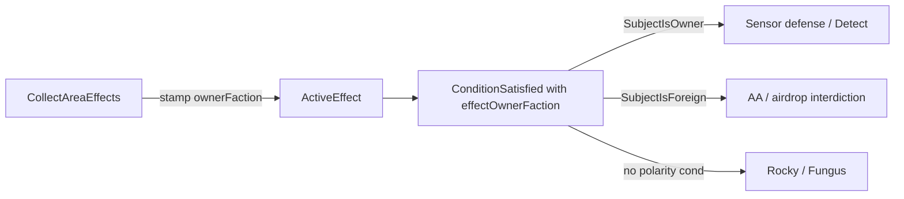

# Effect owner polarity via conditions

`owned_by_territory` stays: it stamps `ActiveEffect_t::ownerFaction` from the host tile (unit auras already stamp from the projecting unit). Friendly vs hostile reach becomes authored conditions, not per-consumer C++ gates.

| Layer | Job |
| --- | --- |
| `owned_by_territory` / unit aura stamp | Who owns the effect |
| `SubjectIsOwner` / `SubjectIsForeign` | Who it applies to |
| Unset `ownerFaction`, no polarity condition | Universal (Rocky defense, Fungus Conceal) |

## Conditions

In [`EffectConfig.h`](include/game/effects/EffectConfig.h) / parser / `ConditionEvaluator_`:

- `SubjectIsOwner` — subject faction equals `EffectContext_t::effectOwnerFaction`. Fails closed if either is missing, or owner is `k_NoFactionOwner`.
- `SubjectIsForeign` — subject faction is set, `effectOwnerFaction` is a real faction, and they differ. Fails closed otherwise.

Subject faction is `pFaction` when set, else `pUnit->GetFaction()` (same pattern as other subject arms).

`EffectContext_t` gains `std::optional<FactionId_t> effectOwnerFaction`. Every path that evaluates an `ActiveEffect_t`'s condition copies `ownerFaction` into the context first — centralize in `StatModifierMatchesInContext`, and a small helper used by Detect / Conceal / RuleFlag scans that call `ConditionSatisfied` directly.

Treat both as situational (`ConditionNeedsSituationalContext` true): they need a resolve subject and a stamped owner, so they stay out of context-free `FilterByStatId`.

## Shipping and fixture authors

- [`config/improvements.json`](config/improvements.json) `Sensor`: `SubjectIsOwner` on `tile_defense` and `Detect` (keep `owned_by_territory`). Vision fog stays the existing `visionRadius` + `ownedByTerritory` rebuild gate in [`FactionVisibleMap`](src/game/visibility/FactionVisibleMap.cpp) — not a condition path.
- [`config/unit_components/abilities.json`](config/unit_components/abilities.json) `airdrop_interdiction` RuleFlag: `SubjectIsForeign`.
- AA sample in [`docs/architecture/effects-system.md`](docs/architecture/effects-system.md) and `TestAaEmplacement`: `SubjectIsForeign` beside the domain `AnyOf` (and `owned_by_territory`).
- Fixtures that mirror Sensor / Detect / cloak detectors: same polarity conditions as shipping.
- Attributed unit `Conceal` components that today rely on `AppliesForFaction`: add `SubjectIsOwner` so terrain Conceal without a stamp stays universal.

## Consumers

Drop the polarity `ownerFaction` / `AppliesForFaction` branches once configs carry the conditions:

| Consumer | Change |
| --- | --- |
| `ResolveTileDefenseMultiplier` | Build context with `pFaction` = `forFaction`; `FilterByStatIdInContext` (not context-free `FilterByStatId` + `AppliesForFaction`). Sensor’s `SubjectIsOwner` replaces the gate. |
| Conceal collection | Stamp `effectOwnerFaction`; drop `AppliesForFaction` when attributed Conceal authors `SubjectIsOwner`. |
| Detect covering | Keep fail-closed without stamped owner (Detect type rule). Stamp context; drop `AppliesForFaction` in favor of authored `SubjectIsOwner`. |
| `IsAirdropInterdicted` | Evaluate the RuleFlag with dropper as subject + effect owner in context; drop the manual `ownerFaction == dropperId` skip. |
| `DestroyEnhancementSuccessChance` | Area list goes through `FilterByStatIdInContext` only; drop the friendly/unattributed skip loop — AA’s `SubjectIsForeign` does that work. |

Detect’s fail-closed `has_value()` stays next to the type. `AppliesForFaction` is removed once every polarity consumer uses conditions.

## Tests and docs

- Sensor defense / Detect: territory owner receives; other faction on the same tile does not.
- Airdrop interdiction / AA: foreign subject hit; same-faction subject ignored; unattributed / `k_NoFactionOwner` fails closed for foreign polarity.
- Rocky / Fungus: still universal (no polarity condition).
- Update [`docs/architecture/effects-system.md`](docs/architecture/effects-system.md): attribution vs polarity; AA sample uses `SubjectIsForeign`. Map-system Sensor bullet points at the condition, not “`owned_by_territory` means only the owner receives.”
- RuleFlag neighbourhood note: consumers evaluate conditions (including polarity) rather than hand-checking `ownerFaction`.

## Out of scope

- Removing or renaming `owned_by_territory`.
- Per-effect attribution metadata.
- Changing `visionRadius` fog rebuild to conditions.
- Manifold Nexus / FactionGlobal landmark pool wiring.
