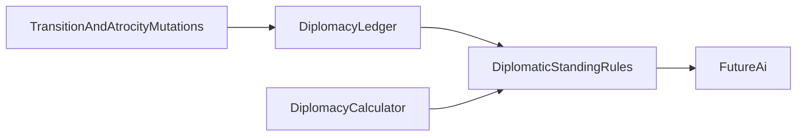

# Remaining diplomacy: requirements by slice

The pairwise **status machine is done**. Commlinks only lists known factions. Integrity and grievances are empty ledger maps. AI always accepts and always honors Pacts; that stays until our AI exists. This pass gives that AI friction, integrity, mood, and repute to read.

"Mood" in this repo is base riot / golden age. Diplomatic mood is SMAC `#MOOD`, derived from **friction**.

Already declined: a proposal queue; pending proposals on `PlayerInteractionQueue`.

Confirmed in GOG Alien Crossfire v2.0 `terranx.exe` (`4b19c1fe3266b5ebc4305cd182ed6e864e3a1c4a`). Thinker names from GitHub `induktio/thinker`; every mechanic below was read in the disassembly. Thinker leaves vanilla diplomacy in place except loans, tech-for-energy, and base-swap (`Details.md`).

---

## Confirmed SMAC model

One `Faction` (Thinker `engine_types.h`, stride `0x20CC`, base `0x96C9E0`):

- `diplo_friction[8]` at `+0x58` (`0x96CA38`): directed, clamped **0–20**. This is what our ledger calls grievances. The binary never uses the word "grievance".
- `integrity_blemishes` at `+0x124` (`0x96CB04`): per-faction **count**, 0 = best. The scenario editor labels it **Blemishes**. The commlink portrait indexes `#REPUTE` with `clamp(count, 0, 7)`. There is **no separate blemish event log**.
- `diplo_reputation` at `+0x128`: incremented when a Pact / Treaty / Truce is made (`pact_of_brotherhood` `0x53CAF0`, `make_treaty` `0x53CE10`, `pledge_truce` `0x53D160`).
- `diplo_gifts[8]`, `diplo_wrongs[8]`, `diplo_betrayed[8]`: per-pair gift and double-cross counts. `reputation(faction, other)` (`0x53A100`) returns `clamp(integrity_blemishes - diplo_gifts[other], 0, 99)` for AI, not for the portrait label.

Datalinks (`alphax.txt` `#MOOD` / `#REPUTE`; `concepts.txt` CONCEPT7): 9 mood names, 8 repute names (not the six Noble→Treacherous the architecture doc currently claims). Integrity falls only when an **agreement is broken**, not for attacking a Vendetta enemy.

### Mood (`get_mood` `0x53A090`)

Derived from friction only. Not stored. Not a blend of integrity, power, or SE.

- friction ≤ 0 → 0 Magnanimous
- 1–2 → 1 Solicitous
- 3–4 → 2 Cooperative
- 5–8 → 3 Noncommittal
- 9–12 → 4 Ambivalent
- 13–15 → 5 Obstinate
- 16–17 → 6 Quarrelsome
- 18–19 → 7 Belligerent
- 20 → 8 Seething

`diplomacy_caption` (`0x5399A0`) uses the same bands on the cached `DiploFriction` (`0x93FA74`). If the pair is Vendetta (`DIPLO_VENDETTA` `0x10`) and friction < 15, the caption floors friction to 15 (Obstinate). Pointer table `Mood[9]` at `0x94C9E4`, filled from `#MOOD`.

### Integrity / blemishes

Portrait (`DiploPop` `0x43F955`): `clamp(integrity_blemishes, 0, 7)` indexes `#REPUTE` at `0x946A30`:

- 0 Noble, 1 Faithful, 2 Scrupulous, 3 Dependable, 4 Ruthless, 5 Treacherous, 6 Wicked, 7 Infamous

- `y`Counts above 7 still display Infamous; `reputation()` can keep growing to 99 (AI).
  Writers confirmed:
  - `double_cross` (`0x50BCC0`): `inc` blemishes on the breaker (several pact/treaty branches); `inc` `diplo_wrongs` / `diplo_betraed`; `cause_friction` −4 or −2 on some paths (gifts/credit toward the victim); sets Vendetta via `treaty_on` `0x10`; calls `pact_ends`.
- `atrocity` (`0x55EEE0`): `cause_friction(..., 5)` when a status bit is set; `inc` blemishes unless that pair already has `DIPLO_ATROCITY_VICTIM` (`0x40000`).
- `major_atrocity` (`0x55F450`): if the pair is not yet `DIPLO_MAJOR_ATROCITY_VICTIM` (`0x80000`), `blemishes = blemishes + 2`, then if that is still < 6 set to **6** (Wicked), cap 99; otherwise just `+2`.
- `probe` (`0x59F120`): `inc` blemishes (`0x5A4FC7`); `cause_friction(..., 4)` at two sites.
- `battle_fight_2` (`0x506AF0`): `cause_friction` +3, −1, +5.
- `action_terraform` (`0x4C9B00`): `cause_friction(..., 5)` at `0x4CA3EB` (site still in terraform, immediately before `action_staple`).
- `communicate` (`0x54FFD0`): several `cause_friction` −1 / −2 / +1 and computed gift deltas; can `dec` blemishes when count > 1 (`0x557A99`).
- `setup_player` (`0x5B0E00`): zeros both blemishes and `diplo_reputation`.
- Scenario editor (`EDITINTEGRITY` in `xscript.txt`) writes the count under the caption "Blemishes:".

`cause_friction(a, b, delta)` (`0x53A030`): `friction[a][b] = clamp(friction[a][b] + delta, 0, 20)`. 19 call sites. No separate per-turn decay function was found; negatives come from gifts, talk, and some combat/double-cross paths.

### Talk (not a chain state machine)

`xscript.txt` / `Script.txt` scene labels, picked in C++:

- First contact: `#INTRONEW0`–`#INTRONEW5`
- Returning: `#INTRO0`–`#INTRO3` (friendly) and `#INTROMAD0`–`#INTROMAD4` (hostile)
- Menu: `#DIPLO` / `#DIPLOMENU` (done, trade again, proposal, battle plans, call off Vendetta, council vote, renounce Pact, demand withdrawal)
- Proposal submenu: `#PROPOSAL` / `#PROPOSALMENU` (gift, Pact, Treaty, tech, prototypes, commlink, energy, loan repayment, maps, joint attack, cede base, units)
- War lines: `#VENDETTA0`–`#VENDETTA18`
- Per-faction: `#FACTIONTRUCE` / `#FACTIONTREATY` (and alien variants) in each `factions/*.txt` — one propose line plus accept/refuse

Functions: `introduce` `0x53D360`, `diplomacy_menu` `0x54C560`, `proposal_menu` `0x54DCF0`, `communicate` `0x54FFD0`, `threaten` `0x549930`. Incoming call: `#COMM` / `#COMMDIPLO` / `#URGENTCOMM`.

Our `phrases.json` `greeting` / `war_declaration` plus `PickPhrase` is a stub for this scene table, not SMAC's system.

SMAC's own accept/honor/initiation (`propose_pact` `0x543BC0`, `propose_treaty` `0x544E40`, `wants_to_attack` `0x55BC80`, `enemy_diplomacy` `0x55F930`, `great_satan` `0x539C00`) is **not** in this pass. Those functions read friction, `reputation()`, goodwill, status, and ranking; our AI will call the standing rules instead of cloning them.

---

## 1. Integrity (blemish count)

**Today:** `[DiplomacyLedger](include/game/diplomacy/DiplomacyLedger.h)` `Get/Set/AddIntegrity`, default 0, tests only.

**Requirements:**

- Keep the per-faction int. **0 = Noble.** Higher is worse. Display `clamp(n, 0, 7)` as the eight `#REPUTE` names from config (not six).
- A calculator maps the int to the label. No extra banding: the count **is** the index, except display saturates at 7 while the stored count may exceed it (major atrocity / AI `reputation()`).
- Mutations write at the sites above: `double_cross` analog (treaty/pact/truce break → `[CancelTreaty](src/game/diplomacy/DiplomaticTransitionMutations.cpp)` / sneak `[ApplyHostileAct](src/game/diplomacy/DiplomaticTransitionMutations.cpp)` while an agreement is held), `[CommitAtrocity](src/game/atrocities/AtrocityMutations.cpp)` (simple +1 unless already victim; major +2 with floor 6), probe success, combat as listed. Deltas come from `[config/diplomacy.json](config/diplomacy.json)`; parser requires them; tests use the fixture.
- Native life never participates (`HasDiplomacy`).
- Do not add a parallel blemish log. The editor name "Blemishes" is this same counter.
- `diplo_gifts` / `diplo_wrongs` / `diplo_betrayed` / `diplo_reputation` wait until a writer exists (gift proposals). The query API does not expose `reputation()` until gifts are stored.
- `"integrity_loss"` stays out of atrocity JSON; the atrocity mutation calls the diplomacy writer.

---

## 2. Grievances (friction)

**Today:** directed `Get/Set/AddGrievance(holder, against)`, tests only.

**Requirements:**

- Keep the directed map. Clamp **0–20** in the mutation (SMAC `cause_friction`).
- Mood (slice 3) reads this value. It is not atrocity victim memory.
- Config owns the per-act deltas (combat +3/+5/−1, probe +4, simple atrocity +5, talk gifts negative, etc.). A calculator does not need a formula beyond add-and-clamp unless a later site is a computed gift (`communicate` uses a computed delta at `0x554A30`).
- No TurnStart decay unless a later pass finds one. None was found among the 19 `cause_friction` calls.

---

## 3. Blemishes

**Not a third axis.** SMAC's "Blemishes" label **is** `integrity_blemishes`. Drop the architecture line that treats blemishes as unimplemented storage. Repute is this count, not a list of past acts. Atrocity records stay on `AtrocityLedger`.

---

## 4. Diplomatic mood and the AI query API

This is the surface the future AI reads. Do not clone SMAC `EvaluateResponse_` / `propose_pact` / Pact-honor logic. `[DiplomaticActionExecutor::EvaluateResponse](src/game/diplomacy/DiplomaticActionExecutor.cpp)_` and `[AiHonorsDefensiveObligation_](src/game/diplomacy/DiplomaticTransitionMutations.cpp)` stay always-yes stubs until that AI exists.

**Calculator** (`DiplomacyCalculator`, owned by `GameDataContext`, plain values, `const`):

- `MoodIndex(friction)` — SMAC `get_mood` bands from config
- `ReputeIndex(blemishes)` — `clamp(blemishes, 0, 7)`
- `ClampFriction(friction)` — 0–20

**Rules** (`DiplomaticStandingRules`, read the current game; native life answers empty / no mood):

- `FrictionToward(holder, against)`
- `IntegrityBlemishes(faction)`
- `MoodToward(holder, against)` — `MoodIndex` of stored friction (raw; no Vendetta caption floor)
- `ReputeOf(faction)` — `ReputeIndex` of stored blemishes

Vendetta caption floor (Obstinate / friction 15) is **display-only**. It lands with the talk overlay, not on the AI query.

Config holds the nine mood labels/thresholds and eight repute labels. Parser requires them; tests use `[tests/fixtures/diplomacy.json](tests/fixtures/diplomacy.json)`.

`DiplomaticModifierEffect_t` stays a TODO. `AIProfile` tendencies are not mood inputs.

The ledger mutations in slices 1–2 are the production writers. The rules functions are the AI seam (same kind as `AIProfile` / `GetAvailableActions` today). Tests encode the SMAC bands and writer deltas. Do not have `EvaluateResponse_` call the new rules and ignore the result.

---

## 5. Dialogue / commlinks talk (later)

**Today:** non-clickable `[CommlinksPanel](src/ui/commlinks/CommlinksPanel.cpp)`. Council lives on `[CommlinksView](include/ui/commlinks/CommlinksView.h)`. Artboxes stay extract-only.

**Requirements:**

- Click a known faction → talk overlay (rect+text). Native life never appears.
- Scene table, not an RPG chain engine: first-contact vs returning, friendly vs mad greetings, then `#DIPLOMENU` / `#PROPOSALMENU` analog. Per-faction Treaty/Truce lines from faction data (today `[phrases.json](config/factions/gaian/phrases.json)` only has `greeting` / `war_declaration` — extend those files with the scene keys the overlay uses, in the same change).
- Actions from `[GetAvailableActions](include/game/diplomacy/DiplomacyActions.h)`. One-sided Cancel/Declare call mutations directly; StepUp and trade go through `[DiplomaticActionExecutor::Propose](include/game/diplomacy/DiplomaticActionExecutor.h)`.
- Trade builder: existing `TradeItem_t` variants. SMAC's proposal menu is wider (loans, prototypes, units, gift); extra kinds wait until a caller needs them.
- Caption: leader name + mood band (Vendetta floor). Also show REPUTE name (integrity).
- Inbound AI offers stay in the one pending slot; their UI lands with AI initiation.
- First contact does not auto-open talk.

---

## Implementation order

Standing (writers) and mood (rules) share one prereq: **config + `DiplomacyCalculator`**. After that they can land in one change.

1. Parser keys in `diplomacy.json` (friction clamp, mood bands/labels, repute labels, per-act deltas). Fixture first.
2. `DiplomacyCalculator` (`MoodIndex`, `ReputeIndex`, `ClampFriction`). Tests with fixture numbers; no game state.
3. Mutation writers (integrity / friction) using those deltas and `ClampFriction`.
4. `DiplomaticStandingRules` (`FrictionToward`, `IntegrityBlemishes`, `MoodToward`, `ReputeOf`) reading the ledger through the calculator.

Do not start with the rules: `MoodToward` is `MoodIndex(stored friction)`, so the calculator has to exist. Writers without the calculator would clamp in the mutation, which the calculator already owns.

Talk UI and our AI both wait on the rules API. They are not prereqs of each other; both wait on this pass.

---

## Architecture and tests

Update `[docs/architecture/diplomacy-system.md](docs/architecture/diplomacy-system.md)`: eight REPUTE names; blemishes = integrity count; grievances = friction 0–20; mood from friction; standing rules as the AI query API; drop "six levels", "blemishes not implemented", and the claim that an attitude model must live inside `EvaluateResponse_`. `[docs/thinker/terranx-map.md](docs/thinker/terranx-map.md)` already has the standing section.

Tests: fixture owns bands and deltas; writers at mutation sites; `MoodToward` / `ReputeOf` from fixture inputs; no shipping-config asserts.

---

## Later tracks (not this pass)

- Commlinks talk overlay (section 5)
- Our AI: consume `DiplomaticStandingRules` from `EvaluateResponse_`, Pact honor, and initiation. Do not port SMAC `propose_pact` / `wants_to_attack`.
- Covert detection, per-turn healing, tribute/loans, infiltration readers, save/load, council AI
- `diplo_gifts` / `diplo_wrongs` / `diplo_patience` until a writer exists
- Extra trade kinds (loan, prototype, units) until the talk overlay offers them

