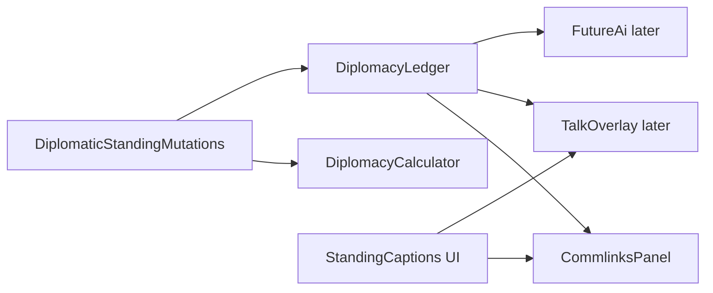

# Remaining diplomacy: requirements by slice

The pairwise **status machine is done**, and so are the standing writers. Friction and
blemishes live on `DiplomacyLedger`, `DiplomacyCalculator` clamps them, and
`DiplomaticStandingMutations` writes them at every site whose prerequisites exist. The remaining
sites wait on talk. The AI always accepts and always honors Pacts; that stays until our AI
exists.

"Mood" in this repo is base riot / golden age. Diplomatic mood is SMAC `#MOOD`, a caption over
**friction**.

Already declined: a proposal queue; pending proposals on `PlayerInteractionQueue`.

Confirmed in GOG Alien Crossfire v2.0 `terranx.exe` (`4b19c1fe3266b5ebc4305cd182ed6e864e3a1c4a`). Thinker names from GitHub `induktio/thinker`; every mechanic below was read in the disassembly. Thinker leaves vanilla diplomacy in place except loans, tech-for-energy, and base-swap (`Details.md`).

---

## Confirmed SMAC model

One `Faction` (Thinker `engine_types.h`, stride `0x20CC`, base `0x96C9E0`):

- `diplo_friction[8]` at `+0x58` (`0x96CA38`): directed, clamped **0–20**. Our ledger stores it as friction. The binary never uses the word "grievance".
- `integrity_blemishes` at `+0x124` (`0x96CB04`): per-faction **count**, 0 = best. The scenario editor labels it **Blemishes**. The commlink portrait indexes `#REPUTE` with `clamp(count, 0, 7)`. There is **no separate blemish event log**.
- `diplo_reputation` at `+0x128`: incremented when a Pact / Treaty / Truce is made (`pact_of_brotherhood` `0x53CAF0`, `make_treaty` `0x53CE10`, `pledge_truce` `0x53D160`).
- `diplo_gifts[8]`, `diplo_wrongs[8]`, `diplo_betrayed[8]`: per-pair gift and double-cross counts. `reputation(faction, other)` (`0x53A100`) returns `clamp(integrity_blemishes - diplo_gifts[other], 0, 99)` for AI, not for the portrait label.

Datalinks (`alphax.txt` `#MOOD` / `#REPUTE`; `concepts.txt` CONCEPT7): 9 mood names, 8 repute names. Integrity falls only when an **agreement is broken**, not for attacking a Vendetta enemy.

### Mood (`get_mood` `0x53A090`)

Derived from friction only. Not stored. Not a blend of integrity, power, or SE.

- friction ≤ 0 → 0 Magnanimous
- 1–2 → 1 Solicitous
- 3–4 → 2 Cooperative
- 5–8 → 3 Noncommittal
- 9–12 → 4 Ambivalent
- 13–15 → 5 Obstinate
- 16–17 → 6 Quarrelsome
- 18–19 → 7 Belligerent
- 20 → 8 Seething

Every reader draws text: `DiploPop_draw_portrait`, `InfoWin_setup_text` and `ReportWin_draw_intel`. No AI or talk function calls it. The portrait reads the raw `diplo_friction[rival][player]`, which is the rival's friction toward the player.

`diplomacy_caption` (`0x5399A0`) uses the same bands on the cached `DiploFriction` (`0x93FA74`). If the pair is Vendetta (`DIPLO_VENDETTA` `0x10`) and friction < 15, the caption floors friction to 15 (Obstinate). Pointer table `Mood[9]` at `0x94C9E4`, filled from `#MOOD`.

### Integrity / blemishes

Portrait (`DiploPop` `0x43F955`): `clamp(integrity_blemishes, 0, 7)` indexes `#REPUTE` at `0x946A30`:

- 0 Noble, 1 Faithful, 2 Scrupulous, 3 Dependable, 4 Ruthless, 5 Treacherous, 6 Wicked, 7 Infamous

Counts above 7 still display Infamous; `reputation()` can keep growing to 99 (AI). The InfoWin also draws the player's own count under the label `Integrity`.

Writers confirmed:

- `double_cross` (`0x50BCC0`): `inc` blemishes on the breaker (several pact/treaty branches); `inc` `diplo_wrongs` / `diplo_betrayed`; `cause_friction` −4 or −2 on some paths (gifts/credit toward the victim); sets Vendetta via `treaty_on` `0x10`; calls `pact_ends`.
- `atrocity` (`0x55EEE0`): `cause_friction(..., 5)` when a status bit is set; `inc` blemishes unless that pair already has `DIPLO_ATROCITY_VICTIM` (`0x40000`).
- `major_atrocity` (`0x55F450`): if the pair is not yet `DIPLO_MAJOR_ATROCITY_VICTIM` (`0x80000`), `blemishes = blemishes + 2`, then if that is still < 6 set to **6** (Wicked), cap 99; otherwise just `+2`.
- `probe` (`0x59F120`): `inc` blemishes (`0x5A4FC7`); `cause_friction(..., 4)` at two sites.
- `battle_fight_2` (`0x506AF0`): `cause_friction` +3, −1, +5.
- `action_terraform` (`0x4C9B00`): `cause_friction(..., 5)` at `0x4CA3EB` (site still in terraform, immediately before `action_staple`).
- `communicate` (`0x54FFD0`): several `cause_friction` −1 / −2 / +1 and computed gift deltas; can `dec` blemishes when count > 1 (`0x557A99`).
- `setup_player` (`0x5B0E00`): zeros both blemishes and `diplo_reputation`.
- Scenario editor (`EDITINTEGRITY` in `xscript.txt`) writes the count under the caption "Blemishes:".

`cause_friction(a, b, delta)` (`0x53A030`): `friction[a][b] = clamp(friction[a][b] + delta, 0, 20)`. 19 call sites. No separate per-turn decay function was found; negatives come from gifts, talk, and some combat/double-cross paths.

### Talk (not a chain state machine)

`xscript.txt` / `Script.txt` scene labels, picked in C++:

- First contact: `#INTRONEW0`–`#INTRONEW5`
- Returning: `#INTRO0`–`#INTRO3` (friendly) and `#INTROMAD0`–`#INTROMAD4` (hostile)
- Menu: `#DIPLO` / `#DIPLOMENU` (done, trade again, proposal, battle plans, call off Vendetta, council vote, renounce Pact, demand withdrawal)
- Proposal submenu: `#PROPOSAL` / `#PROPOSALMENU` (gift, Pact, Treaty, tech, prototypes, commlink, energy, loan repayment, maps, joint attack, cede base, units)
- War lines: `#VENDETTA0`–`#VENDETTA18`
- Per-faction: `#FACTIONTRUCE` / `#FACTIONTREATY` (and alien variants) in each `factions/*.txt` — one propose line plus accept/refuse

Functions: `introduce` `0x53D360`, `diplomacy_menu` `0x54C560`, `proposal_menu` `0x54DCF0`, `communicate` `0x54FFD0`, `threaten` `0x549930`. Incoming call: `#COMM` / `#COMMDIPLO` / `#URGENTCOMM`.

Our `phrases.json` `greeting` / `war_declaration` plus `PickPhrase` is a stub for this scene table, not SMAC's system.

SMAC's own accept/honor/initiation (`propose_pact` `0x543BC0`, `propose_treaty` `0x544E40`, `wants_to_attack` `0x55BC80`, `enemy_diplomacy` `0x55F930`, `great_satan` `0x539C00`) is **not** in this pass. Those functions read friction, `reputation()`, goodwill, status, and ranking. Our AI will read friction and blemishes from the ledger instead of cloning them.

---

## 1. Integrity (blemishes)

**Today:** `DiplomacyLedger::GetBlemishes` / `SetBlemishes`, 0–`blemishes_max`.
`ApplyBlemishes` (`NextBlemishes`: add, raise to a floor, clamp) is called from:

- `CancelTreaty`, `DeclareVendetta` and sneak `ApplyHostileAct`, for `break_agreement_blemishes`;
- `CommitAtrocity`, from `atrocities.json` severities (`blemishes`, `blemishes_floor`,
  `repeat_blemishes`).

**Remaining:**

- `communicate`'s blemish decrement (count > 1) waits on talk.
- The probe blemish (`0x5A4FC4`) fires only in multiplayer against a human target.
- `diplo_gifts` / `diplo_wrongs` / `diplo_betrayed` / `diplo_reputation` wait until a writer exists (gift proposals). `reputation()` waits on gifts.

Native life never participates (`HasDiplomacy`). There is no parallel blemish log.

---

## 2. Friction

**Today:** directed `DiplomacyLedger::GetFriction` / `SetFriction(holder, against)`,
0–`friction_max`. `ApplyFriction` (`NextFriction`) writes:

- a kept probe agreement (`probe_keep_friction_draw`);
- an atrocity against a victim with diplomacy;
- relic capture (`artifact_capture_friction`);
- fighting an agreement partner's Vendetta enemy on its land (`allied_territory_battle_friction`);
- a Former's raise or lower land that dries an AI's land (`terraform_rainfall_friction`).

**Remaining**, all waiting on talk: the +3 refused-demand battle site, `communicate`'s gift
deltas and inline +4, and the wants-revenge betrayal that replaces rainfall friction
([deviations](config/deviations/README.md)). No TurnStart decay: none of the 19 `cause_friction`
calls is one.

---

## 3. Blemishes

**Not a third axis.** SMAC's "Blemishes" label **is** `integrity_blemishes`, stored as the
ledger's blemishes. Repute is this count, not a list of past acts. Atrocity records stay on
`AtrocityLedger`.

---

## 4. Mood and repute captions

Plan: [diplomatic_mood_repute_8d31f6a2.plan.md](.claude/plans/diplomatic_mood_repute_8d31f6a2.plan.md).

- Mood and repute are UI captions over the stored counts. `StandingCaptions`
  (`config/ui/standing_captions.json`) names friction by the nine `#MOOD` bands and blemishes by
  the eight `#REPUTE` names. Counts past the last band read the last band.
- `CommlinksPanel` is the first caller. It shows each met faction's mood toward the player (raw
  friction, no Vendetta floor) and repute, plus the player's own integrity.
- The game layer does not change. The future AI reads friction and blemishes from the ledger,
  as SMAC's AI reads raw friction and `reputation()`.

`DiplomaticModifierEffect_t` stays a TODO. `AIProfile` tendencies are not mood inputs.
[DiplomaticActionExecutor::EvaluateResponse_](src/game/diplomacy/DiplomaticActionExecutor.cpp)
and [AiHonorsDefensiveObligation_](src/game/diplomacy/DiplomaticTransitionMutations.cpp) stay
always-yes stubs until that AI exists.

---

## 5. Dialogue / commlinks talk (later)

**Today:** non-clickable [CommlinksPanel](src/ui/commlinks/CommlinksPanel.cpp). Council lives on [CommlinksView](include/ui/commlinks/CommlinksView.h). Artboxes stay extract-only.

**Requirements:**

- Click a known faction → talk overlay (rect+text). Native life never appears.
- Scene table, not an RPG chain engine: first-contact vs returning, friendly vs mad greetings, then `#DIPLOMENU` / `#PROPOSALMENU` analog. Per-faction Treaty/Truce lines from faction data (today [phrases.json](config/factions/gaian/phrases.json) only has `greeting` / `war_declaration` — extend those files with the scene keys the overlay uses, in the same change).
- Actions from [GetAvailableActions](include/game/diplomacy/DiplomacyActions.h). One-sided Cancel/Declare call mutations directly; StepUp and trade go through [DiplomaticActionExecutor::Propose](include/game/diplomacy/DiplomaticActionExecutor.h).
- Trade builder: existing `TradeItem_t` variants. SMAC's proposal menu is wider (loans, prototypes, units, gift); extra kinds wait until a caller needs them.
- Portrait: `MOOD` and `REPUTATION` from `StandingCaptions`, with mood from the rival's raw friction toward the player.
- Caption: leader name + mood band. At Vendetta, friction below 15 reads as 15 (Obstinate). This is display only, and the floor lives in `standing_captions.json`.
- The player's own `Integrity` line, as in SMAC's InfoWin.
- Inbound AI offers stay in the one pending slot; their UI lands with AI initiation.
- First contact does not auto-open talk.

---

## Implementation order

1. Slice 4: [diplomatic_mood_repute_8d31f6a2.plan.md](.claude/plans/diplomatic_mood_repute_8d31f6a2.plan.md).
2. The talk overlay reuses `StandingCaptions` for its portrait and caption, so it follows slice 4.
   Our AI reads the ledger directly. Neither track waits on the other.

---

## Architecture and tests

The slice 4 plan lists its updates to [diplomacy-system.md](docs/architecture/diplomacy-system.md),
[ui-system.md](docs/architecture/ui-system.md) and [terranx-map.md](docs/thinker/terranx-map.md).

Tests: fixtures own bands and deltas; writers are tested at mutation sites; no shipping-config asserts.

---

## Later tracks (not this pass)

- Commlinks talk overlay (section 5)
- Our AI: read friction and blemishes (and `reputation()` once gifts exist) from `EvaluateResponse_`, Pact honor, initiation, and the probe keep-or-break decision. Do not port SMAC `propose_pact` / `wants_to_attack`.
- Covert detection, per-turn healing, tribute/loans, infiltration readers, save/load, council AI
- `diplo_gifts` / `diplo_wrongs` / `diplo_patience` until a writer exists
- Extra trade kinds (loan, prototype, units) until the talk overlay offers them
