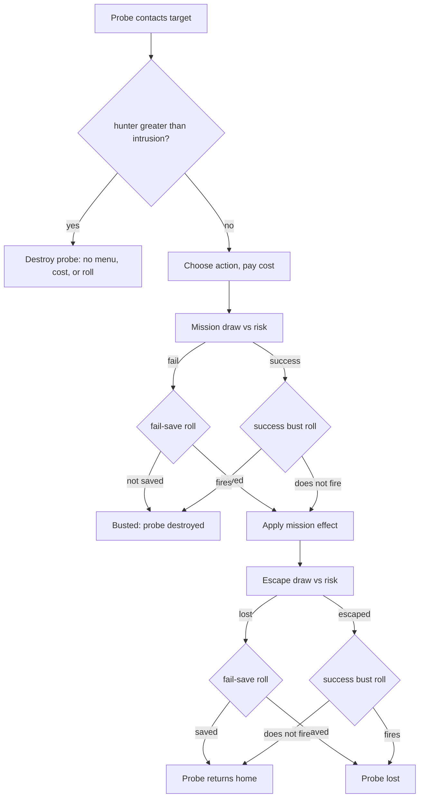

# Probe hunter as stats, not Hunter-Seeker

## Original mechanics (`probe` `0x59F120`)

Confirmed in [docs/thinker/terranx-map.md](docs/thinker/terranx-map.md).

**Contact (before the menu, cost, or roll).** Target has Hunter-Seeker, probe lacks Algorithmic Enhancement → `veh_kill`, `HUNTERSEEKER` / `HUNTERSEEKER2`. With Algo the mission continues; the target is still treated as having HSA for odds and coins.

**Displayed odds** (`success_rates` `0x59EEE0`):

- Covert Ops Center facility `0x22` adds +2; that plus SE Probe is clamped to `[-2, 0]` as defense.
- Failure `(risk * 100) / ((morale / 2) − defense + 1)`. Algo **and not HSA**: signed `/2` of failure.
- Success `100 − failure`. HSA: signed `/2` of success.
- Loss `((risk + 1) * 100) / (morale − defense)`. Algo **and not HSA**: `/2` of loss. Survival `100 − loss`.
- The binary then halves success a second time for HSA. We follow Thinker's `Fix:` and apply that second `/2` to survival instead (`ComputeProbeChances` multiplies survival by the success scale). Display only.

**Mission roll** (`0x5A311C`–`0x5A3238`):

- `game_randv(morale/2 − defense + 1)` vs risk (`jge` = success). Risk 0 always passes this step.
- On failure: busted unless Algo **and not HSA** and `random() & 1` (50% save; the mission then succeeds).
- On success: if HSA, `random() & 1` still busts (50%). Algo does **not** cancel this coin.

**Escape roll** (`0x5A42CA`–`0x5A4466`):

- `game_randv(morale − defense)` vs risk (`jle` = lost).
- On loss: saved (returns home) only when Algo **and not HSA** and `random() & 1`.
- On escape: HSA's 50% coin runs only for a sea-triad probe whose return base is not a port.

**Our escape bust.** HSA's coin applies to every successful escape. The binary's coin sits inside the sea-probe port search, and its displayed odds aim the second HSA `/2` at survival; we follow the displayed intent, consistent with Thinker's display `Fix:`.

**Algo vs HSA (original 1 vs 1):**

- No Algo, no HSA: normal formula, no coins, no contact kill.
- Algo only: failure and loss ×0.5, 50% save on a failed mission or escape, no extra bust.
- HSA only: contact kill (never reaches the roll).
- Both: no contact kill; Algo's failure/loss scale and fail-save are **cancelled**; HSA's success ×0.5 and success bust still apply.

**Mind-control garrison** (`mind_control` `0x59EA80`, terranx-map "Mind-control cost"): every unit in the stack on the base tile counts, any faction. The garrison is the number of `PLAN_OFFENSE` plus `PLAN_COMBAT` units, times (number of Poly Encryption units in the stack + 1). Defense, recon and non-combat plans count 0. Poly is a stack multiplier: three offense units with one Poly among them count 6, and a Poly defender still raises the multiplier. Thinker matches.

**Unit subversion** (`0x5A17C0`–`0x5A17FC`): after the SE Probe table, a Poly target costs ×2; then a target whose plan is neither colony nor terraform costs /2, so colony pods and formers pay full price. Thinker matches.

**Unit plan** (`make_proto` `0x5A5D40`, terranx-map "Unit plan"): the design's AI role, derived from its components. Predefined `alpha.txt` units state their plan instead; Scout Patrol (gun, no armour, infantry) is `PLAN_RECON` there, where `make_proto` would give `PLAN_OFFENSE`.

## Stats

Delete RuleFlags `BlocksProbeTeams`, `IgnoresProbeBlock`, `PolyEncryption`. Add:

| Stat | Kind | Domain | Emitter | Shipping |
| --- | --- | --- | --- | --- |
| `probe_hunter` | Additive | Base | target FactionGlobal | HSA `Add` 1 |
| `probe_intrusion` | Additive | Unit | probe ThisUnit | Algo `Add` 1 |
| `probe_success_bust` | Additive (percent) | Base | target FactionGlobal | HSA `Add` 50 |
| `probe_failure_save` | Additive (percent) | Unit | probe ThisUnit | Algo `Add` 50 |
| `garrison_probe_weight` | Additive | Unit | `probe_actions.json` FactionUnits | baseline `Add` 1 when `DesignPlan` is offense or combat |
| `garrison_probe_multiplier` | Additive | Unit | ThisUnit | Poly `Add` 1 |
| `subversion_distance_scale` | PureMultiplier | Base | ThisBase | Punishment Sphere `MultiplyGeometric` 0.5 |
| `ai_probe_cost_scale` | PureMultiplier | Base | `difficulty.json` FactionGlobal, `PlayerType` Player | Thinker `MultiplyGeometric` 0.75; Transcend 0.6 |
| `subversion_cost_scale` | PureMultiplier | Unit | `probe_actions.json` FactionUnits; ThisUnit | baseline `MultiplyGeometric` 0.5 when `DesignPlan` is not colony or terraform; Poly `MultiplyGeometric` 2 |

Existing PureMultipliers `probe_success_scale` (target) and `probe_failure_scale` (probe) stay. Update the `ProbeFailureScale` comment in [EffectEnums.h](include/game/effects/EffectEnums.h): it is cancelled by the target's hunter, not by a flag.

Every Additive stat here resolves against `SeedFor` (0). A baseline is an ordinary contribution in the owning subsystem's config, as `base_conquest.json` and `production.json` do, so a mod can raise it as well as clamp it.

Target-side stats (`probe_hunter`, `probe_success_bust`, `probe_success_scale`) all resolve from `EffectSourceBase(rTarget)` through `ResolveBaseStat`, so unit targets use their home base (or any base of the faction), and a faction with no bases resolves 0 / 1.0. `TargetHasFlag` stays for `ProbeSubversionImmune`.

## Rules ([ProbeRules.cpp](src/game/probes/ProbeRules.cpp))

The target's hunter **neutralises** the probe's intrusion when `hunter > 0 && hunter >= intrusion`.

1. `ProbeContactDestroys(rProbe, rTarget)`: `hunter > intrusion`.
2. `ProbeChancesFor`: the probe's `probe_failure_scale` applies unless neutralised; else 1.0. It scales both failure and loss, as today.
3. `ProbeChance_t::failureSaveChance` = the probe's `probe_failure_save` unless neutralised; else 0.
4. `ProbeChance_t::successBustChance` = the target's `probe_success_bust`.
5. The success scale always comes from the target.

Original 1 vs 1 falls out: Algo 1 vs HSA 1 → no contact kill, neutralised (no scale, no save), bust 50, success ×0.5. Algo 1 vs no HSA → scale and save apply. A probe with no intrusion keeps any `probe_failure_scale` or `probe_failure_save` granted elsewhere against a target without a hunter.

`ProbeHunterSource(rTarget)` returns the `sourceId` of the largest positive `probe_hunter` contribution, from `ResolveStatModifiers`' `StatBreakdown_t` on the source base's effects. Called only after `ProbeContactDestroys` is true, so a contributor always exists; throw if none.

`IntrusionBonuses_` returns the failure scale and save chance together and decides neutralisation itself, so no helper takes a "neutralised" flag. `ProbeChance_t` drops `bAlgoSave` / `bHsaCoin`; its comment names the save and bust chances instead of Algo/HSA. Rename the header comments on `ResolveTargetSuccessScale`, `ComputeProbeChances` and `ProbeChancesFor` to describe the hunter/intrusion contest.

**Mind-control garrison and unit subversion:**

- `CountCombatUnitsOnTile_` becomes `MindControlGarrison_(rTile, rMap, rCost)`. It walks every unit on the tile, any faction, dropping the owner filter and the attack/defense test. It sums `garrison_probe_weight` (the plan decides who weighs 1) and `garrison_probe_multiplier`, and returns `weight × (rCost.garrisonMultiplierBase + multiplier)`.
- `ProbeCostConfig_t::garrisonMultiplierBase` (`garrison_multiplier_base`, shipping 1): required on base-target costs and rejected on unit targets, as `mind_control_divisor` is.
- `QuoteUnitActionCost_` multiplies `costMultiplier` by the target unit's `subversion_cost_scale` (seed 1.0) before quoting. The baseline halves everything but colony pods and formers; Poly doubles.

**Quote fixes** (terranx-map "Mind-control cost" and "Unit subversion cost"; Thinker matches the binary on each):

- `DistanceToHeadquarters_` uses `TabletopDiagonalDistance`, which equals the binary's `vector_dist` on every offset. Both quotes use it; `ChebyshevDistance` understates long diagonal-free distances (12 columns apart is 9, not 6).
- Base quote:
  - Refuse on the raw distance (the HQ tile), before scaling. A scaled distance of 0 is quoted.
  - Scale the distance by truncating toward zero, not `lround`; that equals the binary's sequential `×2` then `/2`s.
  - `mind_control_distance_scale` emitters become `MultiplyGeometric`: Genejack 2, Children's Crèche 0.5, Punishment Sphere 0.5. As `AddPercent`, Crèche plus Punishment Sphere sums to 0 and makes the base unquotable, and Genejack plus Crèche gives ×1.5 instead of ×1.
- Unit quote:
  - `mineralCost * ((energy + energyBias) / (dist + distBias))`, dividing first as the base quote already does.
  - The distance is scaled by `subversion_distance_scale` resolved on the target unit's home base (1.0 without one), truncated. Only Punishment Sphere emits it; Crèche and Genejack do not touch unit subversion.
  - No HQ-tile refusal; the binary has none. `QuoteSubvertUnitCost_` returns `int`, and `QuoteUnitActionCost_` stops being optional.
- `QuoteProbeActionCost` multiplies `costMultiplier` by the target's `ai_probe_cost_scale` (from `EffectSourceBase`, as `probe_action_cost`) when the actor is not player-controlled. The `PlayerType` Player filter keeps it off AI targets, matching the binary's "target is human" test.

## Unit plan

SMAC's `UNIT.plan`, ported as a rule over the design. It feeds the two probe costs above through an effect condition.

- `UnitPlan_t` in `include/game/units/UnitPlan.h`, with one string map next to it: offense, combat, defense, recon, air_superiority, planet_buster, naval_superiority, naval_transport, colony, terraform, supply, probe, artifact, tectonic_missile, fungal_missile.
- `UnitPlanRules::DesignPlan(const IDesign&)` follows `make_proto`'s order (terranx-map "Unit plan"). Inputs:
  - offense and defense: the weapon's and armour's own `attack` / `defense` `Add` amounts (SMAC's `offense_value` / `defense_value`), not resolved stats. Psi parts have none and count as 0, which orders the same as SMAC's −1 in every comparison `make_proto` makes.
  - speed: the chassis `movement` `Add` amount. Domain: `UnitDomain`.
  - A weapon component's optional `plan` (`config/unit_components/specials.json`): colony (Colony Pod), terraform (Terraformer), supply (Supply Crawler), probe (Probe Team), naval_transport (Transport), planet_buster, tectonic_missile, fungal_missile (payloads). Combat weapons omit it. A weapon `plan` wins, as weapon mode ≥ 7 and the missile payloads do in `make_proto`.
  - An ability component's optional `plan`, applied where `make_proto` tests that ability: `offense` on a land design (Amphibious Pods, Drop Pods, Bombard), `air_superiority` on an air design (Air Superiority), `defense` on a land offense-1 defense-1 design (Non-Lethal Methods).
- `UnitComponentConfig_t::plan` (`std::optional<UnitPlan_t>`), parsed by `UnitComponentConfigParser`; the config docs mark it optional.
- Effect condition `DesignPlan`: `{"kind": "DesignPlan", "plans": [...], "value": true}` matches when the subject unit's `DesignPlan` is in `plans`; `"value": false` inverts it, as `IsNativeLife` does. Parser, `ActiveEffect.cpp` evaluator, and validation.
- `UnitDesign` derives its plan once in its constructor and stores it; `GetPlan()` returns it. Parts are found by component type, as `GetDomain` finds the chassis.
- Orbital is our Missile chassis: `make_proto`'s missile branch, so a payload weapon's plan, else `offense`.
- Natives state their plan: `NativeUnitConfig_t::plan`, required in `native_units.json` (Mind Worm combat, Isle of the Deep naval_transport, Sea Lurk naval_superiority, Locusts air_superiority, Spore Launcher offense, Fungal Tower recon, Alien Artifact artifact).
- Predefined composed designs that state their plan (Scout Patrol is recon in alpha.txt) do not exist yet; the deviations doc tracks it.

## Roll ([ProbeActionMutations.cpp](src/game/probes/ProbeActionMutations.cpp))

Delete `RollHalf_` and `ApplyAlgoSaveAndHsaBust_`. Use `RollPercent`, which does not touch the RNG at 0 or 100, so probes without Algo/HSA draw exactly what the binary draws.

- Mission draw failed → `RollPercent(failureSaveChance)` makes the mission succeed.
- Mission draw succeeded → `RollPercent(successBustChance)` busts it.
- Escape draw failed → `RollPercent(failureSaveChance)` escapes.
- Escape draw succeeded → `RollPercent(successBustChance)` loses the probe.

One helper per outcome serves both draws: failed draw → save roll, successful draw → bust roll.

## Executor, WorldView, notices

- Rename `HunterSeekerDestroys` → `ProbeContactDestroys`, `WouldHunterSeekerDestroy` → `WouldContactDestroyProbe`, `DestroyOnHunterSeeker_` → `DestroyOnProbeContact_`, `ProbeHunterSeeker_t` → `ProbeContactDestroyed_t`. WorldView still opens the probe flow when contact would destroy, so the kill fires without a menu.
- `ProbeContactDestroyed_t` carries `BuildingId_t hunterSourceId` from `ProbeHunterSource`. `FillNoticeNames_` fills `rNotice.facilityName` from it with `FacilityName_`, as it does for `ProbeDestroyedFacility_t`.
- [ProbeNotices.cpp](src/ui/ProbeNotices.cpp) `ContactDestroyedBody_` uses `facilityName`: "The {facilityName} of the {target adjective} has destroyed our probe team!" / "A {actor adjective} probe team has been destroyed by our {facilityName}!". Shipping HSA still reads "Hunter-Seeker Algorithm", its [projects.json](config/buildings/projects.json) `name`.

## Probe baseline effects

[probe_actions.json](config/probe_actions.json) gains a required top-level `effects` array beside `success_formula` and `actions`, injected into every faction's pool like `production.json`'s:

- `ProbeActionsConfig_t::effects`, parsed by the existing probe-actions parser.
- `FactionEffectsPool` takes it and collects it under source id `"probe_actions"`; [Faction.cpp](src/game/faction/Faction.cpp) passes `probeActionsConfig->effects`.
- `EffectReferenceValidator` checks it as `"probe_actions"`.
- Shipping and [tests/fixtures/probe_actions.json](tests/fixtures/probe_actions.json), scope `FactionUnits`:
  - `garrison_probe_weight` `Add` 1, condition `DesignPlan` [offense, combat];
  - `subversion_cost_scale` `MultiplyGeometric` 0.5, condition `DesignPlan` [colony, terraform] `"value": false`.
- `mind_control_base` and `total_thought_control` costs gain `"garrison_multiplier_base": 1`.

## Config

- HSA ([projects.json](config/buildings/projects.json)): `probe_hunter` +1, `probe_success_bust` +50, `probe_success_scale` −50%. Remove `blocks_probe_teams`.
- Algo ([specials.json](config/unit_components/specials.json), [tests/fixtures/unit_components_specials.json](tests/fixtures/unit_components_specials.json)): `probe_intrusion` +1, `probe_failure_save` +50, `probe_failure_scale` −50%. Remove `ignores_probe_block`.
- Poly ([abilities.json](config/unit_components/abilities.json)): `garrison_probe_multiplier` +1, `subversion_cost_scale` `MultiplyGeometric` 2. Remove `poly_encryption`.
- Component `plan` fields as listed under Unit plan, in shipping and fixture component files.
- [buildings.json](config/buildings/buildings.json): Genejack, Children's Crèche and Punishment Sphere `mind_control_distance_scale` as `MultiplyGeometric` 2 / 0.5 / 0.5; Punishment Sphere also emits `subversion_distance_scale` `MultiplyGeometric` 0.5 (`ThisBase`). Same in [tests/fixtures/buildings.json](tests/fixtures/buildings.json).
- [difficulty.json](config/difficulty.json): `thinker` and `transcend` levels emit `ai_probe_cost_scale` `MultiplyGeometric` 0.75 / 0.6, `FactionGlobal`, `factionFilter` `PlayerType` Player. Same in the difficulty fixtures.

## Tests

- [ProbeActionTests.cpp](tests/game/ProbeActionTests.cpp): hunter-seeker cases plant `probe_hunter` / `probe_intrusion` / chance stats instead of flags; add a case for hunter 1 vs intrusion 2 (scale and save apply) and for `probe_failure_scale` without intrusion against no hunter.
- [ProbeRulesTests.cpp](tests/game/ProbeRulesTests.cpp): chance fields; roll tests for save and bust on mission and escape; a zero-chance roll leaves the RNG untouched.
- Garrison: offense and combat units count 1, defense/recon/non-combat 0; an allied unit on the tile counts; three offense units with one Poly count 6; a Poly defender alone in a stack of two offense units makes 4.
- Unit subversion: a combat unit costs half a colony pod of the same mineral cost; Poly doubles either.
- `DesignPlan`: one case per `make_proto` branch (missile payloads, weapon plan, sea, air with and without Air Superiority, land offense/defense/combat, fast offense, ability overrides, 1/1 recon and police).
- `DesignPlan` condition: `plans` membership and `"value": false`.
- Quotes: HQ distance on a 12-column straight offset is 9; a Crèche base one tile from HQ is quoted; Crèche plus Punishment Sphere quarters the distance; Genejack plus Crèche leaves it unchanged; a unit whose home base has a Punishment Sphere halves its distance; the unit cost divides before multiplying; an AI actor pays ×0.75 against a Thinker-level player and ×1 against an AI target or a player actor.
- Probe-actions parser: a missing top-level `effects` is a parse error.
- [ParserTests.cpp](tests/effects/ParserTests.cpp), [ValidationTests.cpp](tests/effects/ValidationTests.cpp): new stat ids and kinds; drop the three flag checks.
- [ProbeNoticesTests.cpp](tests/ui/ProbeNoticesTests.cpp): contact-destroyed copy uses `facilityName`.

## Docs

- [effects-system.md](docs/architecture/effects-system.md): new stats; Poly; `DesignPlan` condition; `probe_actions.json` top-level `effects` in the baseline list and trigger-slot table; `probe_success_bust` applies on mission and escape success.
- [config/deviations/README.md](config/deviations/README.md): update the TODO "HSA bust coin on every escape" entry's **Where** to `probe_success_bust`.
- [player-interaction-system.md](docs/architecture/player-interaction-system.md): `ProbeContactDestroyed_t`.
- [unit-designer-system.md](docs/architecture/unit-designer-system.md): `UnitPlanRules`, component `plan`.

`./bd build` then `./bd test`.
