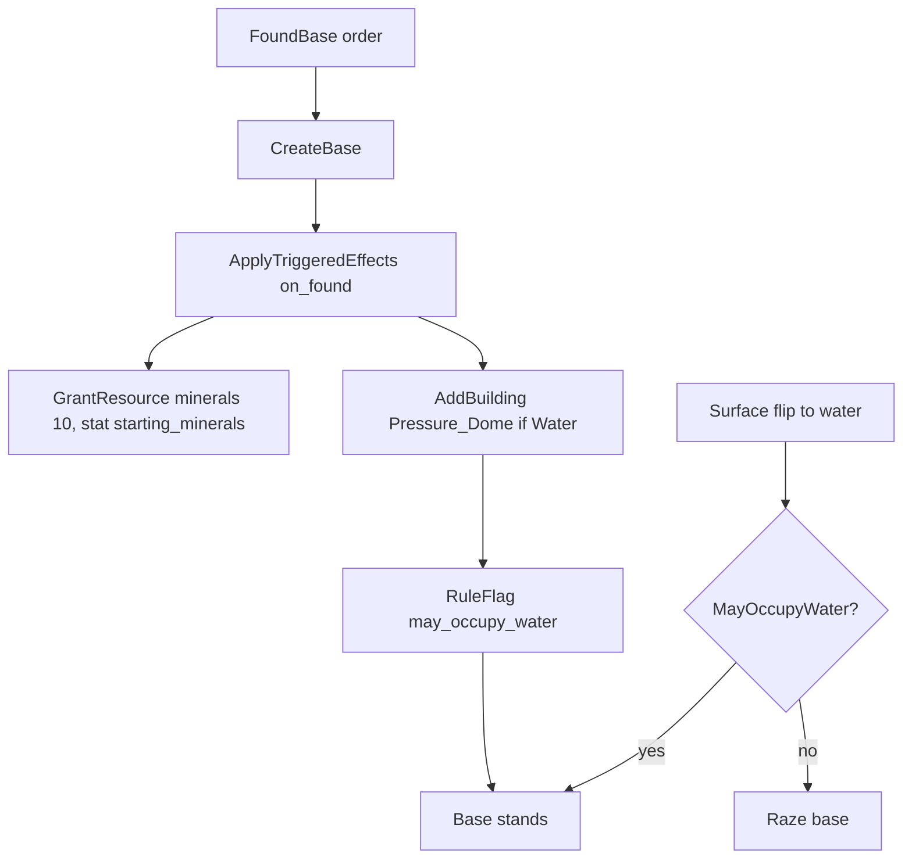

# Pressure Dome, flood raze, and on_found_effects

## Intended rule (deviation from SMAC)

Document in `[config/deviations/README.md](config/deviations/README.md)` under TODO (`[Ours]`):

- **Original** (`[docs/thinker/terranx-map.md](docs/thinker/terranx-map.md)` “Sea bases” / `alt_set`): undomed land base on a flood loses `clamp(size/2, roll, cap)` pop, is granted Pressure Dome, and is razed only when emptied (last-base exception).
- **Ours:** a base may always sit on land. Pressure Dome adds water occupancy. If the tile is water and the base may not occupy water, raze immediately (no pop-loss / emergency-dome path). Sea founding constructs a real Pressure Dome via founding effects.



## Founding minerals: `GrantResource` + continuous `StartingMinerals`

The pod's +10 only means something at the instant of founding, so it is a triggered grant, not
a continuous stat on the unit (same move as starting XP → `GrantXp` on
`on_unit_produced_effects`). SE and projects are standing faction rules that size that grant,
so they stay continuous. Name the triggered type `GrantResource` (not `GrantMinerals`) so
supply pods and other one-shots can credit minerals — or later nutrients / energy stockpiles —
with the same shape. `GrantEnergy` (treasury) stays separate.


| Piece | Role |
| --- | --- |
| `GrantResource` (triggered, base subject) | Required `resource` (stockpile lane: `minerals` now; nutrients/energy when those writers exist). `amount` literal seeds the resolve; optional `stat` names a base stat whose modifiers apply on top; result floored at 0 and added to that resource's stockpile. |
| Continuous `StartingMinerals` | **Base pool only** (SE Support ≤ −2 −10, projects +5, …). Founding's grant names it via `stat: starting_minerals`; it reads nothing on its own. Supply grants omit `stat` (flat amount) unless they grow a different modifier later. |
| `FoundBase` C++ | `CreateBase` → dispatch `on_found` → `ExpendIfSingleUse`. No inherent mineral credit. |
| Eligibility | Non-empty collected `on_found_effects` (like detonate). Drop `found_base`. |

`amount` + `stat` is “literal seed plus modifier stat”, distinct from Earthquake / Explosion’s
“literal *or* stat” (`levels` vs `levels_stat`); document it as such. `stat` is optional so a
scripted event or supply pod can grant a flat amount. Seeding with the literal (rather than
summing) lets a future `MultiplyGeometric` project scale founding minerals.

Write semantics: add into the stockpile (fresh base is 0, so founding matches a set). Turn
original stays null, so retooling remains free.

Consequences:

- `ResolveStartingMinerals`’ unit-pool merge, its `pFoundingUnit` parameter, and
`ApplyStartingMinerals` are deleted; the “before the founder is spent” ordering constraint
goes with them. The grant resolves through the ordinary base-domain path.
- A founder that authors no grant founds with an empty stockpile; SE −10 then has nothing to
cancel (floor 0 applies per grant).
- Drop the effects-system “multi-pool ubiquity, not a DomainFor escape hatch” note for
`StartingMinerals`.

Founding surface / embarked optional widenings are already a deviations TODO
(`Founding surface and embarked exceptions`); this plan ships the strict default only.

## `on_found_effects` slot

Add on unit components (`[UnitComponentConfig](include/game/units/UnitComponentConfig.h)` / parser / design `CollectOnFoundEffects`, same shape as `on_detonate_effects`).

- `[CanFoundBase](src/game/base/FoundBaseRules.cpp)` and the FoundBase hotkey gate use non-empty on-found effects, not `RuleFlagId_t::FoundBase`. Remove `found_base` from shipping/fixture colony components, enums, and flag tests.
- `[FoundBase](src/game/base/BaseMutations.cpp)`: `CreateBase` → `ApplyTriggeredEffects(on_found)` with `pBase` / `pUnit` / tile subjects → `ExpendIfSingleUse`. After `m_bMayOccupyWater` is removed, the new base sits on water without the dome until `on_found`’s `AddBuilding` runs — do not insert an occupancy raze/reconcile between those steps (founding does not surface-flip; keep it that way).
- No dome grant in `Faction::CreateBase`.

### Who may found where

Today’s check (`water ⇒ domain == Sea`) already rejects a land pod whose tile is water — including when embarked on a transport (passenger keeps land domain, shares the carrier’s water tile). Tighten and test it so that path cannot regress:

- Refuse if `Transport().IsEmbarked()` — founding is an occupant action; unload first.
- Water founding only for `UnitDomain_t::Sea`. Land, air, and orbital may found only on land (SMAC allows Colony Module on air chassis and prices air non-combat designs; `Colony_Pod` has no `requires_chassis`, so Needlejet/Gravship/Missile + colony remains designable — founding on land works, founding on water does not).
- Then `CanFoundBaseAt` (spacing / foreign territory) as today.

Add a test: land colony pod embarked on a sea transport on water → `CanFoundBase` false (and does not create a base). Air/orbital colony on land may found; on water may not.

### Colony pod config

In `[config/unit_components/specials.json](config/unit_components/specials.json)` (and fixtures):

```json
"effects": [
  { "type": "RuleFlag", "scope": "ThisUnit", "parameters": { "flag": "single_use" } },
  { "type": "RuleFlag", "scope": "ThisUnit", "parameters": { "flag": "cannot_capture_bases" } }
],
"on_found_effects": [
  { "type": "GrantResource",
    "parameters": { "resource": "minerals", "amount": 10, "stat": "starting_minerals" } },
  { "type": "AddBuilding",
    "parameters": { "building_id": "Pressure_Dome" },
    "condition": { "kind": "TargetTileHas", "value": "Water" } }
]
```

`on_complete_effects` (production pop cost) unchanged. Wire the slot into the effects-system trigger-slot table and validators.

## Pressure Dome effects (config)

In `[config/buildings/buildings.json](config/buildings/buildings.json)` (and matching fixtures):

- Continuous on `Pressure_Dome`:
  - `RuleFlag` `may_occupy_water`, scope `ThisBase`
  - The same yield `StatModifier`s as Recycling Tanks (`ThisBase` +1 nutrients / minerals / energy)
- Bring `Recycling_Tanks` to those three +1s (today only nutrients).

Wire `may_occupy_water` through `[EffectEnums.h](include/game/effects/EffectEnums.h)` / flag parse map.

## Occupancy query

`[BaseManager::MayOccupyWater](src/game/base/BaseManager.cpp)`: resolve `RuleFlagId_t::MayOccupyWater` (same pattern as `IsHeadquarters`). Delete `m_bMayOccupyWater` and the founding-tile constructor bit — water founding installs the dome via on-found, so the flag is the sole source of truth.

Stop hardcoding `HasBuilding(k_PressureDomeBuildingId)` for occupancy. Keep the building id where founding / scrap name the facility.

## Surface flip: raze, do not flood

In `[TerraformRules](src/game/terraform/TerraformRules.cpp)` / `[SurfaceOccupancy](src/game/terraform/SurfaceOccupancy.cpp)`:

- When `bNowWater && pBase && !pBase->MayOccupyWater()`, mark for destruction (not `SubmergedBase_t`).
- Mutation razes and notifies loss; no pop removal, no emergency `AddBuilding`.
- Land flip unchanged (base always may occupy land).
- Delete `SubmergedBase_t`, `ResolveSubmergence`, `FloodBase_`, and `map_rules.json` / parser / fixture keys `submerged_pop_loss_*`.

Wrong-domain improvement removal and stranded-unit logic stay; shelter still requires a standing base after the flip.

## Scrap on water

Extend `[CanScrapBuilding](src/game/production/ProductionRules.cpp)` to take the base: deny scrap when the building is `Pressure_Dome` and the tile is water. Land scrap of a dome remains allowed.

## Tests and docs

- Founding: non-empty `on_found_effects` required; sea founding gets `Pressure_Dome`; no `found_base` flag; embarked land pod on water cannot found.
- Sea `FoundBase` on water: base is not razed; it has constructed `Pressure_Dome`, `MayOccupyWater()` is true, and the tile still has the Base improvement (locks “dome applied before any water-occupancy raze”).
- Founding minerals keep today’s numbers via `GrantResource`: pod alone 10; pod + project 15; Support −2 cancels to 0; Support −2 + project 5. Add: without `stat` grants the flat amount; a founder with no grant founds at 0.
- `StartingMinerals` filter tests drop the unit-pool case (`[FilterTests.cpp](tests/effects/FilterTests.cpp)` “pod” entry moves to a base-pool source).
- Flood without dome → razed (including former last-base emergency-dome cases).
- Domed / sea-founded base survives a water flip with unchanged size.
- Dome alone matches tanks’ +1 N/M/E; scrap denied for dome on water.
- Update `[docs/architecture/effects-system.md](docs/architecture/effects-system.md)` (triggered-type list + a `GrantResource` section, trigger-slot table, `StartingMinerals` stat description and DomainFor note), `[docs/game-rules-decisions.md](docs/game-rules-decisions.md)` founding-minerals note, flood-raze deviations entry, `[TerraformRules.h](include/game/terraform/TerraformRules.h)` comments, and submerged notice copy (drop “now has a Pressure Dome”).

