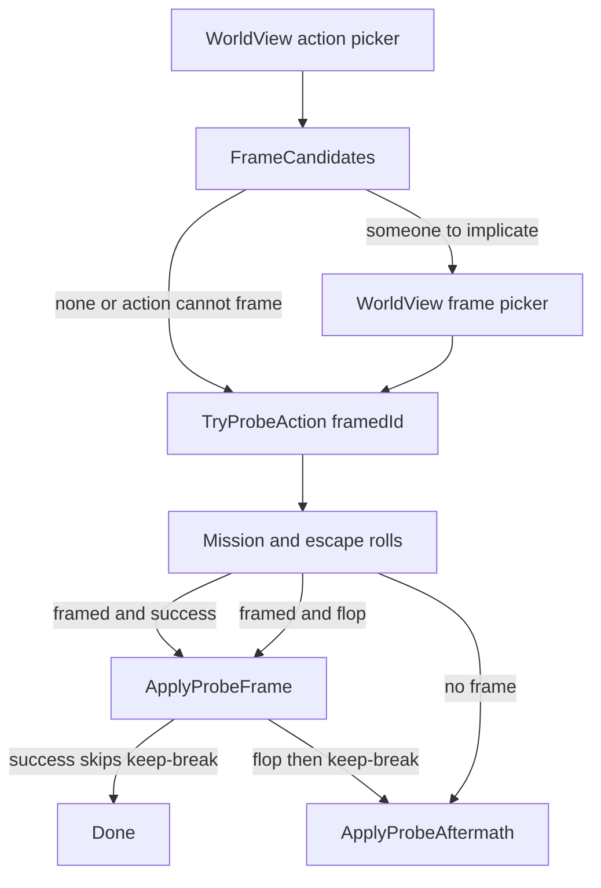

# Probe frame standing

A human actor, after choosing a frame-eligible action against an AI, may implicate another faction they have a commlink with ([terranx-map.md](docs/thinker/terranx-map.md) Frame). Framing is part of committing the probe (same shape as the sabotage-facility picker), not a mid-turn `PlayerInteractionQueue` yield.

Confirmed in `terranx.exe` (`sha1` `4b19c1fe3266b5ebc4305cd182ed6e864e3a1c4a`).

## Confirmed in the binary

**Who gets a FRAME menu** (`[ebp-0x18]` action id at `0x5A2DCD`):

- Offer: action id `1..5` (`jge 6` / `jg 0` at `0x5A2DDA`–`0x5A2DDE`) — steal tech, sabotage, drain, incite, assassinate. Action `8` (free captured leader) also falls through (`cmp 8` / `jne 0x5A3111` at `0x5A2DE0`); we have no such action.
- Skip: infiltrate `0`, unit subversion `−1`, mind-control city `6`, plague `7` (and TTC, which is mind-control city with nonzero risk).

Human actor vs AI target then lists candidates (`0x5A2FDB`): other factions, not actor, not target, actor→them `DIPLO_COMMLINK` (`0x8` at `0x5A2FFF`), alive (`0x9A64E9`). No Vendetta filter. A chosen id is stored in `Veh.probe_action` bits 5+ (`shl 5` at `0x5A30BE`). Nonzero framed id increments risk (`inc [ebp-0x30]` at `0x5A3101`).

**Flop vs success** (aftermath `0x5A4BA0`):

- Bust/capture negates the framed id (`0x5A31D1`). `prb_state < 0` is flop; `> 0` is success; `0` is unframed.
- **AI flop** (`0x5A4C2F`): `treaty_on(framed, actor, VENDETTA)` (`0x10`). Then `neg` of the positive framed id (`0x5A4C37`) stores `prb_state` **still negative**. The human-framed block is skipped (`je 0x5A4EE7` at `0x5A4C5B`). The human-target check (`0x5A4EE7`) jumps to `0x5A53B3` when the victim is AI. There `test eax` / `jle 0x5A5515` (`0x5A53B3`) sees the negative id and **skips the success write**. Keep/break at `0x5A5515` runs between actor and victim.
- **Success** (`prb_state > 0` at `0x5A53B3`): `treaty_on(target, framed, COMMLINK|VENDETTA|0x40)` (`0x58` at `0x5A53BE`) and `set_treaty` `DIPLO_WANT_REVENGE` (`0x20`). Then `jmp 0x5A5816` (`0x5A5510`) — no keep/break.

Thinker's `mod_probe` after an AI flop does `prb_state = -prb_state` (positive), so it would also run the success write. The binary does not. Record that in `terranx-map.md`.

## Who may be framed

[ProbeRules](include/game/probes/ProbeRules.h):

- `ProbeMayFrame(actor, target, action)`: action `may_frame`, actor is player-controlled, target is not, both have diplomacy.
- `FrameCandidates(actor, target)`: every other living diplomatic faction `AreKnown` to the actor, excluding actor and target.

Empty candidates: no picker, `framedId` unset.

## Config

Each action in [config/probe_actions.json](config/probe_actions.json) and [tests/fixtures/probe_actions.json](tests/fixtures/probe_actions.json) requires `may_frame` (parser rejects missing). Shipping: true for steal_tech, drain_energy, sabotage_random, sabotage_facility, incite_drone_riots, assassinate; false for infiltrate, mind_control_base, total_thought_control, genetic_plague, subvert_unit.

`probe_actions.json` top-level required integer `frame_risk` ≥ 0 (fixture/shipping `1`). When `framedId` is set, executor risk is `MissionRisk(...) + frame_risk` before `ProbeChancesFor` / `RollProbeAction`.

## Commit path

[TryProbeAction](include/game/probes/ProbeActionExecutor.h) takes `framedId` (`std::optional<FactionId_t>`; callers pass `nullopt`). No store on `Unit`. An id that is not a candidate throws.

[WorldView](src/ui/world/WorldView.cpp): after the action choice, if `ProbeMayFrame` and candidates are nonempty, open a `ListSelectorPopup` (first item: do not frame) then call `TryProbeAction`. Sabotage facility still picks the facility first, then this picker.

AI auto-frame (`morale ≥ 5`, `RankingFactionIDUnk1` at `0x5A2E04`) waits on an AI probe caller.

## Standing writes

New `ResolveProbeFrame` (rules) / `ApplyProbeFrame` (mutations), called from `ResolveProbeRoll_` **before** `ApplyProbeAftermath`.

- **Success** (framed, mission succeeded, escaped): `ApplyProbeVendetta(victim, framed)` — Vendetta, contact, no blemish, no obligations. Skip actor–victim `ApplyProbeAftermath`. `DIPLO_WANT_REVENGE` and bit `0x40` stay TODOs (no revenge record).
- **Flop** (framed, and mission failed or escape failed): `ApplyProbeVendetta(framed, actor)`, then **still** `ApplyProbeAftermath` for actor vs victim (keep with friction when `may_keep_agreement`).
- **Human-framed flop** (`PACTFRAMEEXCUSE` / `FRAMEEXCUSE` at `0x5A4C3E`): not this slice. In SP the player is the actor, so every candidate is AI.

## Notices

`ProbeNoticeInteraction_t` carries the framed faction (snapshot names) and flop vs success so [ProbeNoticeCopy](include/ui/ProbeNotices.h) can serve FRAMEFLOP (actor, flop) and FRAMED (actor, success). FRAMEJOB when the player is the framed party can land on the same arm.

## Tests and docs

Fixture-owned `frame_risk` and `may_frame`. Cases in [tests/game/ProbeActionTests.cpp](tests/game/ProbeActionTests.cpp) / [tests/game/ProbeRulesTests.cpp](tests/game/ProbeRulesTests.cpp):

- Steal-tech vs AI, third commlink faction framed, success: victim–framed Vendetta; actor–victim status unchanged; friction 0.
- Same without a frame: existing keep-friction.
- Framed flop: framed–actor Vendetta, **and** actor–victim keep-friction (Treaty/Pact still held).
- Mind-control / infiltrate: `may_frame` false, no candidates used.
- Framing adds `frame_risk` to the mission risk used for the roll.

[docs/thinker/terranx-map.md](docs/thinker/terranx-map.md): FRAME skip at `0x5A2DCD`, flop leaves `prb_state` negative so success is skipped, Thinker's sign flip differs. [docs/architecture/diplomacy-system.md](docs/architecture/diplomacy-system.md) Probe standing: frame runs first; only success skips keep-break. [docs/architecture/player-interaction-system.md](docs/architecture/player-interaction-system.md) only if the notice payload grows. `./bd test`.
