# Planetary Council System Architecture

```mermaid
graph TB
    subgraph "Runtime (mutable, per-game)"
        PlanetaryCouncil[PlanetaryCouncil<br/>membership, governor, laws, history]
        CouncilEffects[CouncilEffects<br/>active-effect store]
        CouncilVoteExecutor[CouncilVoteExecutor<br/>propose, vote, veto, resolve]
        PendingProposal[PendingProposal_t<br/>ballots / electionVotes]
        Signals[Signals<br/>OnProposalOpened<br/>OnResolved]
    end

    subgraph "Decisions and outcomes"
        CouncilRules[CouncilRules<br/>eligibility, weights, tally, veto]
        CouncilMutations[CouncilMutations<br/>on_passed / on_elected effects]
    end

    subgraph "Definition Data (immutable)"
        CouncilProposalRegistry[CouncilProposalRegistry]
        CouncilProposalConfig[CouncilProposalConfig_t]
        CouncilRulesConfig[CouncilRulesConfig_t]
        ProposalParser[CouncilProposalConfigParser]
        RulesParser[CouncilRulesConfigParser]
    end

    subgraph "Collaborators"
        GameState[GameState<br/>owns the council and its executor]
        Faction[Faction<br/>members]
        DiplomacyLedger[DiplomacyLedger<br/>commlinks / infiltration]
        EconomyManager[EconomyManager<br/>energy grants]
        ResearchManager[ResearchManager<br/>tech gating]
        ActiveEffect[ActiveEffect_t<br/>effects system]
        WorldEvents[(WorldEvents<br/>future sea-level trigger)]
    end

    GameState --> PlanetaryCouncil
    GameState --> CouncilVoteExecutor
    GameState -->|CollectWorldEffects| CouncilEffects

    CouncilVoteExecutor --> PendingProposal
    CouncilVoteExecutor --> Signals
    CouncilVoteExecutor --> CouncilRules
    CouncilVoteExecutor -->|RecordProposal, RecordPassed,<br/>Enact, InstallGovernor| PlanetaryCouncil
    CouncilVoteExecutor --> CouncilMutations
    CouncilVoteExecutor -->|SetKnown| DiplomacyLedger
    CouncilRules -->|reads| PlanetaryCouncil
    CouncilRules -->|commlinks| DiplomacyLedger
    CouncilRules -->|tech gating| ResearchManager
    CouncilRules -->|population, votes| Faction

    PlanetaryCouncil --> CouncilEffects
    PlanetaryCouncil --> CouncilProposalRegistry
    PlanetaryCouncil --> CouncilRulesConfig

    CouncilEffects --> ActiveEffect
    CouncilMutations -->|AddEnergy| EconomyManager
    CouncilMutations -->|SetInfiltration| DiplomacyLedger
    CouncilMutations -.->|TODO: world-parameter trigger| WorldEvents

    CouncilProposalRegistry --> CouncilProposalConfig
    CouncilProposalRegistry --> ProposalParser
    CouncilRulesConfig --> RulesParser

    style PlanetaryCouncil fill:#f9f,stroke:#333,stroke-width:4px
    style CouncilVoteExecutor fill:#f9f,stroke:#333,stroke-width:3px
    style CouncilEffects fill:#fbf,stroke:#333,stroke-width:2px
    style CouncilMutations fill:#fbf,stroke:#333,stroke-width:2px
    style CouncilRules fill:#bfb,stroke:#333,stroke-width:2px
    style CouncilProposalRegistry fill:#bbf,stroke:#333,stroke-width:2px
    style CouncilProposalConfig fill:#ffd,stroke:#333,stroke-width:2px
    style CouncilRulesConfig fill:#ffd,stroke:#333,stroke-width:2px
    style GameState fill:#fbf,stroke:#333,stroke-width:3px
    style ActiveEffect fill:#fbf,stroke:#333,stroke-width:2px
    style Signals fill:#f9f,stroke:#333,stroke-width:2px
```

## Component Overview

### PlanetaryCouncil (state owner)
- **Purpose**: The council's standing state and the queries over it: membership, the
  governorship, the Supreme Leader victory stub, the laws in force, pass counts, each
  faction's last proposal year, and the council's effects and revision. No method takes a
  `GameState`.
- **In force vs enacted** are two different questions:
  - `IsActive(id)`: *in force*, this proposal contributes continuous world effects right now.
    Only proposals that carry a `Continuous` + `WorldGlobal` effect ever enter this set.
  - `HasPassed(id)`: *enacted*, it has been voted through at least once (pass-count history).
    One-shots and pure repeals are only ever this.
  If every passed proposal were "in force", `CanPropose`'s non-repeatable rule would consume
  `repeal_un_charter` permanently and a reinstated charter could never be repealed again.
- **Transitions** (called by `CouncilVoteExecutor`): `RecordProposal`, `RecordPassed`
  (repeals its targets and counts the pass), `Enact` (puts continuous laws in force),
  `InstallGovernor`, `SetSupremeLeaderVictory`, and `Expel`.
- **Revision** bumps when membership, the governor or the laws in force change, so `Faction`
  composed-pool caches recompose. The pending vote is not council state and does not bump it;
  vote weights do not depend on it.
- **Owned by**: `GameState` (`m_pCouncil`), created by `GameState::CreatePlanetaryCouncil`.
- **Depends on**: `CouncilProposalRegistry` + `CouncilRulesConfig_t` (references) and
  `Faction*` members (non-owning, must outlive the council).

### CouncilRules
- `HasCommlinksToAllMembers`, `ProposeCooldownYears`, `YearsUntilCanPropose`.
- `CanPropose` owns proposal availability: member, proposable, tech, required/forbidden rule
  flags, `required_proposals` (satisfied by *enacted*, so a one-shot prerequisite like
  `launch_solar_shade` still counts), the repeal gate (a proposal with `repeals` is available
  only while one of its targets is in force), and repeatability. Repeatability has two
  exemptions, continuous world laws and repeals, because both become meaningful again when
  their subject changes state. Commlinks and cooldown are the propose-time checks it leaves out.
- `VoteWeight` applies `CouncilVotes` effects to a member's representative or population weight.
- `GovernorCandidates` (the two most populous members) and `EligibleCandidates` (those for a
  Planetary Governor election, the whole council for Supreme Leader). Election eligibility is
  the council's rule, not the UI's.
- `ProposalPasses` and `ElectionWinner` tally a `PendingProposal_t`. A missing ballot is an
  abstention; a vote threshold is measured against the total member weight.
- `CanVeto` (the governor, never in an election) and `VetoOverruled` (every other member voted
  Yea).

### CouncilVoteExecutor
- **Purpose**: Runs one vote from agenda to outcome. Holds the single `PendingProposal_t` and
  the `OnProposalOpened` / `OnResolved` signals. Owned by `GameState` beside the council and
  reached through `GameState::GetCouncilVotes()`.
- `Propose` checks `CanPropose`, commlinks and cooldown; shares commlinks among members
  (`DiplomacyLedger::SetKnown`); opens the pending vote with its candidate snapshot; records the
  proposal on the council; then emits `OnProposalOpened`. If an observer throws, the pending
  slot is cleared, because only `Resolve` clears it otherwise and `Propose` throws while it is
  set.
- **The candidate snapshot**: eligibility derives from live population, so recomputing it per
  ballot would let a faction drop out mid-vote while ballots already cast for it stood.
  `CastElectionVote` and `ElectionWinner` both validate against the snapshot.
- **Absentees abstain.** `Resolve` has no "everyone voted" precondition, so the vote can always
  be resolved. `AllMembersVoted()` is an advisory query.
- `Expel` expels from the council and drops the expelled faction's ballot and candidacy from
  the pending vote.

### CouncilMutations
- `ApplyPassedCouncilEffects` runs a proposal's `on_passed_effects` through
  `ApplyTriggeredEffects` with every member as a subject, so `GrantEnergy` credits each of them.
  World-parameter effects (sea level) are a documented **TODO**: they must trigger a
  `WorldEvents` world event, not mutate the map here.
- `ApplyCouncilGovernor` runs the rules' `on_elected_effects` for the incoming governor (e.g. a
  `SetInfiltration` that outlives the term). Continuous `Infiltration` +
  `factionFilter: CouncilMembers` stays query-time.

### CouncilEffects
- **Purpose**: Owns the continuous `ActiveEffect_t`s the council projects, keeping each
  wrapper together with its backing `EffectConfig_t` so `ActiveEffect_t::config` pointers stay
  valid across rebuilds.
- **Two lanes**:
  - **World** — continuous `WorldGlobal` effects gathered from the proposals in force
    (Trade Pact, U.N. Charter, …), rebuilt by `RebuildWorld` whenever the active set changes.
  - **Governor** — continuous `FactionGlobal` effects from the council rules, set by
    `SetGovernorEffects` when a governor is elected.
- **Shared predicate**: `IsContinuousWorldEffect` is the single definition of "a continuous
  world-global council effect," used both here and by the council's proposal eligibility.
- **Conversion**: builds wrappers via the codebase's canonical `AppendActiveEffects` rather
  than a hand-rolled loop.

### CouncilProposalRegistry / config
- **CouncilProposalConfig_t**: one proposal definition — `kind` (Standard/Election),
  `voteWeight` (Representative/Population), `voteThreshold`, `repeatable`, `initiallyActive`,
  `proposable`, `requiredTech`, `requiredProposals`, `repeals`, `requires/forbidsRuleFlags`,
  `electionOutcome`, `effects` (standing law) and `onPassedEffects` (one-shot outcomes).
- **CouncilRulesConfig_t**: standing rules — `governorProposeIntervalYears`,
  `memberProposeIntervalYears`, `governorEffects` (standing) and `onElectedEffects`
  (one-shot).
- **CouncilProposalRegistry**: loads/validates the proposal list (rejects `requiredProposals`
  / `repeals` that reference unknown ids). Parsed by `CouncilProposalConfigParser`; rules by
  `CouncilRulesConfigParser`. Loaded from `config/council/`.
- **Honored effect shapes** (load-time; anything else throws — a passed proposal must not be a
  silent no-op):
  - **Proposals**: `effects` must be `WorldGlobal` (any type the continuous world store can
    hold). `on_passed_effects` must be `GrantEnergy` (credited to every member) or
    `WorldParameter` — the latter an **explicit deferred** shape: load is allowed, apply is a
    no-op until `WorldEvents` exposes a trigger API.
  - **Governor**: `governor_effects` must be `FactionGlobal`. `on_elected_effects` accepts any
    triggered type.

### Notifications
- `CouncilVoteExecutor::OnProposalOpened(Faction&, const std::string&)` fires when a proposal
  is put before the council; the UI raises the vote popup and AI observers decide their ballots.
- `CouncilVoteExecutor::OnResolved(const std::string&, ResolveProposalResult_t)` fires once per
  resolution, for every outcome. Complements the pull-based `Revision` counter.

## Usage Flow

### Proposing and voting
1. UI lists proposals via `GetRegistry()` filtered by `CanPropose`; `YearsUntilCanPropose`
   supplies the cooldown notice.
2. `CouncilVoteExecutor::Propose` validates eligibility, commlinks and cooldown, shares
   commlinks, opens the `PendingProposal_t`, records the proposal, and emits `OnProposalOpened`.
3. Members cast ballots (`CastVote` / `CastElectionVote`); the governor may `VetoPending`.
   The UI reads live tallies from `GetPending()` and weights from `VoteWeight`.
4. `Resolve`: a veto stands unless `VetoOverruled`; otherwise `ProposalPasses` or
   `ElectionWinner` decides; a pass is applied; then the pending vote is cleared and
   `OnResolved` emitted.

### A passed proposal
1. `PlanetaryCouncil::RecordPassed` lifts the laws it repeals and counts the pass.
2. `ApplyPassedCouncilEffects` applies `on_passed_effects`.
3. `PlanetaryCouncil::Enact` puts continuous laws in force (`CouncilEffects::RebuildWorld`).
4. A Planetary Governor election installs the winner (`InstallGovernor`, then
   `ApplyCouncilGovernor`); a Supreme Leader election records the victory stub.
5. `GameState::CollectWorldEffects…` folds `CouncilEffects` world + governor effects into the
   faction effect pool, so council law reaches stat resolution.

## Design Decisions

### Single responsibility
`PlanetaryCouncil` holds the council's state; `CouncilRules` decides who may propose, how much a
vote weighs and what passes; `CouncilVoteExecutor` runs the vote; `CouncilMutations` carries out
the outcomes beyond the council; `CouncilEffects` stores the effects it projects. Each has one
reason to change.

### Membership is seated once and only ever shrinks
Members are non-owning pointers fixed at construction, with `Expel` as the single exception: a
faction that commits a major atrocity loses its seat for good (`atrocity-system.md`, through
`CouncilVoteExecutor::Expel`). Expulsion does three things beyond dropping the pointer, because
a vote may be open at the time:

- discard any ballot or election vote the expelled faction holds, so `AllMembersVoted` and the
  tally do not wait on, or weight, a seat that no longer exists
- vacate the governorship and clear its standing effects (`CouncilEffects::ClearGovernorEffects`)
  if the expelled faction held it — otherwise a removed member keeps its commerce bonus and its
  `CouncilMembers` infiltration
- bump the revision, so `Faction` composed-pool caches recompose

`Expel` on a faction that holds no seat is a no-op, so a second major atrocity cannot disturb the
council.

### The council never mutates the world map
World-parameter outcomes (sea level, climate) are triggers, not direct edits — gradual map
mutation belongs to the `WorldEvents` system. Until that system exposes a trigger API, the
council mutations hold a TODO and no world state lives on the council. Stock proposals that declare
an `on_passed` `WorldParameter` (solar shade, polar caps) are still **allowed at load** as a
deferred surface; apply is a documented no-op until WorldEvents.

### Moddability
Governor benefits are fully config-driven via `governorEffects` (continuous FactionGlobal
bonuses, including Continuous `Infiltration` filtered to council members). Proposals, vote
weights, thresholds, tech gates, and rule-flag interactions all come from `config/council/`.

### Event-driven for the UI
The vote executor exposes `Signal`s for the AI-initiates-a-vote popup flow rather than forcing the
UI to diff a `Revision`, matching the engine's internal signal pattern (e.g.
`UnitManager::OnUnitCreated`).
