# Diplomacy and Trade Architecture

```mermaid
graph TB
    subgraph "Session (GameState)"
        GameState[GameState]
        DiplomacyLedger[DiplomacyLedger<br/>pairwise status + known-ness]
        DiplomaticActionExecutor[DiplomaticActionExecutor<br/>pending slot + routing]
        FirstContactResolver[FirstContactResolver<br/>marks factions known]
    end

    subgraph "Proposal data"
        DiplomaticProposal[DiplomaticProposal_t<br/>proposer, recipient,<br/>requestedStatus, give, demand]
        TradeItem[TradeItem_t<br/>variant]
        TradeCredits[TradeCredits_t]
        TradeTechnology[TradeTechnology_t]
        TradeBase[TradeBase_t]
        TradeCommFrequency[TradeCommFrequency_t]
        TradeWorldMap[TradeWorldMap_t]
        TradeDeclareVendetta[TradeDeclareVendetta_t]
        TradeKind[TradeKind_t<br/>+ TradeKindOf trait, TradeKinds]
    end

    subgraph "Proposals (DiplomaticProposalRules / DiplomaticProposalMutations)"
        IsValidProposal[IsValidProposal<br/>CanDeliver_ per item, no base or tech twice,<br/>side totals; StepUp only]
        CanDeliver[CanDeliver<br/>one item from its giver]
        ApplyProposal[ApplyProposal<br/>status, then Deliver_ per item]
    end

    subgraph "Status definition"
        DiplomaticStatus[DiplomaticStatus_t<br/>closed enum]
    end

    subgraph "Ruleset (GameDataContext)"
        DiplomacyConfig[DiplomacyConfig_t<br/>per-status rules + friction_max<br/>blemishes_max + break_agreement_blemishes<br/>probe_keep_friction_draw + base_value<br/>config/diplomacy.json]
        DiplomacyCalculator[DiplomacyCalculator<br/>NextFriction / NextBlemishes<br/>BaseValue]
    end

    subgraph "Base value (BaseValueRules)"
        BaseValueRules[BaseValue<br/>HQ distance, ring scan,<br/>region counts, built costs]
    end

    subgraph "What a status permits (DiplomaticPermissionRules)"
        PermissionRules[StatusRulesFor / MayEnterTerritoryOf unit<br/>MayShareTiles / MayRepairAt<br/>HasDiplomacy / IsObligedToDefend]
    end

    subgraph "Owner identity (VisibilityRules)"
        OwnerKnown[IsOwnerKnownTo<br/>false for another faction's Covert unit]
    end

    subgraph "Transition rules (DiplomaticTransitionRules)"
        StepUpDown[StepUp / StepDown]
        CanPropose[CanProposeStepUp / CanCancelTreaty<br/>CanDeclareVendetta]
        HostileActAgainst[HostileAct_t / HostileActAgainst<br/>attributed unless a side is covert]
        VendettaRules[VendettaFromHostileAct / VendettaWithdrawsTerritory<br/>HonoredObligationCascades / BombardHostileActs]
        AgreementBreak[IsAgreement / AgreementBreakBlemishes]
    end

    subgraph "Transition effects (DiplomaticTransitionMutations)"
        ApplyStatusChange[ApplyStatusChange<br/>status + commlink + eviction]
        ExpireStatuses[ExpireDiplomaticStatuses<br/>TurnStart]
        CancelTreaty[CancelTreaty<br/>one-sided StepDown]
        ApplyHostileAct[ApplyHostileAct<br/>ignores unattributed acts;<br/>sneak attack unless may_attack]
        ApplyAtrocityVendetta[ApplyAtrocityVendetta<br/>sneak; no agreement-break blemish]
        ApplyProbeVendetta[ApplyProbeVendetta<br/>sneak; no blemish, obliges nobody]
        DeclareVendetta[DeclareVendetta<br/>declared Vendetta + defensive obligation]
        JoinVendetta[JoinVendetta<br/>declared Vendetta, obliges nobody]
        VendettaImpl[EnterVendetta_ / DeclareVendetta_<br/>private, take VendettaKind_t]
        RaiseObligations[RaiseDefensiveObligations_<br/>private, checks each partner in turn]
        HonorDecline[HonorDefensiveObligation / DeclineDefensiveObligation<br/>carry VendettaKind_t]
        EvacuateTerritory[EvacuateUnitsFromTerritory<br/>EvacuateUnitsSharingWith]
    end

    subgraph "Standing (DiplomaticStandingMutations)"
        ApplyStanding[ApplyFriction / ApplyBlemishes]
    end

    subgraph "Standing captions (UI)"
        CommlinksPanel[CommlinksPanel + StandingCaptions<br/>mood toward the player, repute<br/>config/ui/standing_captions.json]
    end

    subgraph "Talk (UI; see ui-system.md)"
        Talk[TalkPopup + TalkConversation<br/>config/ui/talk.json, text packs]
    end

    subgraph "Hostile act sources"
        Combat[UnitAttackExecutor<br/>TryAttack / TryBombard<br/>act built before combat,<br/>reported after it resolves]
        Probe[ProbeActionExecutor<br/>ProbeHostileAct: attributed,<br/>or ProbeDetected]
        ProbeFrame[ResolveProbeStanding ProbeRules<br/>ResolveProbeFrame: who blames whom,<br/>then whether keep or break follows]
        ProbeAftermath[ResolveProbeAftermath ProbeRules<br/>the choice, before any Vendetta<br/>ApplyProbeAftermath ProbeActionMutations<br/>writes keep or break]
        Atrocity[CommitAtrocity<br/>always attributed]
    end

    subgraph "Action menu (DiplomacyActions)"
        GetAvailableActions[GetAvailableActions<br/>Trade whenever the pair has met]
        GetTalkActions[GetTalkActions<br/>no declaring; cancel only a Pact]
    end

    subgraph "Affected faction state"
        EconomyManager[EconomyManager<br/>SpendEnergy / AddEnergy]
        ResearchManager[ResearchManager<br/>AddDiscoveredTech]
        FactionExploredMap[FactionExploredMap<br/>CopyExploredMap]
        Bases[Faction::TransferBaseTo]
    end

    GameState --> DiplomacyLedger
    GameState --> DiplomaticActionExecutor
    GameState --> FirstContactResolver
    FirstContactResolver -->|SetKnown| DiplomacyLedger
    FirstContactResolver -->|HasDiplomacy:<br/>never meets native life| PermissionRules
    FirstContactResolver -->|never meets the owner<br/>of a covert unit| OwnerKnown

    DiplomaticActionExecutor --> DiplomaticProposal
    DiplomaticProposal --> TradeItem
    TradeItem --> TradeCredits
    TradeItem --> TradeTechnology
    TradeItem --> TradeBase
    TradeItem --> TradeCommFrequency
    TradeItem --> TradeWorldMap
    TradeItem --> TradeDeclareVendetta
    TradeItem -.->|one trait per alternative| TradeKind

    DiplomaticActionExecutor -->|Propose / Accept| IsValidProposal
    DiplomaticActionExecutor -->|accepted| ApplyProposal
    IsValidProposal -->|CanProposeStepUp| CanPropose
    IsValidProposal -->|AreKnown| DiplomacyLedger
    GetAvailableActions --> CanPropose
    GetTalkActions --> GetAvailableActions
    Talk -->|what may be said| GetTalkActions
    Talk -->|StepUp, trade| DiplomaticActionExecutor
    Talk -->|renounce a Pact| CancelTreaty
    Talk -->|trade rows| CanDeliver
    CanDeliver -.->|same visitor| IsValidProposal
    CanPropose --> DiplomacyLedger

    ApplyProposal --> EconomyManager
    ApplyProposal --> ResearchManager
    ApplyProposal --> FactionExploredMap
    ApplyProposal --> Bases
    ApplyProposal -->|requestedStatus| ApplyStatusChange
    ApplyProposal -->|TradeDeclareVendetta_t:<br/>the giver declares| DeclareVendetta
    CancelTreaty -->|StepDown| ApplyStatusChange
    CanPropose --> StepUpDown
    AtrocityMutations[AtrocityMutations<br/>universal Vendetta] -->|living AI only| JoinVendetta
    TerritoryEntry[TerritoryEntryMutations<br/>BreakAgreementAndContinue] --> DeclareVendetta
    ExpireStatuses -->|StepDown| ApplyStatusChange
    Combat -->|IUnitOrderWorld::OnHostileAct| ApplyHostileAct
    Probe --> ProbeFrame
    ProbeFrame -->|held: victim vs framed<br/>flop: framed vs actor| ApplyProbeVendetta
    ProbeFrame -->|no frame, or a flop| ProbeAftermath
    ProbeAftermath -->|no agreement, or double cross| ApplyHostileAct
    ProbeAftermath -->|broken below mind control| ApplyProbeVendetta
    ProbeAftermath -->|kept: victim resents actor| ApplyStanding
    ProbeAftermath -->|Pact ended: StepDown| ApplyStatusChange
    ProbeAftermath --> DiplomacyConfig
    ApplyProbeVendetta -->|SneakAttack| VendettaImpl
    Atrocity --> ApplyAtrocityVendetta
    Combat --> HostileActAgainst
    Probe --> HostileActAgainst
    HostileActAgainst --> OwnerKnown
    ApplyHostileAct -->|VendettaFromHostileAct| VendettaRules
    VendettaRules -->|may_attack| PermissionRules
    ApplyHostileAct -->|SneakAttack| VendettaImpl
    ApplyAtrocityVendetta -->|SneakAttack| VendettaImpl
    ApplyAtrocityVendetta --> RaiseObligations
    DeclareVendetta -->|Declaration| VendettaImpl
    JoinVendetta -->|Declaration| VendettaImpl
    VendettaImpl -->|HasDiplomacy| PermissionRules
    VendettaImpl --> ApplyStatusChange
    VendettaImpl -->|Declaration only:<br/>EvacuateUnitsFromTerritory| EvacuateTerritory
    VendettaImpl -->|DeclareVendetta_ only| RaiseObligations
    RaiseObligations -->|IsObligedToDefend| PermissionRules
    RaiseObligations -->|AI partners| HonorDecline
    RaiseObligations -->|player partner| PlayerInteractionQueue[PlayerInteractionQueue<br/>PactObligationInteraction_t<br/>+ kind]
    PlayerInteractionQueue -->|InteractionPresenter,<br/>while IsObligedToDefend holds| HonorDecline
    HonorDecline -->|honor: defensive_obligation_mode,<br/>inherited kind| VendettaImpl
    HonorDecline -->|decline: StepDown| ApplyStatusChange
    ApplyStatusChange -->|SetStatus / SetKnown| DiplomacyLedger
    ApplyStatusChange -->|rules lost| EvacuateTerritory
    ApplyStatusChange --> DiplomacyConfig
    DiplomacyCalculator --> DiplomacyConfig
    BaseValueRules -->|BaseValueInputs_t| DiplomacyCalculator
    BaseValueRules -->|HeadquartersDistance, RegionCache,<br/>ForEachTileInRings| MapSystem[map-system.md]
    ApplyStanding --> DiplomacyCalculator
    ApplyStanding -->|SetFriction / SetBlemishes| DiplomacyLedger
    CommlinksPanel -->|GetFriction / GetBlemishes| DiplomacyLedger
    Atrocity -->|counted blemishes; friction if diplomatic victim| ApplyStanding
    CancelTreaty --> AgreementBreak
    DeclareVendetta --> AgreementBreak
    ApplyHostileAct --> AgreementBreak
    AgreementBreak --> ApplyStanding
    Movement[MovementRules / StepEvaluator<br/>EvacuateTerritoryRules] --> PermissionRules
    PermissionRules --> DiplomacyConfig
    PermissionRules --> DiplomacyLedger
    PermissionRules -->|MayEnterTerritoryOf:<br/>covert units ignore bans| OwnerKnown
    EvacuateTerritory -->|leaves covert units| OwnerKnown

    style DiplomacyLedger fill:#fbf,stroke:#333,stroke-width:3px
    style DiplomaticActionExecutor fill:#f9f,stroke:#333,stroke-width:4px
    style TradeItem fill:#bbf,stroke:#333,stroke-width:3px
    style IsValidProposal fill:#bfb,stroke:#333,stroke-width:2px
    style ApplyStatusChange fill:#fbf,stroke:#333,stroke-width:3px
    style DiplomacyConfig fill:#bfb,stroke:#333,stroke-width:2px
    style AtrocityMutations fill:#eee,stroke:#999,stroke-width:1px
```

## Why diplomacy is world-scoped

A relationship is a property of a **pair**, not of either side. `DiplomacyLedger` lives on
`GameState` and keys its symmetric axes on a `FactionPair`, so "A has a truce with B" cannot
disagree with "B has a truce with A". Storing a per-faction `Diplomacy` object — which older
versions of the faction doc described — would mean two copies of one fact.

`Faction` therefore owns **no** diplomacy member. What it owns is the state a trade *moves*:
its treasury, its discovered techs, its explored map, its bases.

## DiplomacyLedger

Five axes. Two are directional and one is per-faction rather than pairwise, which is why they are
separate containers rather than fields of one relationship record. Contact and infiltration are
sets: a pair is either in them or not.

| Axis | Key | Meaning |
|---|---|---|
| `m_statuses` | `FactionPair` (symmetric) | `Neutral` / `Truce` / `Treaty` / `Pact` / `Vendetta`, and how many turns the pair has held it |
| `m_known` | `FactionPair` (symmetric) | the two have met; a precondition for every action |
| `m_friction` | `DirectedFactionPair` | **holder**'s friction toward **against** (0–`frictionMax`) — A may resent B without B resenting A |
| `m_infiltration` | `DirectedFactionPair` | **infiltrator** has a probe foothold in **target** — emphatically one-way |
| `m_blemishes` | `FactionId_t` | a faction's blemish count (0–`blemishesMax`); not about any pair |

- **Known-ness** is set by `FirstContactResolver` during visibility rebuilds, and by
  `TradeCommFrequency_t` as a trade item (introducing a third party). Native life is never met:
  it has no diplomacy (`HasDiplomacy`), so every rule that asks whether two factions have met
  already excludes it. A covert unit does not meet its owner either, since the observer cannot
  tell whose it is (`IsOwnerKnownTo`). Its own sight still meets the factions it sees, and
  contact is mutual.
- **Status legality** lives in `DiplomaticTransitionRules` (`CanProposeStepUp`, `CanCancelTreaty`,
  `CanDeclareVendetta`), not in the ledger — the ledger stores, the rules decide.
- **Friction and blemishes** are written through `DiplomaticStandingMutations`
  (`ApplyFriction` / `ApplyBlemishes`). The ledger stores; `DiplomacyCalculator::NextFriction` /
  `NextBlemishes` add, raise to a floor, and clamp to `[0, frictionMax]` / `[0, blemishesMax]`.
  The writers apply what their rule decided: `ResolveAtrocity` writes friction only toward a
  victim with diplomacy (`HasDiplomacy`) and blemishes on every counted act. Victimless counted
  majors add `blemishes` with no floor. An agreement break only follows a status native life
  never holds. Atrocity amounts live on `atrocities.json` severities (`friction`, `blemishes`,
  `blemishes_floor`, `repeat_blemishes`); `ResolveAtrocity` picks first or repeat from prior
  `HasVictimizedAtLeast` when the act has a victim, before anything is written.
  `break_agreement_blemishes` lives in `diplomacy.json`. Cancelling an agreement (talk's
  Pact renounce, which SMAC blemishes inline) or declaring Vendetta from one (trade, the
  territory border, or sneak `ApplyHostileAct`) writes that blemish;
  `HonorDefensiveObligation`, `ApplyAtrocityVendetta` and `ApplyProbeVendetta` do not. A
  hostile probe that keeps its agreement adds the victim's friction toward the actor (see
  [Probe standing](#probe-standing)). Combat, terraform and talk gifts are not wired yet. A counted major's universal Vendetta goes through `JoinVendetta`
  (`game/diplomacy/DiplomaticTransitionMutations.h`) for living AI factions only, and never
  native life. See `atrocity-system.md`. Whether a faction has ever been the victim of an
  atrocity is `AtrocityLedger::HasVictimized` / `HasVictimizedAtLeast`, not a friction total.
- **Every status change goes through `ApplyStatusChange`** (`game/diplomacy/DiplomaticTransitionMutations.h`):
  proposals, cancellations, `TradeDeclareVendetta_t`, atrocity universal Vendetta, expiry,
  hostile acts, and defensive obligations. See [Diplomatic statuses](#diplomatic-statuses).

## Base value

`BaseValue(base, evaluator, counterparty)` (`game/diplomacy/BaseValueRules.h`) is SMAC's
`value_of_base` (`docs/thinker/terranx-map.md`, "Base value"): what an AI weighs a base at in a
deal with another faction. The base may belong to either. Nothing in play calls it yet: a talk
gift of a base is its first consumer, and base trades and threatened cession wait on AI
evaluation.

- **Inputs** (`BaseValueRules`):
  - the evaluator's `HeadquartersDistance` to the base; the evaluator's own headquarters
    throws, as the binary prices it at −1 and every caller refuses it first;
  - that distance adjusted by a scan of rings 1 to `scan_radius` in the binary's order
    (`ForEachTileInRings`). The evaluator's base stops it, −1 when in the same region; the
    counterparty's in the same region adds 1; any other faction's in the same region stops it;
  - the larger treasury, the population, and whether any unit stands in the base;
  - both factions' bases in the base's region (`RegionCache`), counted live;
  - built facilities in `BuildingRegistry` order (neither projects nor orbital), the secret
    projects built there, and the evaluator's units in the base.
- **Formula** (`DiplomacyCalculator::BaseValue`, `diplomacy.json` `base_value`): the treasury
  share by distance and population with a floor, halved for an empty base, scaled by region
  holdings, plus the facility, project and unit costs in SMAC's rows (`minerals_per_row`).
- The AI's fear and hostility, scenario objectives and the Believers' doubling are not applied
  ([deviations](../../config/deviations/README.md)).

## Diplomatic statuses

`DiplomaticStatus_t` is a closed enum. Game logic names its members (Neutral is the default,
Vendetta is where hostile acts lead, Truce is the way out of Vendetta), so a mod cannot add
one. What a mod tunes is each status's **rules**, in `config/diplomacy.json`:

| Rule | Neutral | Truce | Treaty | Pact | Vendetta |
|---|---|---|---|---|---|
| `enter_territory` | ✓ | ✓ | ✗ | ✓ | ✓ |
| `share_tiles` | ✗ | ✗ | ✗ | ✓ | ✗ |
| `repair_at_bases` | ✗ | ✗ | ✗ | ✓ | ✗ |
| `effects` (`CommerceRate`) | ×0 | ×0 | ×0.5 | ×1 | ×0 |
| `effects` (`ProbeActorCost`, base targets) | — | — | — | ×2 | — |
| `may_attack` | ✗ | ✗ | ✗ | ✗ | ✓ |
| `break_by_attack` | ✓ | ✓ | ✓ | ✗ | ✓ |
| `defensive_obligation` | ✗ | ✗ | ✗ | ✓ | ✗ |
| `duration_turns` | null | 20 | null | null | null |

(Shipping values. `null` duration means the status lasts until changed.) `DiplomacyConfigParser`
requires all five statuses and every key but `effects`, and refuses a duration or a
`defensive_obligation` on a status with nowhere to step down to. It also requires the top-level
`defensive_obligation_mode` (see [the defensive obligation](#declaring-vendetta-and-the-defensive-obligation))
`friction_max` (integer > 0; `DiplomacyCalculator::NextFriction`), `blemishes_max`
(integer > 0; `NextBlemishes`), `break_agreement_blemishes` (integer ≥ 0), and
`probe_keep_friction_draw` (integer > 0; see [Probe standing](#probe-standing)). Atrocity
friction and blemishes live on `atrocities.json` severities.

A status's `effects` may only be `FactionPair` `StatModifier` entries on a stat some rule
resolves toward a partner: `commerce_rate`, and `probe_actor_cost`, which a probe quote
resolves on the actor toward the target. Only `probe_actor_cost` may carry a condition, and only
`TargetIsBase`: Pact's surcharge reaches base mind control, not unit subversion. Each faction's effect pool carries them once per partner, tagged with that partner
(a faction can hold a Treaty with one partner and a Pact with another), and they resolve only
when a context names the partner. `CommerceRules` resolves `CommerceRate` toward each
partner; a rate of 0 means the pair does not trade, so whether a status trades is its rate,
not a separate flag. Use `MultiplyGeometric` for a status's factor. AddPercents sum before they
multiply, so a Treaty's `AddPercent -50` beside Global Trade Pact's `AddPercent 100` would give
×1.5 instead of ×1.0, and only a geometric ×0 keeps a non-trading status at zero.

### Transitions

The transitions are code (`StepUp` / `StepDown` in `DiplomaticTransitionRules.h`):

| From | Propose (`StepUp`) | Cancel / decline / expire (`StepDown`) |
|---|---|---|
| Neutral | Treaty | — |
| Truce | Treaty | Neutral |
| Treaty | Pact | Neutral |
| Pact | — | Treaty |
| Vendetta | Truce | — |

Any status can go to Vendetta. A proposal's `requestedStatus` can only be `StepUp(current)`.
Cancelling (`CancelTreaty`) and declaring Vendetta (`DeclareVendetta`) are one-sided, so the other
side has nothing to accept.

### Where each rule is read

| Rule | Read by |
|---|---|
| `enter_territory` | `CanEnterTile` via `MayEnterTerritoryOf`, and `StepEvaluator` (`BlockedByTerritory`). A covert unit is exempt where the territory's owner does not know whose it is. A player's move order stops at the border and asks: break the agreement (Vendetta) and continue (`BreakAgreementAndContinue` in `movement/TerritoryEntryMutations.h`), or cancel the order (`TerritoryEntryInteraction_t`). Path planning avoids forbidden territory when it can. Attack legality uses `CanPhysicallyEnterTile`, since the attack itself declares Vendetta. |
| `share_tiles` | `HasFriendlyOccupant`, `HasFriendlyBase`, and `StepEvaluator`'s hostile-occupant check, via `MayShareTiles`. `JoinsSharedStack`: a player's step onto a stack it may share is a move, not an attack. Attacking that stack stays legal, so a sneak attack out of a shared stack still works. |
| `repair_at_bases` | `MayRepairAt`. Per-turn healing does not exist yet; it should ask this. |
| `effects` | Each faction's effect pool (`FactionPair` scope); `CommerceRules` resolves `CommerceRate` toward the partner, and skips the pair at 0; `QuoteProbeActionCost` resolves `ProbeActorCost` toward the target |
| `may_attack` | `ApplyHostileAct`: an attack under a status that does not allow it declares Vendetta. `StatusBrokenByAttack` names the status such an attack breaks, for a faction the attacker has met, and the player's attack asks first (`WorldView::TryBeginAttack_`): "Break the Treaty?" / "Break the Truce?", or "Pronounce Vendetta?" under Neutral. The prompt is the player's alone; the attack itself stays legal, so an AI attack or one out of a shared stack still sneak-attacks. |
| `break_by_attack` | `MayBreakByAttack`: without it, the player's attack is refused with a notice instead of the prompt, and the status ends only in talks (SMAC's Pact). |
| `defensive_obligation` | `IsObligedToDefend`: when a declaration raises obligations, and again when the player's prompt is shown |
| `duration_turns` | `ExpireDiplomaticStatuses`, run by the TurnStart stage |

### ApplyStatusChange

Sets the status and compares the old status's rules with the new one's. When `enter_territory`
is lost, each side's units leave the other's territory (`EvacuateUnitsFromTerritory`), except
covert units the other side cannot identify. When
`share_tiles` is lost, each side's units leave tiles shared with the other and the other's bases
(`EvacuateUnitsSharingWith`). Vendetta also grants mutual known-contact. A Pact ending in Vendetta
therefore clears shared tiles and bases but not territory, because Vendetta allows entering it.

### Expiry

The ledger counts the turns each pair has held its status; changing the status restarts the
count. `ExpireDiplomaticStatuses` ages every pair once per turn and applies `StepDown` to any
status held for its `duration_turns` (a Truce becomes Neutral).

### Declaration vs. sneak attack

The entry point decides which kind of Vendetta begins. Callers never choose it:

| Kind | Entry point | Started by | Territory | Shared tiles and bases |
|---|---|---|---|---|
| Declaration | `DeclareVendetta`, `JoinVendetta` | `TradeDeclareVendetta_t`, breaking an agreement at a territory border, atrocity universal Vendetta | each side's units leave the other's territory (`EvacuateUnitsFromTerritory`) | cleared (`ApplyStatusChange`, when `share_tiles` is lost) |
| Sneak attack | `ApplyHostileAct`, `ApplyAtrocityVendetta`, `ApplyProbeVendetta` | a hostile act, an atrocity against a victim, or a probe whose victim breaks the agreement | units stay where they are | cleared (`ApplyStatusChange`, when `share_tiles` is lost) |

Both run through the private `EnterVendetta_`: the status change and, for a declaration, the
withdrawal. `DeclareVendetta_` then raises the target's partners' obligations. `ApplyAtrocityVendetta`
raises them the same way, without an agreement-break blemish. `EnterVendetta_` and
`DeclareVendetta_` take a `VendettaKind_t`.

The territory withdrawal is part of declaring, not a rule of the Vendetta status, which allows
entering territory. It runs only where the previous status let units in: breaking a Treaty at
its border withdraws nothing, because a Treaty kept both sides out.

A defensive obligation inherits the kind of the Vendetta that raised it, through every link of
the chain: partners honoring a sneak attack's obligation are part of the surprise and withdraw
from nothing. This is the one place the kind is decided earlier and acted on later, so it
travels as data: `HonorDefensiveObligation` takes a `VendettaKind_t`, and
`PactObligationInteraction_t` carries it so the player's answer keeps it. Native life never enters
a Vendetta, so it never withdraws.

### Declaring Vendetta and the defensive obligation

Vendetta is entered one of two ways. Starting a conflict obliges the target's partners;
entering a conflict already under way on the defending side obliges nobody. Both are no-ops
for a pair already at Vendetta, and for native life on either side.

Starting a conflict:

- `DeclareVendetta`: by `TradeDeclareVendetta_t` (the item's giver declares on the third party),
  and by breaking an agreement at a territory border (`BreakAgreementAndContinue`). Talk does
  not declare: SMAC's diplomacy menu has no such item;
- `ApplyHostileAct`: a hostile act, below, as a sneak attack;
- `ApplyAtrocityVendetta`: an atrocity against a diplomatic victim, as a sneak attack, without
  an agreement-break blemish;
- honoring a defensive obligation under `SeparateDeclaration`, with the obligation's kind.

Entering a conflict on the defending side:

- atrocity universal Vendetta: every living AI comes to the victim's defence. Nobody is obliged
  to defend the perpetrator, and its AI Pact partners' Pacts end as they join, so the atrocity's
  Vendetta overrides every defensive obligation toward the perpetrator without a special case;
- honoring a defensive obligation under `JoinAsDefender`, with the obligation's kind.

After a conflict starts, every faction obliged to defend the **target** must choose
(`IsObligedToDefend`: its status with the target carries `defensive_obligation`, and it is not
already at Vendetta with the **declarer**):

- **Honor:** `HonorDefensiveObligation`, by `DefensiveObligationMode_t` (`HonoredObligationCascades` reads it):
  - `JoinAsDefender` — enter the conflict against the declarer; nobody further is obliged.
  - `SeparateDeclaration` — start a conflict with the declarer, which obliges the declarer's own
    partners in turn; the chain ends because a pair already at Vendetta is never asked again.

  The mode is `defensive_obligation_mode` in `config/diplomacy.json` (shipping: `JoinAsDefender`).
- **Decline:** `DeclineDefensiveObligation` steps its status with the target down (Pact →
  Treaty). The parser guarantees every status with the obligation has a rung to step down to.

AI factions decide at once (**stub:** they always declare, pending an AI attitude model). The
player gets a `PactObligationInteraction_t` on the `PlayerInteractionQueue`, which
`InteractionPresenter` shows as a choice; the turn waits on it like any queued interaction. The
same obligation is not queued twice. Each faction is checked as the loop reaches it, so a later
partner sees an earlier one's answer.

The player's prompt is checked again when it is shown. An AI's whole pass runs before the player
answers, so by then the player may already be at Vendetta with the aggressor, or no longer hold
the obligating status; an obligation that no longer stands completes without asking. Native life
never holds a status, so it neither obliges nor is obliged.

### Hostile acts

`ApplyHostileAct(HostileAct_t)` starts a Vendetta between `aggressor` and `victim` as a
`SneakAttack` unless their status allows attacks (`may_attack`). An attack on a faction already at
Vendetta therefore obliges nobody. An unattributed act is ignored, and so is native life on either
side, which has no diplomacy.

A `HostileAct_t` is built before the act resolves, because combat may destroy either unit before
it is reported. `HostileActAgainst` (`DiplomaticTransitionRules.h`) builds it from the acting unit
and either the targeted unit or the faction whose bases or improvements were hit. It is
**attributed** when each owner knows whose unit the other is (`IsOwnerKnownTo` in
`VisibilityRules.h`).

A unit with the `Covert` rule flag (shipping: Probe Team) has an owner no other faction knows.
Acting against one is not a hostile act against its owner, and its own attacks, bombards and probe
actions are not hostile acts against their victims. **Stub:** detection is not implemented, so a
covert unit is never identified.

`ApplyHostileAct` is called by:

- `UnitAttackExecutor::TryAttack` and `TryBombard`, through `IUnitOrderWorld::OnHostileAct`, after
  combat resolves (including an attack ended by interception). A sneak attack on a Pact partner
  clears shared tiles, and doing that first would teleport a stacked attacker or defender away
  before the blow.
  - An attack's act is against the defender `FindAttackableHostileOnTile` picked, so a covert
    defender leaves it unattributed whatever else is stacked with it.
  - A bombard makes one act per faction whose units it targets, or for the territory owner of an
    empty tile's improvements, all collected before the strikes. Each act is attributed when any
    of that faction's targets is.
- `ApplyProbeAftermath`, with `ProbeHostileAct`: the act against the targeted unit or base, also
  attributed when `ProbeDetected` says the target identified the sender, when the pair holds no
  agreement or the probe double-crosses it. **Stub:** the detection roll is not implemented and
  nothing is detected yet.

`CommitAtrocity` calls `ApplyAtrocityVendetta` for the victim, counted or not: sneak Vendetta
and the victim's Pact obligations, without the agreement-break blemish (`atrocity` /
`major_atrocity` do not call `double_cross`; see `terranx-map.md`). Combat that already ran
`ApplyHostileAct` then `CommitAtrocity` still stacks both writes: the Vendetta is already in
place, and the atrocity standing is a separate `ApplyBlemishes`.

### Probe standing

A hostile probe (`ProbeDeclaresHostileAct`: not infiltrate, not Total Thought Control) does not
simply add friction. The victim either keeps the agreement and resents the actor, or breaks it.
The status is exclusive, and a Vendetta leaves no agreement to keep, so the decision comes first:
`ProbeActionExecutor::ResolveProbeRoll_` asks `ResolveProbeAftermath` (`ProbeRules`), then
`ApplyProbeAftermath` (`ProbeActionMutations`) writes the result. This follows SMAC's agreement
aftermath in `probe` (`terranx-map.md`, "Agreement aftermath").

Keeping or breaking is the victim's decision in SMAC: an AI victim weighs its attitude toward the
actor, and a player victim answers a dialog. `ResolveProbeAftermath` sets out the choice in a
`ProbeAftermath_t`: whether the victim may keep (`bMayKeepAgreement`), what keeping costs
(`keepFrictionDraw`), and what breaking does (`breakOutcome`, a `BreakOutcome_t`).
`ApplyProbeAftermath` keeps whenever the victim may. Each action in `probe_actions.json` requires `may_keep_agreement` and
`hostile_act_on_break` (shipping: mind-control city always breaks as a hostile act; plague may be
kept, and is a hostile act if it breaks; everything else may be kept, and if it breaks a Pact
steps down to Treaty or a Truce/Treaty becomes Vendetta with no blemish).

| Status | Action | May keep | Break |
|---|---|---|---|
| Neutral, Vendetta, or an unattributed act | any | no | `HostileAct`: `ApplyHostileAct` |
| Truce, Treaty, Pact | `hostile_act_on_break` | the action's `may_keep_agreement` | `HostileAct`: Vendetta, agreement-break blemish, Pact obligations |
| Pact | otherwise | the action's `may_keep_agreement` | `PactEnded`: `StepDown` to Treaty, no blemish |
| Truce, Treaty | otherwise | the action's `may_keep_agreement` | `Vendetta`: `ApplyProbeVendetta`, no blemish and no obligations |

A victim that keeps adds a draw in `[0, probe_keep_friction_draw)` to its friction toward the
actor, and the status stays. Native life never holds an agreement, so it always takes
`HostileAct`, which ignores it. A surrendered Pact should skip the aftermath; nobody surrenders
yet.

#### Framing

A player probe against an AI may implicate another faction (SMAC's `FRAME` menu;
`terranx-map.md`, "Frame"). `ProbeMayFrame` allows it for an action whose `may_frame` is true
(shipping: steal tech, drain, both sabotages, incite, assassinate). `FrameCandidates` lists every
other faction with diplomacy that the actor knows and that still holds a base. Vendetta does not
exclude one. `WorldView` offers the candidates after the action (and, for targeted sabotage, the
facility) is chosen, and passes the choice to `TryProbeAction` as `framedId`. Implicating someone
adds the top-level `frame_risk` to `MissionRisk`.

`ResolveProbeStanding` returns both writes as one `ProbeStanding_t`: the frame from
`ResolveProbeFrame`, and the aftermath unless the frame held.
`ProbeActionExecutor::ApplyProbeStanding_` applies the frame's Vendetta first, then the
aftermath. `ResolveProbeFrame` resolves every framed act, whatever the actor and victim hold.
SMAC resolves a frame only over a Truce, Treaty or Pact; see "Frame against a victim with no
agreement" in [`config/deviations/README.md`](../../config/deviations/README.md). Against a
victim with no agreement, a held frame skips the aftermath and with it the victim's Vendetta on
the actor.

| Roll | Vendetta (`ApplyProbeVendetta`) | Keep or break |
|---|---|---|
| Mission and escape succeed: `Framed` | victim and framed faction | skipped |
| Mission or escape fails: `Flopped` | framed faction and actor | runs between actor and victim |

The frame's notice, `ProbeFrameNoticeInteraction_t`, follows the mission's own: `FRAMED` or
`FRAMEFLOP` for the actor. A held frame should also leave the victim wanting revenge; there is no
revenge record yet. AI actors do not frame, so a player is never framed and the player's
`FRAMEEXCUSE` choice does not exist yet.

## TradeItem_t and TradeKind_t

`TradeItem_t` is a `std::variant`; each alternative is a payload struct. `TradeKind_t` is the
category a UI or AI offers, and the mapping between them is **one trait per alternative**
(`TradeKindOf<T>`) declared next to the variant. `TradeKinds()` lists one kind per alternative
through the trait, so a new alternative without a trait is a compile error rather than a category
that silently never appears.

Two factions that have met may trade any item under any status, Vendetta included: a Truce can be
bought with credits. A Vendetta only makes the other side less likely to accept, which is AI
evaluation's concern. Whether the giver actually has the item is validation's question, below.

## The proposal lifecycle

1. **`Propose`** validates the whole proposal (`IsValidProposal`, below). An invalid proposal,
   including one that asks for nothing, is rejected without touching any state.
2. If the recipient is **AI**, `EvaluateResponse_` decides (currently a stub that always agrees)
   and the proposal applies immediately.
3. If the recipient is the **player**, the proposal is held in `m_pending` and `PendingPlayer` is
   returned. There is exactly one slot: a second proposal arriving while one is pending is
   refused with `Busy` rather than overwriting it, because the first proposer has already been
   told to wait.
4. **`Accept`** re-validates (state may have moved since the proposal arrived) and applies
   (`ApplyProposal`). **`Reject`** drops it.

Declaring Vendetta and cancelling an agreement are not proposals: the other side cannot refuse
them.

## Validation is aggregate, application is not transactional

`IsValidProposal` (`DiplomaticProposalRules`) checks each side against its own giver (`give`
runs from proposer to recipient, `demand` the other way) in two layers, and the distinction is
load-bearing:

- **Per item** (`CanDeliver_`) — does the giver have this tech, own this base, know this faction,
  have these credits?
- **Per side** (`IsValidSide_`) — do the *total* credits fit in the giver's treasury, and is any
  base or tech offered twice? Each item passing on its own does not make the whole side
  deliverable: two credit items can each fit a treasury that cannot hold both, and a tech handed
  over a second time throws.

`CanDeliver_` and `ApplyProposal`'s `Deliver_` are visitors with one `operator()` per alternative,
so a new `TradeItem_t` alternative fails to compile until both handle it.

`ApplyProposal` (`DiplomaticProposalMutations`) applies the requested status, then `give`, then
`demand`. Credits go through `EconomyManager::SpendEnergy`, so the class that owns the treasury is
the second line of defence.

**Known limitation:** application is *not* a transaction. If `Faction::TransferBaseTo` throws
part-way through a multi-item proposal, earlier items stay applied. Closing that needs
snapshot/rollback for base ownership, techs, ledger entries and explored maps, which wants the
save-game serialisation work to exist first. Recorded in
`docs/full-review-fix-prompts/17-faction-services.md`.

## Where the rules live

| Question | Answer |
|---|---|
| May these two factions talk at all? | `DiplomacyLedger::AreKnown` (never true for native life) |
| Does this faction take part in diplomacy at all? | `DiplomaticPermissionRules::HasDiplomacy` |
| Must this faction defend its ally? | `DiplomaticPermissionRules::IsObligedToDefend` |
| Is this status change legal? | `DiplomaticTransitionRules::CanProposeStepUp` / `CanDeclareVendetta` / `CanCancelTreaty` |
| What does changing a status do? | `DiplomaticTransitionMutations::ApplyStatusChange`, and the Vendetta, cancel and obligation entry points around it |
| Is this proposal valid? | `DiplomaticProposalRules::IsValidProposal` |
| Does the giver actually have it? | `IsValidProposal`'s per-item visitor, `CanDeliver_`; `CanDeliver` for one item |
| What may the player do in talk? | `DiplomacyActions::GetTalkActions`: proposals and trade, and cancelling only a Pact |
| Can the giver afford all of it at once? | `IsValidProposal`'s per-side check, `IsValidSide_` |
| What does accepting change? | `DiplomaticProposalMutations::ApplyProposal` |
| What may two factions do to each other? | `DiplomaticPermissionRules` reading `DiplomacyConfig_t` for their status |
| What is the next stored friction / blemish total, in range? | `DiplomacyCalculator::NextFriction` / `NextBlemishes` |
| What does an AI think a base is worth to it? | `BaseValueRules::BaseValue`, over `DiplomacyCalculator::BaseValue` |
| Is this status an agreement? | `DiplomaticTransitionRules::IsAgreement` |
| Who writes friction and blemishes? | `DiplomaticStandingMutations`, called from `CommitAtrocity`, `CancelTreaty`, `DeclareVendetta` (including sneak `ApplyHostileAct`), `ApplyProbeAftermath` for a kept agreement, `ApplyCombatCaptureAftermath` for taken artifacts, `ApplyAlliedTerritoryFriction` after a melee or duel, and `ApplyRainfallGrievance` after a Former's raise or lower land. `ApplyAtrocityVendetta`, `ApplyProbeVendetta` and `HonorDefensiveObligation` do not. |
| Does a fight earn the attacker goodwill? | `AlliedTerritoryOwner`: the territory owner of the defender's tile, land or water, at Vendetta with the defender and in an agreement with the attacker, gains `allied_territory_battle_friction` toward it. `ApplyFightConsequences` writes it after collateral and promotion and ahead of conquest, the one step that can redraw territory, including when the attacker died; a bombard strike never reaches it. |
| Whom does terraforming aggrieve? | `RainfallGrievant`: the AI owning the base nearest the last tile the re-run dried, scanning until a change lands within `terraform_rainfall_stop_distance` of the terraformer's bases. A player-controlled owner, once recorded, sticks. Only a player-controlled terraformer, and not across a Pact or Vendetta. |
| Does a hostile probe keep or break the agreement? | `ResolveProbeAftermath` (`bMayKeepAgreement` / `BreakOutcome_t`). `ApplyProbeAftermath` writes it. |
| How are guest units cleared off host territory? | `ApplyStatusChange`, when the new status loses `enter_territory` or `share_tiles`; `DeclareVendetta` / `JoinVendetta`, and obligations a declaration raised |

## Not yet built

- **AI evaluation.** `EvaluateResponse_` always agrees. Real evaluation needs an AI attitude
  model, which does not exist. It should weigh the relationship: a recipient at Vendetta with the
  proposer is less likely to accept. Base trades would weigh both bases with `BaseValue`, as
  SMAC's `base_swap` does (`terranx-map.md`, "Base swap").
- **A proposal queue.** One pending slot, with `Busy` as the refusal. A per-recipient queue needs
  ordering and expiry rules that are not specified anywhere.
- **Treaty terms with duration** (tribute per turn). `DiplomaticProposal_t` carries only immediate
  transfers and a status change; the only timer is a status's own `duration_turns`.
- **Detection.** `IsOwnerKnownTo` never identifies a covert unit on the map. A completed
  probe mission (other than infiltrate or Total Thought Control) is attributed even for a
  Covert probe team, so `VendettaFromHostileAct` can fire when `may_attack` is false.
- **Healing.** `MayRepairAt` answers the diplomacy half; per-turn healing does not exist.
- **Talk standing.** Atrocity, agreement-break, probe, relic-capture, allied-territory and
  terraform-rainfall writers are in. The player's probe excuse dialog, talk gifts, the +3
  refused-demand battle friction, and the wants-revenge betrayal that replaces rainfall friction
  are not ([deviations](../../config/deviations/README.md)). Mood and repute captions,
  and the talk caption's Vendetta floor, are `StandingCaptions` (UI; see `ui-system.md`).
- **Returning and hostile greetings.** SMAC greets with `INTRO` / `INTROMAD` only once a pair
  carries `0x8000000` (set when an AI introduces the player) or wants revenge
  (`terranx-map.md`, Talk). Neither record exists, so talk always opens from `INTRONEW`, as SMAC
  does for a faction met by contact.
- **Probe keep-or-break decision.** Every probe victim keeps its agreement until an AI attitude
  model decides, and the player's excuse dialog is not built; see
  [Probe standing](#probe-standing).
