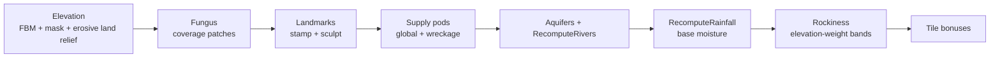

# Map System Architecture

```mermaid
graph TB
    subgraph "Map System"
        WorldMap[WorldMap]
        Tile[Tile]
        WorkedTileIndex[WorkedTileIndex<br/>one worker per tile, world-scoped]
        UnitPositionIndex[UnitPositionIndex<br/>unit occupancy]
        TerritoryMap[TerritoryMap<br/>faction ownership per tile]
        RegionCache[RegionCache<br/>land and water bodies,<br/>per appearance revision]
        RegionRules[AssignRegions<br/>RegionRules]
    end

    subgraph "Tile Identity"
        Position[Position<br/>x,y int]
    end

    subgraph "Tile Characteristics"
        Moisture_t[Moisture_t<br/>enum: Arid/Moist/Wet]
        Rockiness_t[Rockiness_t<br/>enum: Flat/Rolling/Rocky]
        Elevation[Elevation<br/>meters from map_rules.json]
        ElevationMutations[ElevationRules / ElevationMutations<br/>ApplyElevationDelta<br/>config/map_rules.json]
        LandSea[IsWater / IsLand<br/>below ocean_level_meters]
    end

    subgraph "Tile Occupants"
        River[River<br/>bool]
        TerrainFeature_t[TerrainFeature_t<br/>enum: Water/Ocean/OceanShelf/<br/>River/Aquifer<br/>names are terrain ids]
        OptionalTerrain[Optional terrain<br/>fungus, landmarks, bonuses, Monolith<br/>vector const ImprovementConfig_t*]
        Improvements[Improvements<br/>vector const ImprovementConfig_t*]
        Waivers[Coexistence waivers<br/>improvement id, occupant id]
    end

    subgraph "Effects (improvements, terrain, terraform_projects)"
        ImprovementRegistry[ImprovementRegistry<br/>every occupant, split by placement]
        TerraformProjectRegistry[TerraformProjectRegistry<br/>all Former projects<br/>places and/or on_complete_effects]
        CollectTileEffects[CollectTileEffects]
        ResolveTileYield[ResolveTileYield]
        StandingUnitEffects[Standing unit effects<br/>CollectAreaEffects of the unit's tile]
    end

    subgraph "Former Projects"
        TerraformProject[TerraformProject_t<br/>optional places<br/>+ on_complete_effects]
    end

    subgraph "Game Integration"
        Base[Base]
        Faction[Faction]
    end

    WorldMap --> Tile
    WorldMap --> WorkedTileIndex
    WorldMap --> UnitPositionIndex
    WorldMap --> TerritoryMap
    WorldMap --> RegionCache
    RegionCache --> RegionRules
    RegionRules --> LandSea
    Tile --> Position
    Tile --> Moisture_t
    Tile --> Rockiness_t
    Tile --> Elevation
    ElevationMutations --> Elevation
    Elevation --> LandSea
    Tile --> River
    Tile --> OptionalTerrain
    Tile --> Improvements
    Tile --> Waivers
    Tile --> CollectTileEffects
    TerraformProject --> ImprovementRegistry
    TerraformProject --> TerraformProjectRegistry
    CollectTileEffects --> ImprovementRegistry
    CollectTileEffects --> ResolveTileYield
    CollectTileEffects --> StandingUnitEffects
    TerritoryMap --> Base
    Base --> Tile
    Faction --> Base

    style Tile fill:#f9f,stroke:#333,stroke-width:4px
    style WorldMap fill:#fbf,stroke:#333,stroke-width:3px
    style Position fill:#bbf,stroke:#333,stroke-width:2px
    style WorkedTileIndex fill:#fbf,stroke:#333,stroke-width:3px
    style UnitPositionIndex fill:#fbf,stroke:#333,stroke-width:3px
    style TerritoryMap fill:#fbf,stroke:#333,stroke-width:3px
    style ImprovementRegistry fill:#ffd,stroke:#333,stroke-width:2px
    style CollectTileEffects fill:#bfb,stroke:#333,stroke-width:3px
```

## Coordinates and Distance Metrics

Tiles use SMAC coordinates: a tile sits at `(x, y)` with `x + y` even. `y` is the screen row
(0 at the north edge). `x` counts half-tile columns and wraps at `WorldMap::GetWidth()` (SMAC's
`axis_x`, always even). The map holds `width · height / 2` tiles. Indexing goes through
`MapUtils::TileIndex` (`y · width / 2 + wrapped_x / 2`), which throws on odd parity.

Gameplay geometry stays the square lattice. A lattice step `(p, q)` — `p` toward screen SE,
`q` toward screen SW — moves `(p − q, p + q)` in map coordinates. `LatticeDelta` and
`GetTileAtLatticeOffset` convert; neighbor tables keep today's lattice offsets and fetch
through that helper. Orthogonal neighbors are the tiles across the diamond's edges.

Spatial helpers live in `include/game/map/MapUtils.h`. Diamond footprint geometry shares one set
of lattice tables: `DiamondCorner_t` (W/N/E/S screen vertices), `k_CornerNeighbors` (the three
lattice steps that meet each corner), `k_EdgeNeighbors` (orthogonal neighbors across the four
diamond edges, used by `ForEachOrthogonalNeighbor`), and `k_RingNeighbors` (eight neighbors
clockwise from the N corner — the same indexing SMAC uses for road link cells). UI code
(`CoastOverlay`, `TileAutotile`, road links, relief) reads these instead of duplicating local
delta tables. `k_TableOffsets` is the binary's own ring table (`TableOffsetX/Y`, rings 0–8 in
its order, ring 1 equal to `k_RingNeighbors`); `ForEachTileInRings` walks rings 1 to R of it in
that order and stops when the callback returns false, for scans where the first base found
decides (the base value's neighbour scan).

Distances are on the lattice:

| Metric | Definition | Used for |
|--------|------------|----------|
| **Chebyshev** | `max(\|p\|, \|q\|)` = `(\|dx\| + \|dy\|) / 2` | Unit/base/Sensor **sight**, improvement **auras**, unit ThisTile auras — `ForEachTileInChebyshevRadius`. Ring picks for TerraformCluster / fungal bloom share `SelectTilesByRingChance` (per-distance `Rational_t` rolls) and `SelectTilesByRingQuota` (origin-first sample up to N) |
| **Tabletop diagonal** | `longer + shorter/2` on `\|p\|` and `\|q\|` | Energy **inefficiency** HQ distance, unit-scrap closest friendly base, `HeadquartersDistance` (`BaseRules`, the binary's `vulnerable`: probe costs and base value) — `TabletopDiagonalDistance` |
| **Euclidean disk** | `p² + q² ≤ R² + 1` | **Base workable area** (`R = 2`), **territory claim radius** (land `R = 7`, sea `R = 3`) — `InEuclideanRadius` / `ForEachTileInEuclideanRadius` |

Territory overlap between factions is broken by lattice crow-flies distance (`p² + q²`) to the claiming base, then lower `BaseId` — not by Chebyshev.

## Component Overview

### Tile
- **Purpose**: Represents a single tile on the game map with all its characteristics. `Tile` does not know the effects system. Yield and defense stay in `TileEffectsContext`. Characteristic changes and `AddImprovement` notify an optional `TileChangeListener` (`include/game/map/TileChangeListener.h`). The session binds `TileEffectsContext` as that listener, so coexistence is reassessed from the tile mutation itself. `RecomputeRivers`, `RecomputeClimate` and `ApplyElevationDelta` defer those notifications until the batch has a final elevation, surface, river, and moisture layout.
- **Responsibilities**:
  - Store terrain characteristics:
    - Moisture_t (enum: Arid, Moist, Wet)
    - Rockiness_t (enum: Flat, Rolling, Rocky)
    - Elevation (meters; min, max, ocean level, and shelf from `config/map_rules.json`)
  - Expose `IsWater()` / `IsLand()` — water is elevation below `ocean_level_meters` (same rule as landform rendering)
  - Track tile features (Rivers, Fungus, Improvements)
  - Expose `GetTerrainFeatures()` (terrain config pointers) and `GetImprovements()` (config pointers) so the effects system can resolve yield/defense from terrain and improvements through one mechanism — see Tile Improvement Effects below
  - Resolve intrinsic feature ids via `TerrainFeature_t`, whose enumerator names are the terrain-config ids (`magic_enum` maps between them). `HasFeature` switches over it exhaustively — `-Werror=switch` on `ac-core` means adding an enumerator breaks the build until every site decides about it — and `ValidateTerrainFeatures` throws at load if any enumerator lacks an entry whose `placement` is Terrain. Features stack: a sea tile carries `Water` *and* one of `Ocean`/`OceanShelf`
- **Composition**:
  - `Position`: SMAC `(x, y)` with `x + y` even
  - `Moisture_t`: Enum (Arid, Moist, Wet) - affects nutrient production via its `features` entry in `config/terrain.json`
  - `Rockiness_t`: Enum (Flat, Rolling, Rocky) - affects mineral production and (for Rocky) grants a defense bonus, via its `features` entry in `config/terrain.json`
  - `Elevation`: Integer in meters. The storage range is the world-gen preset's `min_elevation` and `max_elevation` (`config/worldGen/presets.json`), copied onto the world's elevation rules when the map is created. Those rules belong to the world: every tile is bound to them (`Tile::MapRules()`), and Former eligibility, the raise/lower energy quote and every play-time edit read them from the tile they act on. `GameDataContext::mapRules` keeps `map_rules.json` as parsed and only seeds world generation. Ocean level and ocean shelf stay in `config/map_rules.json` (`ocean_level_meters`, `ocean_shelf_meters`). `Tile` stores the meters and reads that bound config — the elevation-to-energy rule belongs to the effects layer (`amount_source: ElevationEnergy`, band width from `tile_yield_rules.json`), same as every other terrain-to-yield rule. Play-time edits (Former raise/lower and earthquakes) go through `ApplyElevationDelta` (`include/game/terraform/ElevationMutations.h`). One level is a uniform draw in `[level_min_meters, level_max_meters]` from the same file; shipping sets both to `1000` so a Former raise/lower matches SMAC's single altitude step (`docs/thinker/terranx-map.md` Terraforming / Work), the same width as `reference_level_meters` and the elevation-energy band. After the origin moves, Chebyshev neighbors of every tile that edit changed are pulled up or down until the gap is at most `max_adjacent_difference_meters`. `PlanElevationChange` (`ElevationRules`) runs that cascade on a working copy and returns the writes in order; the edit applies them, then reconciles surfaces and rivers. `EarthquakeDeltaMeters` sums an earthquake's rolls. A Former applies one level, clamped to the preset's elevation range (a roll past the bound lands on it rather than failing an order that has already been paid for); `FormerElevationChangeAllowed` refuses the order first when a max-sized step would leave a surface the Former cannot enter. `ApplyEarthquake` sums `levelCount` rolls and clamps to that same range; the `Earthquake` triggered effect is what fires it in play (a Tectonic Payload's `on_detonate_effects`, sized by the reactor's `earthquake_levels`). An `Explosion` lowers every tile in its Chebyshev disk by one of those level rolls first (`LowerTilesOneLevel`), then runs that same slope relaxation once from the whole changed set, so a neighbor is not pulled before its own roll. A Planet Buster's `on_detonate_effects` fires it, sized by the reactor's `explosion_radius` (1, 2, 3, 4). Radius 1 is 9 tiles. Former raise/lower energy quotes use `reference_level_meters` as the band width and `raise_lower_energy_per_band` / `raise_lower_energy_per_distance` as the quote coefficients. Map-wide terraform-spread sample rate is `spread_attempts_formula` on `map_rules` (`map_tiles`, `turn`), evaluated by `TerraformSpreadCalculator`. Neighbor score is each improvement's `spreads.score_formula` (`moisture`, `rockiness`); land altitude limit is `spreads.altitude_limit_meters`. Rocky and other blocked tiles come from the improvement's `excludes`. A play-time edit that crosses ocean level reconciles occupancy inside `ApplyElevationDelta` when the caller passes tile effects: `SurfaceFlipConsequences` (`SurfaceFlipRules`) names every improvement whose `domain` (`land` or `sea` on `ImprovementConfig_t`; omitted survives either surface) is not the surface the tile landed on, and the flip removes them. A base keeps its `Base` marker. A base that may occupy water (`RuleFlag may_occupy_water`, e.g. Pressure Dome) is untouched on a flip to water; any other base on new water is razed immediately (deviation "Flood razes undomed bases" — not the original `alt_set` pop-loss / emergency-dome path in `docs/thinker/terranx-map.md`, "Sea bases"). The player is told of their own lost bases and of those they can see. Land units on new water and sea units on new land die unless a base on the tile is still standing. A tile that does not flip is left alone.
  - `River`: Boolean flag for river presence (grants an energy bonus via its `terrain.json` entry)
  - `Fungus`: Optional terrain (`ImprovementIds::k_Fungus`) stored beside landmarks, resource bonuses, and Monolith, mirrored into `GetTerrainFeatures()`. Its `terrain.json` entry carries the move cost, nutrient, defense, and conceal effect. World generation, a fungal bloom (`ApplyFungalBloom`), a landmark `set_fungus` footprint, and the `PlantFungus` project add it. `RemoveFungus` removes it. Forest/kelp spread clears it on the target tile. The bloom's tile count comes from the reactor stat `fungal_bloom_tiles` (3, 5, 7, 9). The origin is included when it is not a base; the rest are a random sample of Chebyshev-1 neighbors that are not bases and do not already have fungus. Fungus `excludes` the Plant Fungus clear set (Farm, SoilEnricher, Mine, SolarCollector, Forest, KelpFarm, MiningPlatform, TidalHarness — `docs/thinker/terranx-map.md` "Terraforming"), so every arrival — `PlantFungus` or a bloom — sweeps them off the tile; anything else stays under the fungus. A bloom's required `destroys` list names what it razes on top of that on each newly fungused tile (shipping: `[]` for eco damage, `Road` and `MagTube` for the supply pod and fungal payload), guarded by `IsRemovableByOccupancy` so the Base survives. A Centauri Psi former may build those improvements onto fungus: the placement records a tile waiver, which keeps them until the fungus leaves. World gen still places Fungus on Ocean tiles; Fungus never excludes Ocean. `Base` is left to surface-flip reconciliation. How many native lifeforms appear on the new tiles is a uniform draw of `fungal_bloom_native_lifeforms_min` / `fungal_bloom_native_lifeforms_max` in `config/native_life.json`. Turn-over-turn fungus spread is a separate future enhancement.
  - `Improvements`: Vector of non-owning `const ImprovementConfig_t*` into `ImprovementRegistry`. Covers player-built improvements (Farm, Forest, Mine, roads, kelp, Base). Forest is an improvement. A finished improvement project displaces other improvements it cannot share the tile with and leaves terrain in place. Optional terrain (fungus, landmarks, bonuses, Monolith) is a separate list of pointers into the same registry, distinguished by `placement`.
  - Note: `Tile` holds **no** worked/worker-assignment state — that lives in `WorkedTileIndex` (below), so `Tile` needs no `mutable` members and a `const Tile&` really is immutable. Likewise `Tile` holds **no** political ownership — that lives in `TerritoryMap`.

### WorkedTileIndex (worked-tile occupancy)
- **Purpose**: The single owner of the "which tiles are currently worked" state and the one enforcement point of the **one-worker-per-tile rule across all bases and factions** — two nearby bases, friendly or enemy, may never work the same tile. Owned by `WorldMap`, next to `UnitPositionIndex`.
- **Model**: An assignment is a move-only RAII `WorkedTileClaim` minted exclusively by `WorkedTileIndex::TryClaim(tile, bUserAssigned, onDisplaced)`, which atomically checks-and-claims (returns an empty claim if the tile is already worked by anyone). The claim is held by the working `Pop` and releases the tile automatically when the pop dies, converts to a non-worker type, or is reassigned — the invariant is structural, not a convention. The player-assignment flag lives on the claim, so it cannot outlive the assignment. Worker claims carry a `DisplacedWorkerHandler` so a base founding can displace them (see Base tiles below); base-tile claims carry none and can never be displaced.
- **Components**:
  - `WorkedTileIndex` / `WorkedTileClaim` (`include/game/map/WorkedTileIndex.h`)
  - `WorldMap::GetWorkedTiles()` — accessor used by every base's `WorkerAssignmentManager`
  - `WorkedTileIndex::GetRevision()` — monotonic change counter (see `lib/Revision.h`) bumped on every claim/release, for derived-state caches over worked-tile resources
- **Base tiles**: the base center tile is worked for free (no pop), and `BaseManager` claims it in the index for the base's entire life (`m_centerTileClaim`, via `WorkedTileIndex::ClaimDisplacing`) — a base can never work another base's own tile. Founding a base on a tile currently worked by a neighboring base's pop **displaces** that worker: its claim is emptied and its `DisplacedWorkerHandler` (registered by its `WorkerAssignmentManager` at claim time) re-runs auto-assignment, moving the worker to the best free tile in its own base's radius. The handler fires only after the founding base's claim is registered, so the displaced worker can never be reassigned back onto the founding tile. Founding on another base's *own* tile throws — a founding flow must never allow it.
- **Future seams**: revoking assignments when a tile turns hostile (e.g. enemy unit occupies it) and reconciling after save-game load both have exactly one place to live.

### UnitPositionIndex (unit occupancy)
- **Purpose**: The single owner of unit-position state, mirroring `WorkedTileIndex`'s ownership model. Owned by `WorldMap` (`WorldMap::GetUnitPositions()`; `GetUnitsOnTile()` remains as a convenience forward).
- **Model**: A `Unit` registers itself in its constructor and unregisters in its destructor (RAII — a destroyed unit can never linger in the index), and every move goes through `UnitPositionIndex::MoveUnit`, which updates the per-tile occupancy and the unit's own tile pointer together. Only the index writes either side, so `Unit::GetTile()` and `GetUnitsOnTile()` structurally cannot desync; `Unit` has no public position setter. Each occupied tile keeps two vectors — occupants and cargo — maintained on move / embark / disembark; accessors return const refs (no per-call filter). `GetAllUnitsOnTile` concatenates into a fresh vector for garrison / UI.
- **Stacking**: any number of units per tile (SMAC). Cargo rides the carrier's tile and is tracked in a separate list from occupants; that split is bookkeeping for ZOC / load-site / garrison queries, not a capacity limit.

### TerritoryMap (faction ownership)
- **Purpose**: World-scoped mutually exclusive ownership of tiles — “whose territory is this?” Owned by `WorldMap` (`WorldMap::GetTerritory()`), same placement pattern as `WorkedTileIndex` / `UnitPositionIndex`. `Tile` stays free of political state.
- **Components**:
  - `TerritoryMap` (`include/game/map/TerritoryMap.h`) — dense `FactionId` grid; `k_NoFactionOwner` (-1) for unclaimed
  - `ClaimTerritory` (`include/game/map/TerritoryRules.h`) — the claim rules below; returns the owner of every tile
  - `GameState::RebuildTerritory()` — collects every base of every faction and calls `TerritoryMap::Rebuild`, which stores `ClaimTerritory`'s answer
  - Wired via `Faction::OnBaseListChanged` when a faction is added to `GameState`, so founding a base rebuilds ownership. Rebuild whenever a base is **created, destroyed, or changes hands** — population size is not an input.
- **Claim rules**:
  - **Land base** (`Tile::IsLand()`): Euclidean disk radius 7 (`dx² + dy² ≤ 50`), only land tiles reachable by orthogonal BFS through contiguous land inside that disk
  - **Sea base** (`Tile::IsWater()`): Euclidean disk radius 3 (`dx² + dy² ≤ 10`), only contiguous sea the same way
  - Land bases never claim sea; sea bases never claim land
- **Contested tiles**: among bases that can claim a tile, owner is the nearest base by Euclidean distance (`dx² + dy²`); ties go to the **lower `BaseId`**
- **Rebuild preconditions**: `Rebuild` throws unless the grid has been `Reset` and its dimensions equal the world's, and `ClaimTerritory` throws if a base sits outside the grid, so no caller reads `k_NoFactionOwner` as though ownership were current and a desynced `Reset` cannot index out of bounds.
- **Consumers**: territory-owned improvements (`owned_by_territory: true`, e.g. Sensor) stamp `ActiveEffect_t::ownerFaction` from `GetOwner`. Friendly reach is authored with `SubjectIsOwner` on defense/Detect; Sensor fog vision still uses the `visionRadius` + `ownedByTerritory` rebuild gate in `FactionVisibleMap` (see effects and visibility docs)

### Regions (land and water bodies)
- **Purpose**: SMAC's tile regions (`docs/thinker/terranx-map.md`, "Regions"): which land mass or body of water a tile belongs to. The base value's same-region tests and per-region base counts read them.
- **Rule**: `AssignRegions` (`include/game/map/RegionRules.h`) gives one opaque id per tile. Off the first and last rows, same-surface (`IsWater`) tiles that touch, among the 8 ring neighbours, share an id. Each pole (the first row, and the last) takes one id per surface, so the north and south poles never share one (deviation "Poles are separate regions"), and the flood never passes through those rows, so two bodies that meet only there stay apart. Land and water never share an id. There is no cap on the number of bodies (deviation "Region cap empties the rest of the map").
- **Cache**: `RegionCache` (`include/game/map/RegionCache.h`), owned by `WorldMap` (`GetRegions()`), memoises `AssignRegions` against `GetAppearanceRevision()`. Every land/water change goes through `Tile::SetElevation`, which bumps that revision, so `RegionOf` is never stale; SMAC likewise reruns its scan after every topology change (`world_climate`). `Validate_` also builds a per-region tile-count histogram for `TileCountInRegion` (Planet fauna empty-ocean boat sites).

### World Generation pipeline

`WorldGenerator::Generate` runs a fixed stage order. It is load-bearing, not incidental:

- **Ocean depth**: water takes how far below the waterline its noise sits (0–1), raised to the preset's `ocean_depth_exponent`, as a share of `min_elevation`. Below 1 the sea deepens quickly off the coast, so the shelf (above `ocean_shelf_meters`) stays a coastal band and the open sea renders as SMAC's deep blue; the shipping presets use 0.6.
- **Erosive forces on land only**: after the `oceanCoverage` waterline is fixed, `ErosiveForces_t` (Low / Average / High) selects a row from `decoration.json` `erosive` and scales land height by `land_relief`, then mixes small-scale FBM by `roughness`. Coastlines and ocean fraction stay put. Shipping coeffs target SMAC-like hilliness, not a bit-identical `world_erosion` port.
- **Landmarks before rivers**: landmark placement is the last stage that changes elevation (the Mount Planet sculpt raises peaks and roughens slopes) or stamps a `terminates_river` feature (BoreholeCluster). River tracing walks strictly downhill and stops at terminators, so it has to see the finished terrain. Run the other way round, rivers flowed down pre-sculpt slopes and straight through boreholes.
- **Supply pods after landmarks, before bonuses**: `Supply_Pod` (`config/terrain.json`, `frequency: 0`) is placed by `PlaceGlobalSupplyPods` / `PlaceWreckageSupplyPods` from each `event_groups` entry in `config/supply_pods.json` (`placement.domain` filters eligible tiles). Placement stamps the event group's `id` into `SupplyPodIndex`; open resolves the table from that stamp, not the tile's current surface. Earlier landmarks win contested tiles; pods then beat later bonuses / random Monoliths via mutual `excludes`. `GameRulesConfig_t::noUnityScattering` skips global and wreckage scatter. Start-ring pods (`PlaceStartSupplyPods`) land when factions found, after world gen.
- **Bonuses last**: landmarks exclude `@resource_bonus`, so bonuses must be placed against a tile set that already has its landmarks (and pods).
- **Rain after rivers**: `RecomputeRainfall` ports SMAC's `world_rainfall`, which reads rivers and landmarks, so it runs after both, as in `world_climate`. It writes base moisture; on a new world each tile's moisture is then its base.
- **Fungus before landmarks**: `PlaceFungus` stamps fungus on a `coverage` fraction of eligible tiles (scaled by native life `fungus_coverage_multiplier`), in patches sized by `cluster_scale_tiles` and hollowed by `fill`. Pole rows may also roll `pole_row_chance`. Land and sea alike; deep ocean keeps the fungus dormant via `suppress_terrain`. It reads neither rivers, moisture, nor rockiness, and `TheRuins` sets fungus on its own footprint. Vanilla SMAC used fractal contour bands instead — see [smac-world-generation.md](../thinker/smac-world-generation.md).
- **Rockiness after climate**: `PlaceRockiness` draws Flat / Rolling / Rocky from `decoration.json` elevation-weight bands (and a separate pole-row weight triple). It runs after landmarks and rainfall so sculpted peaks see their final elevation. Vanilla SMAC uses `minerals_at` instead; see [smac-world-generation.md](../thinker/smac-world-generation.md). `ErosiveForces_t` does not drive rockiness.
- **Aquifers**: `GenerateAquifers_` covers `aquifers.fraction` of the tiles the Aquifer entry can occupy. The shipping entry's `domain` is land, so water tiles stay out of that pool.
- **Rivers are a fixed point**: re-running `RecomputeRivers` on a finished world changes nothing. `WorldGenPipelineTests` pins this as the invariant of a correct order.
- **One seed**: the caller (composition root) resolves one session seed and passes it in; every stage that draws randomness uses `m_rng` (including rockiness weight draws). `MapGenerationConfig_t::seed` is the *request* (`0` = pick one), never re-read during generation — otherwise the seed reported for a session could not reproduce it.

### Climate in play

SMAC never updates rainfall locally: every change that can move it re-runs the whole-map
`world_climate` ([terranx-map.md](../thinker/terranx-map.md), "Climate").
`TileEffectsContext::RecomputeClimate` is that step: `RecomputeRivers`, then `RecomputeRainfall`
into base moisture (including lowland forest humidity, which world gen never sees), then
`RecomputeMoisture` on each tile whose base changed. Elevation writes, aquifer toggles and
`terminates_river` occupants call it. Planting forest does not, matching the binary; the next
re-run picks it up. The rainfall setting it reads is `WorldMap::GetRainfall`, fixed at
generation, since the session's settings can change mid-game.

`RecomputeClimate` returns each base-moisture change with its value before the re-run
(`MoistureChange_t`), in tile-index order, which is `world_rainfall`'s row scan.
`ApplyElevationDelta` passes them on, and a Former's raise or lower land reads them for
`RainfallGrievant`, which `ApplyRainfallGrievance` (`TerraformMutations`) writes
([diplomacy-system.md](diplomacy-system.md), "Where the rules live").

Condensers stay a local `moisture_tier` overlay on top of base moisture (see
[deviations](../../config/deviations/README.md), "Condenser moisture is a local overlay").

### Occupant art (`OccupantArt_t`)

Map rendering reads each terrain or improvement entry's optional JSON **`art`** block, parsed into
`OccupantArt_t` on `ImprovementConfig_t` (`include/game/display/OccupantArt.h`). Gameplay still stores
occupants as config pointers on the tile; art is presentation only.

- **`layer`**: `ArtLayer_t` — `landform`, `moisture`, `rockiness`, `landmark`, `vegetation`,
  `river`, `road`, or `object`. Required when `art` is present.
- **Sprite source** (exactly one): `variants` (ordered paths per surface; one picked per tile via
  `PickSpritePath`), `tiles` (`OccupantTileSet_t`: `edges`, `blob`, or `links` layout with
  `{mask}` paths expanded at parse), or `yield_rows` on `object` layers only.
- **`ground`**: farm-style art that replaces the moisture layer, keyed by moisture name.
- **`hides`**: config ids whose `object` art is skipped while this occupant is present.
- **`overhang`**: object-only; fraction of tile height above the footprint (TER1 objects ≈ 0.24).
- **`depth_shade`**: landform on water; range for depth-based palette shading (`WaterShading`).
- **`fill_color`**: overrides elevation fill and minimap colour; last occupant in walk order with
  one wins.

Entries with nothing to draw (`Flat`, `Water`, `Aquifer`, `Base`, …) omit `art`. Sheet layouts
and SMAC selection rules: [smac-terrain-textures.md](../thinker/smac-terrain-textures.md),
[terrain-autotiles.md](../plans/terrain-autotiles.md).

**Elevation is not art.** Continuous meters stay on `Tile`. Relief and slope shading come from
`MapViewport` + `TileRelief`; [`TileRenderer`](../../include/ui/TileRenderer.h) draws palette-index
terrain through `DrawTileSprite` ([smac-palette-lighting.md](../thinker/smac-palette-lighting.md)),
coast overlays ([smac-coastline-rainfall.md](../thinker/smac-coastline-rainfall.md)), and depth
shading on water (`WaterShading.h`). Populate PNGs with `extract_terrain.py`.

[`MapRenderer`](../../include/ui/MapRenderer.h) is the one path every map display draws through;
its [`TileRenderer`](../../include/ui/TileRenderer.h) walks `MapAppearance::OccupantsOf` and dispatches
by `ArtLayer_t`: landform → moisture (or an occupant's `ground`) → rockiness → landmark →
vegetation, then coast, river, and link networks, then fog haze; `RenderObjects` draws `object`
art for terrain occupants then improvements, honouring `hides`. Neighbor rules for tile sets and
roads stay in the renderer, keyed by layer (moisture: at least as wet; landform on water:
deep/shelf swap; road: `links` layout over `k_RingNeighbors`; other sets: same occupant on the
neighbor).

### FactionTileMemory

`FactionTileMemory` (`include/game/visibility/FactionTileMemory.h`) lives on `Faction` beside
`FactionVisibleMap` and `FactionExploredMap`. For each tile it stores copies of the terrain and
improvement occupant lists from the last `Record(const Tile&)`. `Occupants(const Tile&)` returns
those spans as `TileOccupants_t`; `GetRevision()` bumps when any tile is recorded.

Recording runs at the end of `FactionVisibleMap::RebuildFromSources` for every visible tile, in
`VisibilityMutations` when the explored map is fully marked, and in `CopyExploredMap` (map trade
and probe steal-tech). UI builds `MapAppearance::Fogged(world, faction)` or `MapAppearance::Clear(world,
faction)` so tiles in sight use live occupants and explored tiles out of sight use memory; a null
faction means live everywhere. `CoverOf` gives each tile its cover: shroud where the faction never
explored, fog on remembered tiles in a `Fogged` appearance, else none. Coast, water depth, relief,
and yield lookups for object rows still read the live tile.

### Tile Improvement Effects
- **Purpose**: Unifies terrain classification, natural features, player-built improvements, tile specials (formerly "bonus"/"landmark"), and a founded base behind one config type (`ImprovementConfig_t`), since all of them answer the same two questions: what effects do they grant, and what do they exclude. Terrain is resolved by name into cached config pointers (`Tile::GetTerrainFeatures()`); improvements are held directly as `const ImprovementConfig_t*` on the tile (`Tile::GetImprovements()`). Full details (scope semantics, the `ThisTile` resolution pattern, the seeded-energy pattern) are in `docs/architecture/effects-system.md`'s "Tile Improvement Effects" section — this is the map-system-facing summary.
- **Components**:
  - `ImprovementConfig_t` / `ImprovementConfigParser` / `ImprovementRegistry` (`include/game/map/ImprovementConfigParser.h`, `ImprovementRegistry.h`) — id, name, `placement`, `excludes` (incompatible occupant ids), optional `domain` (`land` / `sea`; omit means either surface — Former start, placement, and surface-flip clearance all read it), per-effect `radius`, optional `owned_by_territory`, an `effects` array, optional `std::optional<OccupantArt_t> art` (the JSON `art` block — see Occupant art above). Former turns / energy / techs live on terraform projects, not on occupants. `IsBuildable` is true when a project lists this id in `places`. Coexistence is **not** in this header: `OccupantCoexistence.h` owns the predicate, leaving the parser to parse.
  - `TileEffectsContext::CollectAreaEffects` / `ResolveTileYield` — gather own-tile and neighbor aura effects (Chebyshev scan). A live unit's effects include the Unit-domain stat modifiers of `CollectAreaEffects` on its tile, which is how tile defense reaches the defender.
  - `OccupantsBlockPlacement(tile, candidate, leavingIds, overrides)` (`include/game/map/ImprovementConfigParser.h`) — the one coexistence predicate. `CanBuildImprovement` is the same question asked the other way round for call sites that want permission rather than a blocker.
- **Configuration**: `config/improvements.json` holds improvement occupants (effects, domain, excludes, art, spreads). `config/terrain.json` holds terrain occupants under `features` only. `config/terraform_projects.json` holds **all** Former projects — builds (`places: "Farm"`) and terrain mutations (`PlantFungus`, `RaiseLand`, …). A project is `turns_required` / `energy_cost` / `required_techs`, optional `places`, optional `blocked_by` (start refused while those occupants are present — PlantFungus / RemoveFungus list `Ocean` for LOWTIDAL), and/or `on_complete_effects` (same triggered-effect machinery as a Tectonic Payload). Parser requires `places` and/or a non-empty effects list. Effect conditions still refuse a no-op start when there is nothing to place. `energy_cost` is a non-negative int or a `ConfigReader::Formula` — RaiseLand / LowerLand use `terraform_cost.lua` (vars `elev_band`, `fungus`, `at_sea`, `sea_cost_scale`, `nearest_base_distance`, `own_pop`, `enemy_pop`, `own_range`, `enemy_range`; `sea_cost_scale` is resolved `SeaRaiseLowerCostScale`). `former_domain: Any` and optional `domain` restrict who/where. Occupants load into **one** `ImprovementRegistry`; projects into `TerraformProjectRegistry`. `LoadMapOccupants` reads all three files, marks place-targets for `@buildable`, validates `places` / `blocked_by`, and assigns both registries. Project id may equal its `places` id (hotkey `"Farm"`). `Base` has no place-project, so it is not `@buildable`.
- **Combat bonus example**: `Rocky` 1.5, `Fungus` 1.5 (2 for a native defender) and `Forest`
  1.5 (against a land attacker) share `defense` slot `terrain`, declared `"combine": "Largest"` in `combat.json`, so only the best
  applies and psi fights never read them. SMAC's exclusions are `MaxClamp` 1 in that slot from
  the occupant that causes them: `Base`, `Water`, `Fungus` against a native attacker, and
  `combat.json` for an air defender. Fungus's native 2 keeps a `Rocky` absent condition, since
  SMAC rates rocky ground before fungus. `Bunker` adds 50% to `defense` in slot
  `fortification`, which only conventional fights read, and not against an air attacker.
  Founding a base removes a Bunker, so the two never share a tile in play (see Improvement
  coexistence). `Base` gives that slot its `Fallback` 1.25, which Perimeter, Naval Yard,
  Aerospace or Tachyon displace, and grants `psi_defense` ×1.25 for psi fights. Each
  multiplies the defender's rating, as SMAC's steps do.
  - **Aura example**: `Sensor` declares `radius: 2` on its defense (and vision) effect entries and projects a `defense` ×1.25 (in slot `sensor`, declared `"combine": "Largest"`, so overlapping Sensors give one bonus) to every tile within **Chebyshev** distance 2 — `AppendAreaEffectsFromNeighbors_` uses `ForEachTileInChebyshevRadius`. Prefer per-effect `"radius"` over the improvement-level default. `owned_by_territory: true` stamps `ownerFaction` from the tile's territory owner; Sensor defense applies to a non-native defender whose faction owns that territory or when it is unowned (`AnyOf`[`SubjectIsOwner`, `EffectIsUnowned`]), Detect authors `SubjectIsOwner`, and fog vision still keys on the same ownership stamp via `FactionVisibleMap`. `ResolveTileYield` / own-tile `CollectTileEffects` only look at a tile's own terrain features and improvements unless scanning neighbors for auras.

### Tile Bonuses (special resources)
- **Purpose**: Special resource bonuses on individual tiles (e.g. a nutrient-rich or mineral deposit).
- **Modeling**: A tile bonus is a `config/terrain.json` `features` entry like any other terrain occupant. It grants resources via `ThisTile` `StatModifier` effects, sets `frequency` > 0 for world-gen placement weighting, and may carry an `art` block / `description`. `PlaceTileBonuses` picks from registry entries whose `placement` is Terrain and whose `frequency` > 0, and adds the winner with `AddTerrainFeature`. Coexistence is the same `excludes` list.
- **Frequency System**: Higher `frequency` = more common during map generation; `PlaceTileBonuses` weights its pick by it and stops at `decoration.json`'s `tile_bonuses.fraction` of the tiles a bonus entry can occupy.

### Improvement coexistence (`CanBuildImprovement`)
- **One predicate, both directions**: a candidate may be placed unless the candidate's own `excludes` name a feature already on the tile, **or** a feature already on the tile names the candidate, **or** a `requires` id is missing. Modders declare the relationship once, on whichever side reads better — `MountPlanet` excluding `@resource_bonus` is enough to keep `Nutrients` off it, without `Nutrients` naming every landmark. Which improvement survives fungus depends on which arrived second, as in the binary: Fungus `excludes` the Plant Fungus clear set, so fungus arriving destroys them, while a Centauri Psi former building one onto fungus holds a `CoexistenceOverride` that records a tile waiver. Which projects may start on fungus is config rather than C++: every place-project declares `blocked_by: ["Fungus"]` and `PlantFungus` declares `blocked_by: ["Ocean"]`, then a `TerraformBlockOverride` effect lifts named entries for the acting former — Centauri Empathy lifts `Fungus` for `Road` and `MagTube`, Centauri Psi lifts it for any project. An override matches an entry by id, or by a tag the blocking occupant carries; `Ocean` is named by none, so it stays unliftable. `@buildable` is the implicit tag for every occupant id some project `places` (derived; declaring it by hand is rejected). `Base` has no place-project, so `@buildable` does not name it; the Base excludes `Fungus` itself, with `Rocky`, `Monolith` and `Bunker`. `SoilEnricher` `requires` `Farm` and `MagTube` `requires` `Road` so the upgrade leaves when its base improvement is removed. Founding asks the same placement question a project does (`ImprovementApplies` for the Base occupant, in `CanFoundBaseAt`): excluded terrain refuses, and an excluded improvement is displaced — the sweep removes it when the base arrives, after the player confirms (`ImprovementsDestroyedByFounding`). The Base declares no `domain`; founding rules decide which surface a base may stand on.
- **A change drops improvements that can no longer stay**: `Tile` notifies its listener when an improvement or optional terrain occupant is added, or elevation, rockiness, moisture, or rivers change. `OnTileChanged` sweeps twice: once holding the new arrival exempt so it can clear what it displaces, then again with nothing exempt so the arrival is judged against what is left. The Base is never swept or displaced (`IsRemovableByOccupancy`): it leaves only with its base, so a Base that excludes a project's improvement refuses that project. An improvement project cannot start while remaining terrain still excludes it. When it finishes, it removes conflicting improvements and adds the improvement. It does not change rockiness, moisture, river, aquifer, or fungus — a project's `on_complete_effects` do that work. LOWTIDAL is project `blocked_by: ["Ocean"]` (and sea improvs' Ocean excludes), not a hard-coded deep-ocean check. World gen passes no unit, so it uses the stock excludes and refuses rather than replacing terrain.
- **Waivers are tile state, not unit state**: a `ThisUnit` or `FactionUnits` `CoexistenceOverride` names one or two occupant ids (unordered; one id wild-cards the other side) and can allow a pair the stock `excludes` deny. When such a project completes, `ApplyTerraformResult` records the pairs it actually needed on the tile via `Tile::AddCoexistenceWaiver`, and `OccupantsBlockPlacement` folds the tile's waivers in alongside any overrides the caller passed. That is what makes the permission durable: later sweeps carry no overrides, so without the record the improvement would be evicted by the very feature it was licensed to share. A waiver is dropped with the improvement it belongs to (`RemoveImprovement`) **and** with the occupant it names (any terrain change, via `RefreshTerrainFeatures_`), so a licence never outlives the pair it was granted for — level a waived Farm's Rocky away and the waiver goes too, so Rocky returning evicts the Farm. Losing the component or tech that earned it changes nothing.
- Every placement path shares the predicate: world-gen bonuses, landmark stamping, improvement projects, and forest spread. The incumbent side reads a tile's terrain configs, which exist only after `Tile::BindOccupants` — so `WorldGenerator` binds the whole grid before its first stage. Forest/kelp spread may target a fungus neighbour (cleared on apply), skips `MountPlanet` / `GreatDunes`, and uses Forest `altitude_limit_meters` (2000) with arid refused at/above that limit.

### WorldMap
- **Purpose**: Container owning the SMAC-coordinate tile array plus world-scoped indexes (`WorkedTileIndex`, `UnitPositionIndex`, `TerritoryMap`).
- **Responsibilities**:
  - Store `width · height / 2` tiles in row-major order (north row first); `GetWidth()` is the x wrap period
  - `GetTile(x, y)` wraps X, returns null for Y out of bounds, throws on odd parity
  - Expose worked-tile, unit-position, and territory indexes (sized through `TileIndex`)
- **Invariants**:
  - Both dimensions are positive and width is even — the constructor throws otherwise.
  - Tile addresses are stable for the map's lifetime: units, bases, `UnitPositionIndex` and `WorkedTileIndex` all hold raw `Tile*`. `GetTiles()` therefore returns `std::span<const std::unique_ptr<Tile>>` — tiles stay mutable through the pointer, but the ownership vector cannot be cleared or reseated from outside.
- **Note**: Older docs called this `TileMap`; the live type is `WorldMap`.

## Integration with Game Systems

### Base System
- Bases work tiles to extract resources
- `BaseManager::GetX()` / `GetY()` track map position via the base's tile
- `WorkerAssignmentManager::GetWorkableTiles()` / `ForEachWorkableTile` (`BaseRules`) yield the **Euclidean radius-2** lattice disk (`p² + q² ≤ 5`) around the base — the classic SMAC 5×5 with corners cut — excluding the base's own tile (20 surrounding tiles). Enemy-unit blocking is a TODO pending combat.
- `WorkerAssignmentManager::ComputeWorkedResources()` aggregates resources from worked tiles
- `TileResources_t` struct used to pass resource totals
- Each worker assigned to a tile contributes that tile's resource production
- Assignment claims the tile in `WorkedTileIndex` (see above); the atomic `TryClaim` prevents double-assignment, including by another faction's base
- `BaseManager`'s constructor adds `"Base"` to its tile's improvements, so the base's own garrison defense bonus flows through the same `ImprovementRegistry` lookup as Bunker/Rocky/Fungus (see Tile Improvement Effects above). This is also why `BaseManager` holds a non-const `Tile&` rather than `const Tile&`.

### Faction Economy
- Faction's economy aggregates resources from all bases
- Energy from tiles feeds into faction energy budget
- Minerals from tiles fund production
- Nutrients drive population growth

## Design Rationale

### Separation of Concerns
- Tile stores only its own state
- Bases manage which tiles are worked
- `TerritoryMap` owns political ownership; `WorkedTileIndex` owns worker exclusivity
- Economy aggregates at faction level
- Follows Single Responsibility Principle

### Extensibility
- Improvements system allows extending tile functionality without modifying Tile class
- Improvements are an open set in `config/improvements.json`; a matching entry in `config/terraform_projects.json` with `places` makes one former-buildable, and a `spreads` object (`score_formula`, optional `altitude_limit_meters`) takes part in WorldEvents terraform growth. Rocky and other blocked tiles come from the improvement's `excludes`. Terrain occupants (`config/terrain.json`) and Former projects (`config/terraform_projects.json`) are open sets. A project is defined by `places` and/or triggered effects (`SetTerrainFeature`, `StepRockiness`, `ElevationChange`), so a new one is a config entry, not a new C++ enumerator.
- Resource and defense calculation are entirely effects-driven via `config/improvements.json` and `config/terrain.json`. Adding a new improvement, or changing what Rocky or Fungus grant, never touches `Tile` or its consumers' C++

### Moddability
- Terrain characteristics use semantically meaningful types (enums for moisture/rockiness, actual meters for elevation) for world-gen and rendering, but resolve through the same string-id effects lookup as improvements for yield/defense purposes
- Improvements are referenced by string ID in config for easy content addition; on a tile they're held as resolved `ImprovementConfig_t` pointers
- Resource and defense formulas live in `config/improvements.json` and `config/terrain.json`, not in code

## Future Enhancements

- **Climate side effects**: SMAC's `world_climate` also rebuilds temperature, shorelines and continents, and a rainfall change near a base drives the TERRAMINE / TERRAYOURS popup. `RecomputeClimate` covers rivers and rainfall only.
- **Seed persistence**: `Engine` resolves one session seed and the whole map derives from it, but nothing writes it down — replaying a finished game waits on a save system.
- **Territory UI**: WorldDisplay draws faction base sprites and name labels; border/ownership tint is not implemented yet
