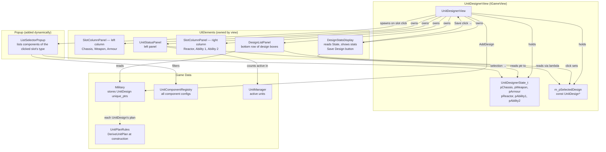

# Unit Designer System

The Unit Designer lets the player compose a `UnitDesign` from components, review its combined stats, save designs to `Military`, and browse saved designs.

`UnitDesign` shares the abstract `IDesign` base with `NativeDesign` (see
[native-units-system.md](native-units-system.md)). The designer UI only lists `UnitDesign`.
Both kinds are `IConstructable` and can be queued at a base; natives are registered on the
faction from `config/native_units.json`.

## Layout

```
┌──────────────┬──────────────────────────┬──────────────┬──────────────┐
│              │   Left column (25%)      │  Center (50%)│ Right (25%)  │
│ Unit Status  ├──────────────────────────┤              ├──────────────┤
│ Panel (15%)  │  Chassis slot            │  Design Stats│  Reactor slot│
│              ├──────────────────────────┤  (combined   ├──────────────┤
│ - Design name│  Weapon slot             │   stats +    │  Ability 1   │
│ - Active cnt ├──────────────────────────┤   Save btn)  ├──────────────┤
│ - In prod    │  Armour slot             │              │  Ability 2   │
│              ├──────────────────────────┴──────────────┴──────────────┤
│              │  Bottom: all saved designs as boxes (DesignListPanel)   │
└──────────────┴────────────────────────────────────────────────────────┘
```

## Component Diagram



## Data Flow: Selecting a Component

1. Player clicks a slot in a `SlotColumnPanel` → triggers that slot's `onClicked` lambda
2. `UnitDesignerView::ShowComponentSelector_()` filters `UnitComponentRegistry` by type **and by
   `required_tech`** (`IsUnlocked_`). The same gate is applied to the slots themselves when the
   columns are built, so a slot behind an undiscovered tech is not laid out at all — config
   already locks both, and offering either let a player assemble and save a design that should
   not exist. A component with `requires_chassis` is listed only when the selected chassis id is
   in that list. Selecting a chassis clears a drafted component the new chassis cannot carry.
   `UnitDesign` throws if a saved design still violates the list. A weapon that delivers its
   payload by detonating rather than attacking (Tectonic Payload, Fungal Payload) carries no
   gameplay `effects` at all — its behaviour is the `on_detonate_effects` list, run by
   `ApplyDetonation`
3. A `ListSelectorPopup` is pushed onto `m_elements`, titled from the slot's `display_name` and
   styled from `Style().componentSelectorPopup` — its own instance of the shared style type
4. Player picks an entry → popup calls the lambda that sets the matching field in `UnitDesignerState_t`
5. Popup closes (`m_bShouldClose = true`), removed next frame
6. `DesignStatsDisplay` reads the updated state on the next render and shows new stats

## Data Flow: Saving a Design

1. When all 4 mandatory components are selected `DesignStatsDisplay` shows "Save Design"
2. Player clicks it → `onSaveDesign` callback fires → `UnitDesignerView::HandleSaveDesign_()`
3. A `std::unique_ptr<UnitDesign>` is constructed and passed to `Military::AddDesign()`
4. `DesignListPanel` reads `Military::GetDesigns()` each frame — new design appears immediately

## upgrade_class

Optional `upgrade_class` on any component — not the same as `plan` (`UnitPlan_t`, the SMAC
AI/role). Stock tags: each chassis a unique value; combat guns `offense`; `Psi_Attack`
`psi`; each special its role (`colony`, `terraform`, `probe`, …); `Bombard` `artillery`.
A design's upgrade_class set is the union of those tags; field upgrades require identical
sets (`UpgradeRules`), not matching `plan`.

## Unit Plan

Every design has SMAC's `UNIT.plan`, the AI role (`IDesign::GetPlan`, `UnitPlan_t`). A
`UnitDesign` derives it once in its constructor with `UnitPlanRules::DeriveUnitPlan`, a port of
`make_proto` (`docs/thinker/terranx-map.md`, "Unit plan"):

- A weapon component's optional `plan` (colony, terraform, supply, probe, naval_transport, the
  missile payloads) wins outright.
- Otherwise sea designs are `naval_superiority`, air designs `offense` (or `air_superiority`
  with an ability whose `plan` says so), and orbital (missile) designs `offense`.
- Land designs compare the weapon's `attack` Add, the armour's `defense` Add and the chassis
  `movement` Add, unscaled: armour above 1 is `defense`, a weapon at least as strong as that
  armour is `combat`, a fast design that out-guns its armour is `offense`. An ability `plan` of
  `offense` overrides any land design; a gun with no armour is `recon` when fast, or `defense`
  with an ability `plan` of `defense`.

Natives state their plan in `native_units.json`, as `alpha.txt`'s predefined units do. Probe costs
read plans through the `DesignPlan` effect condition (see `effects-system.md`).

## TODOs

- `UnitStatusPanel` "In Prod" counter requires `UnitDesign` integration with `BaseManager` production queue
- `UnitManager` is not yet wired into `Faction`; pass it once available to show accurate active counts
- Design naming: currently auto-generated from component names; add a text-entry flow to let the player name designs
