# Unit Movement System

Movement is split into components with one-way dependencies: rule resolution
(`MoveCostRules`), legality checks (`StepEvaluator` + the free functions in
`MovementRules.h` and `TransportRules.h`), planning (`Pathfinder`), and execution
(`UnitMoveExecutor` for steps and airdrops, `UnitOrderExecutor` for the order loop,
founding and terraforming, `UnitAttackExecutor` for attacks and bombards). All entry-cost and
fungus rules live in `MoveCostRules`; the executors and pathfinder only consume its output and
never inspect tile features themselves.

```mermaid
graph TD
    subgraph Rules
        MovementRules[MovementRules<br/>terrain / hold / CanEnterTile,<br/>ZOC, friendly occupant / base]
        TransportRules[TransportRules<br/>carries / capacity / harbor load,<br/>boarding, CanUnloadTo]
        MoveCostRules[MoveCostRules<br/>tile costs + fungus entry rules]
        EntryTerms[EntryTerms_t<br/>costFragments,<br/>bRequiresFullCost, bEndsTurn]
        MoveCostRules -->|resolves per unit + tile| EntryTerms
        MovementRules --> TransportRules
        AttackRules[AttackRules<br/>CanAttackTile / targeting /<br/>FindAttackableHostileOnTile]
        InterceptRules[InterceptRules<br/>sources, readiness, charge base]
        InterceptMutations[InterceptMutations<br/>deploy, roll, kill or lose source]
        InterceptMutations --> InterceptRules
        ScrambleRules[ScrambleRules<br/>FindScrambler]
        AttackRules --> MovementRules
        EvacuateTerritoryRules[EvacuateTerritoryRules<br/>on-host / nearest own tile]
        EvacuateTerritoryMutations[EvacuateTerritoryMutations<br/>ClearOrder + MoveUnit]
        EvacuateTerritoryMutations --> EvacuateTerritoryRules
    end

    subgraph Conquest
        BaseConquestRules[BaseConquestRules<br/>garrison, capture veto, species,<br/>conquest kind, capture and raid plans]
        BaseConquestMutations[BaseConquestMutations<br/>draws within the plans: pop loss,<br/>facility destruction, pods, transfer]
        BaseConquestConfig[BaseConquestConfig_t<br/>config/base_conquest.json]
        BaseConquestMutations --> BaseConquestRules
        BaseConquestMutations --> BaseConquestConfig
    end

    subgraph Combat
        CombatRules[CombatRules<br/>roll pools, round outcome,<br/>strike HP floor, odds]
        CollateralRules[CollateralRules<br/>collateral plan,<br/>unprotected non-combatants]
        CollateralMutations[CollateralMutations<br/>applies the collateral plan]
        DisengageRules[DisengageRules<br/>eligibility, threshold, retreat tiles]
        CombatResolver[CombatResolver<br/>rounds, retreat move, boarding,<br/>removes the defeated]
        CaptureRules[CaptureRules<br/>boarding threshold and stack,<br/>defeated-unit capture, home base, friction]
        CaptureMutations[CaptureMutations<br/>CaptureUnits, RemoveDefeatedUnit,<br/>capture aftermath]
        NativeRules[NativeRules<br/>wild natives, Planet Pearls bounty]
        CombatConfig[CombatConfig_t<br/>config/combat.json]
        CaptureMutations --> CaptureRules
        CaptureMutations --> NativeRules
        CaptureRules --> CombatConfig
        CombatResolver --> CaptureRules
        CombatResolver --> CaptureMutations
        CollateralMutations --> CaptureMutations
        CombatResolver --> CombatRules
        CollateralMutations --> CollateralRules
        CombatResolver --> DisengageRules
    end

    StepEvaluator[StepEvaluator<br/>edge legality: adjacency, terrain,<br/>occupants, ZOC — objective or<br/>faction-known knowledge]
    Pathfinder[Pathfinder<br/>Dijkstra over PlannedCostFragments<br/>+ CanPlanStep]
    UnitMoveExecutor[UnitMoveExecutor<br/>TryStep / TryAirdrop,<br/>spends fragments, banks charges]
    UnitOrderExecutor[UnitOrderExecutor<br/>order loop]
    UnitAttackExecutor[UnitAttackExecutor<br/>TryAttack / TryBombard,<br/>intercept, scramble,<br/>collateral, promotion]
    UnitOrderExecutor --> UnitMoveExecutor
    UnitAttackExecutor -->|scramble move| UnitOrderExecutor
    UnitAttackExecutor --> AttackRules
    UnitAttackExecutor --> InterceptMutations
    UnitAttackExecutor --> ScrambleRules
    UnitMutations[UnitMutations<br/>attack cost, spends SingleUse units]
    UnitAttackExecutor --> UnitMutations
    UnitAttackExecutor --> CollateralMutations
    IUnitOrderWorld[IUnitOrderWorld<br/>session surface: FindBaseAt,<br/>intercept, entry conquest, fight consequences]
    GameState[GameState]
    TerritoryEntryMutations[TerritoryEntryMutations<br/>BreakAgreementAndContinue at a forbidden border:<br/>Vendetta and resume]
    TerritoryEntryMutations -->|resume the order| UnitOrderExecutor

    StepEvaluator --> MovementRules
    StepEvaluator --> TransportRules
    MoveCostRules --> MovementRules
    Pathfinder --> StepEvaluator
    Pathfinder -->|PlannedCostFragments| MoveCostRules
    UnitMoveExecutor -->|EntryTerms| MoveCostRules
    UnitMoveExecutor --> StepEvaluator
    UnitMoveExecutor --> TransportRules
    UnitOrderExecutor --> StepEvaluator
    UnitOrderExecutor --> Pathfinder
    UnitAttackExecutor --> BaseConquestRules
    UnitAttackExecutor --> CombatResolver
    UnitMoveExecutor -->|ctor-injected| IUnitOrderWorld
    UnitOrderExecutor -->|ctor-injected| IUnitOrderWorld
    UnitAttackExecutor -->|ctor-injected| IUnitOrderWorld
    GameState -.->|implements| IUnitOrderWorld
    IUnitOrderWorld --> BaseConquestMutations
    FightAftermathMutations[FightAftermathMutations<br/>allied-territory friction, capture aftermath,<br/>last-defender conquest]
    FightAftermathRules[FightAftermathRules<br/>AlliedTerritoryOwner]
    IUnitOrderWorld --> FightAftermathMutations
    FightAftermathMutations --> FightAftermathRules
    FightAftermathMutations --> DiplomaticStandingMutations
    FightAftermathMutations --> CaptureMutations
    FightAftermathMutations --> BaseConquestMutations
```

## MoveCostRules — the single home of entry rules

`ForUnit(unit, map)` returns a `Query` that caches the unit's rule flags
(`IgnoreDifficultTerrain`). A `Query` resolves each tile into an
`EntryTerms_t`:

- **`costFragments`** — the tile's entry price. Highest `move_cost` among the tile's terrain
  features and improvements. Nothing configured → `defaultMoveCost`. `IgnoreDifficultTerrain`
  caps non-fungus feature costs at the default. That seed is passed to
  `ResolveStatModifiers` with the matching `move_cost` `MaxClamp`s from
  `CollectTileEffects` (Road, River, and MagTube) plus the entering unit's live effects.
  Mind Worms use `"1/3"` on Fungus and Isles use `1`. The tightest
  clamp wins (MagTube 0 beats Road 1/3) and does not raise a lower cost. The parsed amount
  is move fragments. A `MaxClamp` contribution in the breakdown cancels fungus entry rules.
- **`bRequiresFullCost`** — the full price must be banked (possibly across turns) before the
  unit may enter. Set for fungus without a matching `move_cost` clamp and without a friendly
  occupant. When false, any positive fragment balance admits the unit (the cost clamps to
  what remains) — the default terrain rule.
- **`bEndsTurn`** — entering zeroes the unit's remaining fragments. Set for fungus without
  a matching `move_cost` clamp, friendly occupant or not.

A matching `move_cost` clamp (a Road, River, or MagTube on the tile, or the unit) negates
the fungus entry rules.

Costs are integer *fragments*: `MovementConstants_t::k_moveFragmentsPerPoint` (360) per
movement point, so fractional configs like Road's `"1/3"` stay exact integers.

## Planning vs execution

The `Query` exposes two views of the same terms, one per consumer:

- `EntryTerms(tile)` — the raw rules, resolved from objective tile state. Consumed by
  `UnitMoveExecutor` when actually spending fragments.
- `PlannedCostFragments(tile)` — Dijkstra edge weight for `Pathfinder`. Shrouded
  (unexplored) tiles report the default cost so the planner cannot see rockiness / fungus /
  roads under fog. End-turn entries are valued in whole turns of the unit's movement
  allotment: a banked entry costs `ceil(cost / allotment)` turns, an immediate
  (friendly-occupant) entry exactly one — this is why a clear detour beats a
  "cheaper-looking" fungus shortcut.

## Execution

`ResolveEntryPayment` (`MovementRules`) turns the terms, this turn's fragments and what is
already banked toward the tile into an `EntryPayment_t`; `UnitMoveExecutor::SpendMovesAndEnter_`
charges it and keeps the bank on the move order:

1. `bRequiresFullCost` and the banked total (`MoveOrder_t::chargeFragmentsPaid` toward
   `pChargeTile`) plus this turn's fragments still fall short → bank the remainder, zero the
   unit's fragments, stay put. Switching charge target resets the bank.
2. Otherwise enter: remaining fragments become `0` when `bEndsTurn`, else
   `available - costFragments` (clamped at 0, so ordinary terrain admits a last-fragment
   entry into any cost).

`Execute_(MoveOrder_t)` loops `Pathfinder::NextStep` → `TryStep`, re-planning after every
step because each step can reveal fog or hostiles (which also cancels the order via
`CancelMoveOrderIfNewHostile_`).

### Territory the unit may not enter

Diplomacy can forbid entering another faction's territory (a Treaty's `enter_territory`; see
[diplomacy-system.md](diplomacy-system.md)). Planning does not treat that as a wall: the
`Pathfinder` costs a path as (forbidden-territory tiles entered, fragments), compared in that
order, so it routes around such territory whenever it can and through it only to reach a
destination inside. The objective step check reports `StepOutcome_t::BlockedByTerritory`.
When the next step of a move order is refused that way, `Execute_` stops before it: a
player unit keeps its order and `IUnitOrderWorld::OnTerritoryEntryRefused` queues one
`TerritoryEntryInteraction_t` (declare Vendetta on the owner and continue, or cancel the
order; `BreakAgreementAndContinue` in `TerritoryEntryMutations.h`). Any other unit drops the order. Unloading checks the same
outcome; airdrops into forbidden territory are refused outright (`AirdropFailReason_t::CannotEnter`). A legal drop lands as `AirdropLanding` says: `airdrop_landing_damage` percent of max HP off the faction's own launch pads, never the last point, and a non-combat unit spends the rest of its turn.

`MayEnterTerritoryOf` takes the unit, not its faction. A unit with the `Covert` rule flag
ignores the ban wherever the territory's owner does not know whose unit it is
(`IsOwnerKnownTo`), so it is never refused, asked, or routed around.

`SpendMovesAndEnter_` splits arrival into two phases. `EnterTile_` does position and move
cost only; `ApplyArrivalEffects_` then runs the side effects of *being* on the new tile —
boarding a transport parked there, auto-opening a `Supply_Pod` (no Investigate prompt;
`SupplyPodMutations::OpenSupplyPod`), else improvement visit (Investigate prompt or AI
auto-apply of `on_visit_effects`), and base-entry conquest. Air and orbital units skip pods.

### A step can destroy the mover

`TryStep` returns `StepResult_t { bEntered, bMoverDestroyed }` rather than a bool, because a
native-life raider is consumed by the base it raids: the step legally succeeds and leaves no
mover behind. The flag propagates outward — `ApplyArrivalEffects_` → `SpendMovesAndEnter_` →
`TryStep` → `Execute_` → `Execute` → `PlayerActions` — and every layer stops touching the
unit once it is set. `Execute` reports this as `OrderProgress_t::UnitDestroyed`, which is
distinct from `Expended`: `Expended` means *the caller must* `DestroyUnit`, `UnitDestroyed`
means it already happened. `TryStep` is `[[nodiscard]]` so this cannot be dropped silently.

## Transports and cargo

`MovementRules` owns the entry ladder and is what other modules call. For the boarding
case it asks `TransportRules::FindBoardableTransport` (`.cpp` edge only; headers stay
acyclic). Three entry predicates form a ladder:

- `CanEnterTileTerrain` (MovementRules) — `Resolve(enter)` for chassis domain × land/water.
- `CanHoldTileWithoutCarrier` (MovementRules) — terrain allow, or a tile that `TileHarbors`
  the mover's domain for its faction. "Can this unit hold this tile with nothing under it?"
  Grants no entry.
- `CanEnterTile` (MovementRules) — stock enter allow, plus the two wrong-surface lifts: sea
  onto land via `TileHarbors(sea)` (own coastal base), or land onto water via boarding
  (`FindBoardableTransport` → `UnitCarries`).

All three call the same `ResolveInteractionCell(grids, query, actingUnit, ctx)`. The unit is
the *only* override source; there is no tile `InteractionOverride` layer. Tile-shaped rules
(`TileHarbors`, boarding) are plain code at the call sites that need them.

**Wrong-surface lifts.** Stock `enter` denies domain × wrong surface. That deny is lifted by
exactly one of two predicates: `TileHarbors` (the *tile* harbors the mover's domain for its
faction) or `UnitCarries` (a *unit* on the tile carries the mover's domain). Ships berth under
power at their own coastal base; land reaches water — including its own sea base — only by
transport or Amphibious Pods. Holding is easier than reaching: once on a harboring tile,
`CanHoldTileWithoutCarrier` keeps a land garrison alive when its carrier dies
(`SurvivesCarrierLoss`).

**`TransportParams`.** Carrier capability is config-driven: `carries` (passenger domains) and
`requires_harbor` (load only where the tile harbors the *carrier's* domain). Embarked cargo of
a carried domain refuels on the carrier — that follows from `carries`, not a separate flag.
Contributions union across matching `ThisUnit` effects; there is no separate carry
interaction grid. Capacity is the `cargo_capacity` stat. Stock Carrier Deck is one
`TransportParams` (`carries: [air]`).

**Occupants vs cargo.** `WorldMap::GetUnitsOnTile` / `UnitPositionIndex::GetUnitsOnTile` return
a const ref to the per-tile occupant list; `GetCargoOnTile` likewise for embarked units.
Carried units are not on the tile for occupancy, ZOC, or load-site projection. Callers that
need both use `GetAllUnitsOnTile` (concatenated copy — garrison, defence, UI).
`UnitPositionIndex` maintains the two lists on move / embark / disembark; `MoveUnit` tows
cargo with the carrier; `StepEvaluator` routes an embarked mover through `CanUnloadTo`
instead of the normal terrain check.

**Attack implies entry, but entry is not enough.** `AttackRules::CanAttackTile` requires
`CanEnterTile` — ships therefore cannot attack shore (attack ⇒ enter, and a foreign shore is
not a harbor); air may attack wherever it can land — *and* `Resolve(attack_tile)` over the
attacker's domain × `footing` (`land`, `water`, or `embarked`). Stock allows land units to
assault only from `land`, which stops an assault out of a boat or off a sea base. The two
grids are independent: a non-amphibious land unit on a transport *may* disembark onto adjacent
land (`CanUnloadTo` → `CanEnterTile`) but *may not* attack onto it. Amphibious Pods carries
two overrides — a Water+Base `enter` allow for garrisoning sea bases, and an `attack_tile`
allow with the `footing` axis omitted ("assault from anywhere"). Declare-attack legality for
`TryAttack` / UI is `FindAttackableHostileOnTile` (moves, adjacency, visible hostile,
`CanAttackTile`, then `Resolve(attack_unit)`). The UI shows odds against the defender it picks and
passes that unit to `TryAttack`, which refuses it unless the rule still picks it. A resting aircraft — on a tile that harbors its
domain, or embarked on a same-faction carrier that carries it — is attackable by any domain.
Targeting rules (embarked-in-base, prefer carrier) live in `FindVisibleHostileOnTile`, which
hands the visible hostiles to `SelectDefender`: the best `DefenderWinChance` defends, ties in
tile order. `ComputeCombatOdds` is the reduced attacker:defender ratio of
`ResolveCombatStrength` × hits-to-kill (`ceil(current HP / damage per lost round)`).
Conventional damage is `k_CombatRoundDamage`; psi uses the receiver's `psi_damage`.
`DefenderWinChance` is the defender's share of that ratio.
When the attacker has fewer than one movement point of fragments left, `ResolveCombatStrength`
multiplies the resolved attack rating by that leftover fraction of a point; a full point
or more leaves attack strength unchanged. The post-combat spend (`SpendAttack`, UnitMutations) is `AttackMoveFragments`: one
point, or the rest of the turn when `AttackingEndsTurn`, bombarding, or destroying an
enhancement. After a fight or a
duel, `UnitAttackExecutor` applies stack collateral when the defender died, then
`TryPromote` on the survivor `PromotionCandidate` names (`CombatPromotionChance`:
eligibility × success from effective morale, `our_strength`/`their_strength`, and live
effects);
a strike never promotes.

**Destroy Enhancement.** `D` on a combat unit (`IsCombatUnit`) or Former (`terraform` flag)
opens a picker of `DestroyEnhancementOptions` on the unit's tile: every non-Base improvement
id and display name, empty on a Base tile (occupancy does not matter — the unit is standing
there). Domain must match the tile (air always). Attempts = `DestroyEnhancementAttempts`
(`destroy_enhancement_count`, seed 1); success per chosen id = `DestroyEnhancementSuccessChance`
(`destroy_enhancement_success`, seed 100, unit effects plus foreign-owned `CollectAreaEffects`
on the tile — air chassis Add −25). `MultiSelectListPopup` up to attempts (footer Destroy/Cancel).
Each chosen id rolls independently, then
`SpendAttack(..., DestroyEnhancement)` spends every remaining fragment without `SingleUse`.
Reports `DestroyEnhancementHostileAct` when the tile's territory owner is a foreign faction.
Cancel leaves moves untouched. Empty-tile bombard wrecking stays on the bombard path.

**Bombard.** A unit with the `bombard` rule flag has no melee attack. `IsWithinBombardRange`
is the declare gate: the flag, any remaining movement fragments, and Chebyshev distance in
`1 .. bombard_range`. Visibility and `CanEnterTile` are not required. `F` is bombard targeting or the Farm terraform binding. The key walks those actions, runs the one that is valid, and throws when both are. Whether the terraform binding is valid is `CanStartTerraformProject` (TerraformRules), the check a caller makes before `StartTerraform`: it resolves the project id against the session's improvements and terrain operation registry, and reads the elevation rules of the Former's world. The next click fires a targeting shot. `ArtilleryDuelTarget`
and `BombardStrikeTargets` choose the duel or the strike list from the same hostile census melee
uses (surface units, then embarked cargo on a base) and the same `attack_unit` gate; any
bombard-capable hostile empties the strike list. `TryBombard` resolves that choice, and removes
one random id from `BombardImprovementTargets`, which is empty unless the tile has no units.
Fog and Conceal are unchanged: a unit `IsUnitVisibleTo` rejected stays hidden after the shot.
While bombard playback is up, the map draws those units; it stops when playback ends.
A strike (`CombatResolver::Strike`) records one round from `ResolveStrikeRound`, which never
damages the attacker. Defender HP stops at `ceil(hit_points * bombard_min_hp_percent / 100)`
from the defender tile (world rule and Base / Bunker clamps together; `BombardHpFloor`). A
strike that kills only destroys the target: no capture, collateral, Planet Pearls, promotion or
last-defender base casualty (terranx-map.md "Artillery strike vs duel"). A duel
(`CombatResolver::ResolveDuel`) is a full fight with no early exits, and the defender is rated
with Attack. The attacker's roll pool still comes from
`ResolveCombatStrength` before the shot spends every remaining fragment. Each unit that was
rolled against has its order cleared.

**Rounds.** `CombatResolver` rolls each side's `[0, strength)` pool and hands both rolls to `ResolveCombatRound`, which names the winner (equal rolls favour the defender), the damage (`k_CombatRoundDamage`, or the receiver's `psi_damage` in psi combat) and each side's HP loss; the resolver writes the loser's HP. A fight (`Resolve`, `ResolveDuel`) decides its possible early exits before the first round: who may disengage (`DisengageRules`) and the boarding threshold; a duel has none. The round loop only decides: after a round both sides survive, `EarlyEnd_` checks a boarding when the defender was hit, then a withdrawal by the side just hit, then by the other. `PastDisengageThreshold` (DisengageRules) is the half-starting-HP gate before rolling `disengage_chance`. A death ends the fight with no exit offered. The loop returns how the fight ended, and `Finish_` applies it to the two fighters: a death removes the fallen (`RemoveDefeatedUnit` for the defender: pearls, capture or destroy), a withdrawal moves the unit to its rolled retreat tile, and a boarding captures the tile. The resolver ends there; collateral and promotion follow in `UnitAttackExecutor`.

**Stack collateral.** After a fight or duel kills the defender, `UnitAttackExecutor` runs collateral on the tile it died on, read before the fight; by then the defender has left it, destroyed or captured onto the attacker's tile. `PlanStackCollateral` decides what happens to each occupant still there and `ApplyStackCollateral` carries it out; the splash is the attacker's `collateral_damage` alone. Each occupant resolves `collateral_susceptibility` (PureMultiplier, seed 1) from its live effects plus `CollectTileEffects` on the tile, and loses `lround(splash * susceptibility)` HP. A result of 0 HP goes through `RemoveDefeatedUnit`. Embarked cargo is not in the stack. A wild native (`IsWildNative`: `IsNativeLife` owned by a `NativeLife` faction) is destroyed outright unless the tile clamp skipped it. `RemoveDefeatedUnit` pays the killer `PlanetPearlsBounty` (NativeRules) for that native and for the defender. A `MaxClamp` that leaves susceptibility at 0 (Base, Bunker) skips that occupant: no HP loss, no wild wipe, no non-combatant removal. `world_rules.json` multiplies air susceptibility by 0; that geometric zero still counts the unit as present, so a wild locust in the open is wiped and a wild worm in a base is not. Reactors Add their collateral tier. Native life designs Add 1. While `non_combatants_destroyed_without_combatant` is in force, a `non_combatant` (Probe Team) is not a combatant: after the splash, `NonCombatantsLeftUnprotected` lists them when every remaining eligible occupant is a non-combatant, and those occupants are destroyed. Removing the world flag leaves the tag and the splash.

**Capture.** A fight can hand units to the attacker instead of destroying them (terranx-map.md "Unit capture in combat"). *Boarding:* before the first round `BoardingThreshold` reads the attacker's `board_chance` and `board_hp_limit` in the combat context (Marine Detachment conditions them on a sea attacker, a sea non-native defender, water and no base); the threshold is `floor(defender starting HP × board_hp_limit)`. In each round the defender loses, before the disengage check, `BoardingRollWon_` wears it down by the round's damage and, once spent, rolls `board_chance` every lost round. A success (`Board_`) runs `CaptureUnits` on `BoardingCapture` (the whole tile, cargo included, damage kept, moves spent, home base by `combat.json`'s `boarding_home_base_min_pop`) and ends the fight with nothing destroyed. *Defeated units:* every unit the attacker kills, the defender in `CombatResolver` or a stackmate in `ApplyStackCollateral`, goes through `RemoveDefeatedUnit`, which pays any Planet Pearls and then captures a `captured_on_defeat` unit (the artifact) onto the attacker's tile, or a carrier there with room, when `DefeatedUnitCapture` allows, and destroys it otherwise; it returns the captured unit's id, or nothing when it destroyed the unit. `CombatResult_t::capturedUnitIds` lists what changed hands, the defender before any stackmates; `UnitAttackExecutor` hands the result to `IUnitOrderWorld::ApplyFightConsequences`, whose `ApplyCombatCaptureAftermath` adds `artifact_capture_friction` and queues a `CaptureNoticeInteraction_t`. `attack_not_hostile` (the artifact off a base) makes `IsHostileAttack` false, so `AttackHostileAct` gives no hostile act to report. Subvert Unit hands its target over through the same `CaptureUnits`, built by `SubvertCapture`.

**Intercept vs scramble vs airdrop interdiction.** Three related but distinct paths:

1. **`Intercept`** (ODP / SAM-style) — rolled in `TryInterceptAttack` before combat.
   `CollectInterceptSources` lists the defender side's charges in the order they are tried,
   `InterceptSourceReady` says which are off cooldown, and `InterceptChargeBase` names the base
   a building charge is billed to and lost from. Each ready source deploys and rolls its
   chance; a miss rolls `chance_of_destruction_on_fail`. Success destroys the attacker with
   empty rounds. A miss that loses the defender's own design loses the defender: the attack
   ends with empty rounds, spent but with no kill, so no promotion and no last-defender loss.
   Stock filters orbital attackers on base tiles.
2. **`Scramble`** — after Intercept misses/skips, `ResolveScrambleDefender_`
   picks a same-faction unit with a matching `condition` against the attacker, Chebyshev
   distance within the effect's `range`, and a `Pathfinder` path whose `totalCostFragments`
   fit in remaining moves. Ranking: highest live Attack, then current HP, then lowest unit
   id. `TryAttack` assigns a `MoveOrder` to the destination and `Execute`s it — the same
   hop-by-hop `TryStep` loop as normal movement — then uses the arrived unit as the
   `CombatResolver` defender (original defender does not fight). Hops are recorded on
   `CombatResult_t::scramblePath` for future UI playback. Stock Air Superiority uses
   `condition` Domain air and `parameters.range` 2.
3. **Airdrop hard-deny** — `IsAirdropInterdicted` scans `CollectAreaEffects` on the
   destination for a hostile-owned `airdrop_interdiction` RuleFlag (ThisTile aura, typically
   with radius). Stock Air Superiority projects radius 2 the same way units project Detect;
   spent moves do not lift the aura. Aerospace Complex would use the same flag once building
   `ThisTile` has a base-tile anchor (today that scope on buildings is legal but inert).

**Diplomatic evacuate (forced relocate).** `EvacuateUnitsFromTerritory` teleports a guest
faction's free units off a named host's territory onto the nearest Chebyshev own-territory
tile that passes `CanHoldTileWithoutCarrier` and holds no unit the
guest may not share a tile with (`MayShareTiles`). `EvacuateUnitsSharingWith` does the same
for units standing on a tile with the host's units or in its bases. A unit already on its own
territory is home and stays, so of two factions sharing a tile there, the guest moves. Search expands
rings and stops at the first hit. Bulk APIs only select which units leave, then each runs
`EvacuateUnit` (clear order; free units `MoveUnit` to that nearest tile; embarked cargo clears
orders and is towed by the carrier). When no legal own-territory tile exists the unit stays
put (orders still cleared). Covert units the host cannot identify are not selected. Diplomacy
is the caller: `ApplyStatusChange` when a status loses `enter_territory` or `share_tiles`, and a
declared Vendetta (see [diplomacy-system.md](diplomacy-system.md#declaration-vs-sneak-attack)).
Territory redraw and Covert/identity reveal share `EvacuateUnitsOnTerritoryChange` (shipping
false): when on, `RebuildTerritory` and `OnUnitDesignRebound` call
`ApplyEvacuateOnTerritoryChange` for units that `MustVacateCurrentTerritory`. Airdrops relocate
through `MoveUnit` and therefore `GameState::RefreshUnitSession_` (visibility + first contact);
forbidden territory is refused before the drop.

**Grid shape.** Every grid in `interaction_grids.json` is the acting unit's domain (the row)
against one other thing (the column). "Actor" is always the unit whose own overrides
`ResolveInteractionCell` consults first — the mover, the attacker, the unit a ZOC would
hold — so the
row axis is `actor_domain` everywhere. Only the column vocabulary differs: `enter` uses
`surface` (the target tile's land/water), `attack_tile` uses `footing` (what the acting unit is
standing on), and `attack_unit` and `zoc` both use `target_domain`. Note which unit the actor
is on the `zoc` grid: the row is the *held* unit's domain and the column the projector's,
because the actor is always whoever is acting — for ZOC that is the unit trying to move, not
the one standing next to it. A unit that ignores ZOC therefore declares a plain `zoc` `deny`
on itself (Cloaking Device, Probe Team): where stock would hold it that is non-default; where
stock already denies, resolve skips the override. Projector-side ZOC overrides are not
expressible; stock rules need none, and the grid still covers every domain pair. Every axis
value is read
directly off a unit or tile — no axis is a derived predicate, so new values are added by
extending an enum and its grid column, never by writing new classification logic. An
`InteractionOverride` names the grid, a `cell` (allow or deny), and any subset of its two
axes; an omitted axis wild-cards, a column axis belonging to a different grid is rejected at
load, and scope must be `ThisUnit` or `FactionUnits`. Resolve applies an override only when
its cell differs from stock (non-default only), so overlapping matches cannot disagree.

**Resolution cost.** `ResolveInteractionCell` consults the acting unit's overrides via
`CollectLiveUnitEffects`, which allocates. Because entry and ZOC are evaluated per tile during
pathfinding, the acting unit is gated by `UnitMayOverride` first — a mask test against
`UnitDesign::GetInteractionMask()` OR'd with `Faction::GetInteractionMask()`. Both masks are
cached (design at construction, faction alongside the existing composed-effects version cache)
and are conservative: a set bit means "collect and check", a clear bit means no override can
exist, so the resolve drops straight to the stock cell. There is no scan of the units standing
on the target tile — that was a second allocation on the pathfinder's hot path, and the rules
that needed it are now plain code at their call sites.

### Boarding is only automatic where it has to be

Two entry points, deliberately different:

- `TryAttachToTransport` — the explicit **L** order. Boards wherever boarding is legal,
  including inside a base.
- `TryAutoAttachOnEntry` — applied silently by `ApplyArrivalEffects_` after a step. Boards
  **only** when the passenger fails `CanHoldTileWithoutCarrier`, i.e. when it could not otherwise
  be on that tile at all. That covers stepping onto open water and transferring from one
  transport onto another adjacent one.

So stepping onto open water loads a land unit onto the transport waiting there, while walking
into a base never stows a unit behind the player's back. `SurvivesCarrierLoss` uses the same
predicate from the other direction: when a carrier is destroyed, cargo that can hold the tile
unaided is set down on it and cargo that cannot goes down with the carrier — a ship sunk in
port does not drown the garrison, one sunk at sea does.

`HasBaseGarrison` counts embarked units in a base (cargo holds against capture and may
defend). Open-sea cargo remains invisible to `FindVisibleHostileOnTile`.

## Base conquest

Conquest is split so the predicates stay testable without a live world:

- `BaseConquestRules` — pure predicates only. `HasBaseGarrison`, `CanCaptureBase`
  (`CannotCaptureBases` is the sole veto — Needlejet/Missile chassis, noncombat modules),
  and the species tests. Land assault legality lives in `AttackRules` /
  `MovementRules::CanEnterTile`.
- `BaseConquestMutations` — every world mutation, returning a `BaseConquestResult_t` tally
  (population lost, facilities destroyed, escape pods, razed, actor destroyed).

Two entry points, reached from `UnitAttackExecutor` (after combat) and `UnitMoveExecutor` (on
entry):

- `ResolvePostCombatBaseConquest` — after a fight or duel kills the last garrison on a base
  tile, as the last step of `ApplyFightConsequences` (`FightAftermathMutations`, after collateral
  and promotion) and before the attack's cost, so a single-use attacker
  (a missile) still costs the base its population (terranx-map.md "Last defender lost"). Applies
  last-defender population loss (Additive `LastDefenderPopLoss`; `base_conquest.json` Adds the
  baseline, Perimeter Defense and Citizen difficulty `MaxClamp` 0 cancel it), then a
  native raid if the attacker is native life. **Capture requires stepping onto the tile**, so
  combat alone never transfers ownership.
- `ResolveBaseEntryConquest` — a unit entered an ungarrisoned foreign base tile. Native life
  raids (`native_raid.facility_chance_percent` between one facility and
  `native_raid.pop_loss` population); anything else captures if `CanCaptureBase`.
  Same-species capture pop loss is the separate Additive `CapturePopLoss`, resolved
  before facility destruction so a `ThisBase` clamp still counts if the granting
  building is then demolished. Unit capture then resolves RawScaled
  `CaptureFacilitiesDestroyed` with seed = eligible facility count (`base_conquest.json`
  MultiplyGeometric `"1/3"`), clamps to `[0, eligible]`, and shuffle-takes that many: HQ,
  secret projects, and any facility whose loss would leave the base unable to occupy its
  tile (`WouldDestroyingBuildingRazeBase`) are exempt from the candidate list; Recreation
  Commons and Recycling Tanks are always cleared afterward if still present. Liberation
  (capturer is `OccupierWindow().formerOwner`) skips the take and the Commons/Tanks wipe.
  Probe mind control uses `TakeBase` only, so it never destroys facilities this way. Pop
  loss is independent of `LastDefenderPopLoss`: Perimeter Defense guards the last-defender
  case only; shipping does not modify capture pop loss, while facility loss is free for
  buildings to clamp or scale.

Same-species capture (and probe mind-control) also starts a recently-conquered drone window
on the base: extra drones for `assimilation_drones × assimilation_decay_turns` turns
(shipping 50), at `assimilation_drones` (shipping 5) minus one per decay interval, capped by
`floor(base_size/4 + ConqueredDroneCap)`. `PopulationManager` keeps an occupier window plus a
claim per faction that lost the base; claims expire independently. Recapture by a faction
with an active claim inverts *that* claim's elapsed time — 12 turns away becomes 1 drone
for 12 turns, including after a third party captured in between. A later occupier still
gets a fresh 5/50. Diplomatic `TransferBaseTo` does not start a window.

Capture and mind control both take the base through `TakeBase` (`BaseConquestMutations`),
SMAC's `capture_base`. A captured Headquarters is always lost (`TransferBaseTo` destroys it, as
it does on every transfer), so capture's random facility loss leaves it out. Before the base
changes hands, `HeadquartersEscapeDestination` (`BaseConquestRules`) names where the owner may
move it: its other base with the lowest `HeadquartersEscapeScore` (`BaseConquestCalculator`,
`base_conquest.json` `headquarters_escape`), when the owner can afford `cost`. An AI owner moves
at once (`EvacuateHeadquarters`) and the player hears of it; a player owner is asked
(`HeadquartersEscapeInteraction_t`). See terranx-map.md "Base transfer and Headquarters".

Razing (population reaching zero) tombstones the base's Secret Projects through
`GameState::MarkSecretProjectDestroyed`, so no faction can rebuild them.

Both entry points need session-wide state the map and pathfinder cannot supply. That reaches
the executor through `IUnitOrderWorld`, a narrow interface `GameState` implements and passes
to the executor's constructor. It is nullable: movement-only test harnesses build an executor
with no world, which disables intercept and conquest but leaves stepping intact. The conquest
data — `base_conquest.json` and the escape pod's unit components — comes from the session's
ruleset, `GameState::GetGameData()`.
